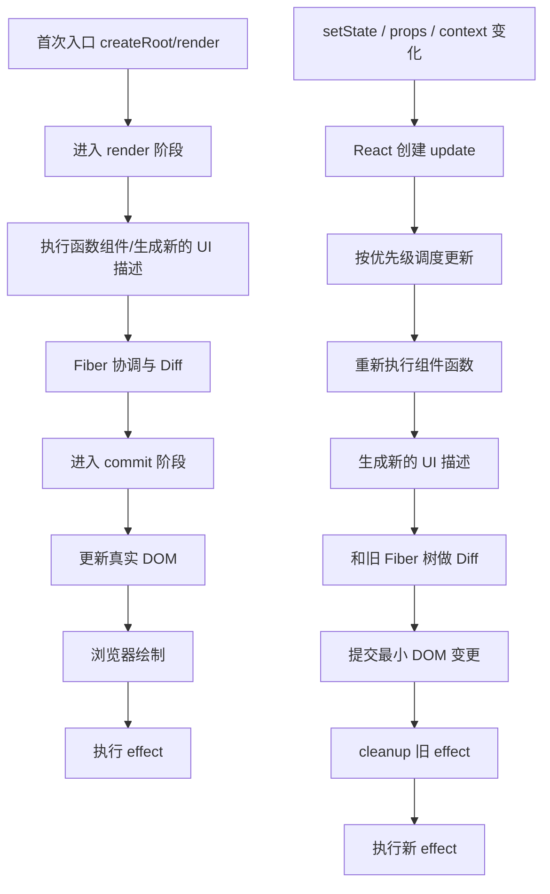
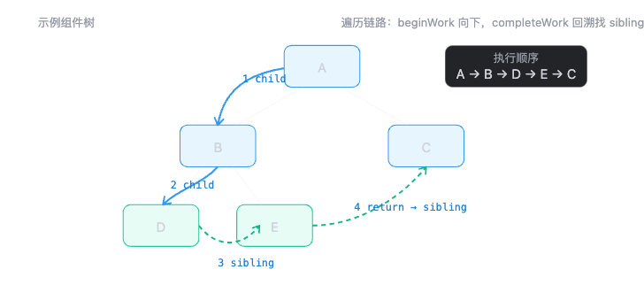
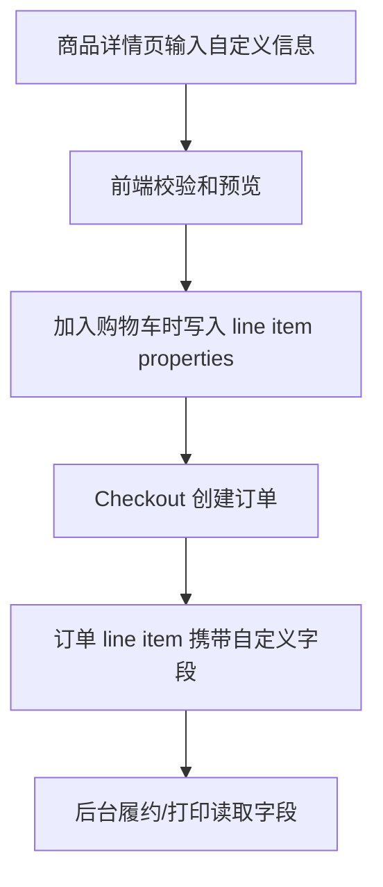

## 目录结构

- CSS
  - BFC 块级格式化上下文怎么理解
  - position relative 是相对于什么定位
  - 左右布局等高 flex 实现
- JS
  - 原型链
  - 事件循环
  - Node 的事件机制
- 浏览器
  - 浏览器输入 URL 到页面渲染完成发生了什么
  - DOM/CSS 解析过程中遇到 JS 阻塞该怎么优化
  - 为什么 JS 解析会阻塞 DOM 树解析
  - localStorage、sessionStorage、cookie 有什么区别
- HTTP
  - 介绍下强缓存和协商缓存
- React
  - React 中两个组件需要通信，怎么实现
  - 虚拟 DOM 的作用
  - 虚拟 DOM 为什么会提高性能
  - useEffect 第一个参数有什么要求
  - React 更新机制
  - Diff 算法流程
  - Fiber 架构
- 工程化
  - 工程化做过哪些
  - Webpack 构建过程大概讲下
  - 案例 1：Next.js 跨境商城首屏包体积治理
  - 案例 2：AI Agent 电商系统的 Vite 构建和验证链路
  - 案例 3：Node 应用的 Docker 构建部署
  - 更体现能力的构建提效点
- 性能优化
  - 整体思路
  - 如果 LCP 是 2.5s，还可以怎么优化
  - Initial JS 从 3MB 到 600KB 怎么做
  - LCP 从 4s 到 2s 怎么做
  - TTFB 高怎么处理
  - 第三方脚本治理
  - 缓存和构建怎么配合
  - Network dependency tree 怎么看
  - 面试收口
  - 性能优化里面，一般关注哪些指标，这些指标受哪些因素影响
  - 对于瀑布流的布局，CLS 如何优化
  - 包体积优化，有哪些方面
  - 这些性能指标该怎么收集
- SEO
  - SEO 优化怎么做
  - Meta 数据是谁写的
- 跨端
  - React Native 和 React 有什么区别、优缺点是什么
  - Hooks 机制
  - Hooks 为什么不能放在循环和条件判断里
- 手写题
  - const 怎么实现
  - 手写发布订阅 EventEmitter
  - 手写 Promise
- 电商业务系统设计
  - 支付与交易链路
  - 自建站支付方式怎么对接
  - 平台迁移与商品同步
  - 从平台站迁到自建站会有哪些问题
  - 平台上的 SKU 怎么同步到自建站
  - 风控与拦截
  - 黑名单用户通过调 API 绕过下单怎么拦截
  - 商品定制与履约
  - 自定义印名印号的交互方式和订单落库原理
  - 用户自定义图片要怎么处理
  - 自定义印名印号为什么不做成 SKU 变体
- 架构与工程设计
  - 新建一个项目时怎么考虑框架选型、构建工具、依赖管理和性能优化
  - 微应用平台如何设计
  - 喜动项目的后端为什么选 Go 而不选 Node
  - BFF
  - 自研 SSR 中我负责什么
  - Node 做 SSR 时遇到哪些问题
  - 自研 SSR 遇到懒加载组件怎么处理
  - Next.js 的 Page Router 和 App Router 有什么区别
- 高并发与缓存
  - Next.js 中遇到高并发场景该怎么处理
  - 减少动态渲染
  - 使用 CDN 和分层缓存
  - 接口和服务保持无状态
  - 控制接口并发和下游压力
  - 保护数据库和共享服务
  - 前端体验和流式返回
  - 监控和压测
- AI规范和方法论
  - AI 使用心得
  - 对于 SDD，比如 OpenSpec 带来的额外文档，该怎么看待
  - Skill 的设计原则
  - 在睿联沉淀 Skill 的案例
  - Rule、Skill、AGENTS.md 的应用场景
- 数据库
  - 事务
- 项目-喜动商城
  - 后台只读 Agent 的完整链路是什么
  - 你是怎么做意图识别的
  - 项目里 Redis 数据库负责支撑什么需求
  - 除了会话管理登录态，还有哪些方案
- 中后台系统场景业务题
  - 权限与数据隔离
  - 表格与批量操作
  - 表单与审批流
  - 状态一致性与并发
  - 搜索、导入与导出
  - 配置化、安全与审计
  - 性能与实时通信
  - 场景题回答框架
  - 五类高频场景题推荐回答
  - 后端语言选型

## CSS
### BFC 块级格式化上下文怎么理解
答：
可以理解成页面里的一个独立布局区域。
这个区域内部的元素按自己的规则参与布局，内部布局不会影响外部，外部浮动、margin 等也不容易干扰它。
常见触发 BFC 的方式：
overflow: hidden;
display: flow-root;
display: inline-block;
position: absolute;
position: fixed;
float: left;
最常见的实际用途有三个：
1. 清除浮动
父元素里面全是浮动元素时，高度可能塌陷：
```css
.parent {
  overflow: hidden;
}
```
让父元素形成 BFC 后，就能包住内部浮动元素。
2. 避免 margin 重叠
普通块级元素上下 margin 可能合并。创建 BFC 后，可以隔离 margin，避免父子或相邻元素 margin 合并。
3. 避免文字环绕浮动元素
左边有浮动元素，右侧内容可能围绕它排列。让右侧内容形成 BFC 后，就能独立占据剩余空间，不和浮动元素重叠。

### position relative 是相对于什么定位
答：
相对于元素自己的位置。

### 在一个需要左右布局场景下，左边元素填充高度要和右边元素一样，但是左右元素内容都是不固定的，用flex布局怎么实现

答：
用 flex 做左右等高布局时，核心是让外层容器 `display: flex`，并保持交叉轴默认的 `align-items: stretch`。这样左右两个 flex item 会自动被拉伸到同一行里最高那个元素的高度。

```css
.layout {
  display: flex;
  align-items: stretch;
}

.left {
  width: 240px;
  background: #f5f5f5;
}

.right {
  flex: 1;
}
```

```html
<div class="layout">
  <aside class="left">左侧内容</aside>
  <main class="right">右侧内容很多，高度不固定</main>
</div>
```

这里不需要手动写固定高度，因为 flex 容器在一行布局里会先根据左右内容算出这一行的高度，再把两个子项在交叉轴上拉伸到同样高度。左边内容少、右边内容多时，左边也会被撑到和右边一样高；反过来也一样。

要注意不要给容器写 `align-items: flex-start`，否则左右元素就不会自动等高。如果左边内部还有一层需要铺满高度，可以让左边自己也变成 flex：

```css
.left {
  width: 240px;
  display: flex;
  flex-direction: column;
}

.left-content {
  flex: 1;
}
```

面试里可以总结成一句：左右内容都不固定时，不要靠 JS 算高度，也不要写死高度；用 flex 容器默认的 `align-items: stretch` 实现同一行子项等高，内部再用 `flex: 1` 填充剩余高度。

## JS
### 原型链

答：
JavaScript 里每个对象内部都有一个 `[[Prototype]]`，通常可以通过 `__proto__` 间接访问。对象在读取某个属性时，会先在自己身上找；如果找不到，就沿着它的原型对象继续往上找，一直找到 `null` 为止，这条查找路径就是原型链。

比如数组可以直接调用 `map`、`filter`，不是因为数组实例自己有这些方法，而是因为会沿着原型链找到 `Array.prototype`。原型链的意义主要有两个：一是实现属性和方法复用，二是支撑 JS 的继承模型。

结合工程经验，实例对象放自己的数据，共享方法放到原型上，这样比给每个实例都拷一份方法更节省内存。

q11: 那像普通函数，怎么查找它的原型方法呢？

答：
普通函数本身也是对象，所以它也有原型链。要区分两个概念：

第一，函数作为“构造函数”时，有一个 `prototype` 属性，这个属性是给实例对象用的。比如 `Foo.prototype.say = ...`，以后 `new Foo()` 出来的实例就能沿着原型链找到 `say`。

第二，函数自己作为一个对象，也能调用 `call`、`apply`、`bind` 这些方法。这些方法不是函数自己定义的，而是沿着原型链找到 `Function.prototype` 上的。

函数对象先看自己身上有没有，没有就沿着 `__proto__` 往上找，先到 `Function.prototype`，再到 `Object.prototype`，最后到 `null`。

### 事件循环

答：
宏任务是“外部事件进入 JS 主线程的入口”

执行一个宏任务 / task 
  -> 调用栈清空（同步代码，函数调用都执行完）
  -> 执行 microtask checkpoint
  -> 清空所有微任务
  -> 如果微任务里又产生新的微任务，也继续执行
  -> 浏览器有机会渲染
  -> 执行下一个宏任务

常见宏任务有 script、setTimeout、I/O、UI 事件；常见微任务有 Promise.then、queueMicrotask、MutationObserver。

这个机制和性能优化也有关系。如果一个任务里塞了很多同步计算，或者不断产生微任务，就会长时间占用主线程，导致渲染和用户输入被延后，页面看起来就会卡。

```js
console.log('1')

setTimeout(() => {
  console.log('2')
}, 0)

Promise.resolve().then(() => {
  console.log('3')
})

console.log('4')
1432
```

### Node 的事件机制

答：

Node 的事件机制可以从两层理解：一层是 JS 层的事件发布订阅，另一层是底层基于 `libuv` 的事件循环。

第一层是 `EventEmitter`。Node 里很多对象都是事件驱动的，比如 HTTP Server、Stream、Socket，本质上都是监听事件并在事件发生时执行回调：

```js
const EventEmitter = require('events')

const emitter = new EventEmitter()

emitter.on('data', (value) => {
  console.log(value)
})

emitter.emit('data', 'hello')
```

这种模式适合处理异步通知，例如请求到达、连接关闭、文件读取完成、流数据到达。

第二层是 Node 事件循环。Node 通过 `libuv` 把文件 I/O、网络 I/O、定时器等异步能力交给底层处理，完成后再把回调放回事件循环中执行。

Node 事件循环主要阶段可以简化成：

```text
timers
-> pending callbacks
-> idle / prepare
-> poll
-> check
-> close callbacks
```

常见对应关系：

- `timers`：执行 `setTimeout`、`setInterval` 到期回调；
- `poll`：处理大部分 I/O 回调，例如文件、网络请求；
- `check`：执行 `setImmediate` 回调；
- `close callbacks`：执行 socket close 等关闭回调。

还要注意微任务顺序。Node 里每个阶段执行完一批回调后，会先清空微任务队列，其中 `process.nextTick` 优先级高于 Promise 微任务：

```text
当前同步代码
-> process.nextTick
-> Promise.then / queueMicrotask
-> 进入事件循环下一个阶段
```

示例：

```js
console.log('start')

setTimeout(() => console.log('timeout'), 0)
setImmediate(() => console.log('immediate'))

Promise.resolve().then(() => console.log('promise'))
process.nextTick(() => console.log('nextTick'))

console.log('end')
```

常见输出前半部分一定是：

```text
start
end
nextTick
promise
```

`setTimeout` 和 `setImmediate` 的先后在主模块里不完全稳定，受计时器是否到期和事件循环进入阶段影响；但如果放在 I/O 回调里，一般是 `setImmediate` 先于 `setTimeout`。

```js
const fs = require('fs')

fs.readFile(__filename, () => {
  setTimeout(() => console.log('timeout'), 0)
  setImmediate(() => console.log('immediate'))
})
```

这时通常输出：

```text
immediate
timeout
```

面试总结：

> Node 的事件机制一方面是 `EventEmitter` 这种发布订阅模型，用来组织请求、流、Socket 等异步事件；另一方面是基于 `libuv` 的事件循环，把 timer、I/O、check、close 等回调分阶段执行。微任务方面，`process.nextTick` 优先于 Promise 微任务。理解这套机制后，就能解释 `setTimeout`、`setImmediate`、Promise、I/O 回调的执行顺序，也能避免用大量同步计算或递归 nextTick 阻塞事件循环。

## 浏览器
### 浏览器输入 URL 到页面渲染完成发生了什么

答：
我会按“网络请求、资源解析、渲染流水线、运行时交互”四个阶段讲。

第一步是 URL 解析和网络连接。浏览器解析 URL，检查缓存，如果没有命中缓存，会做 DNS 解析，拿到 IP 后建立 TCP 连接；如果是 HTTPS，还会进行 TLS 握手。

第二步是发送 HTTP 请求。服务端返回 HTML，浏览器根据状态码、响应头、缓存策略、压缩方式等处理响应。

第三步是解析 HTML。浏览器边下载边解析 HTML，构建 DOM 树；遇到 CSS 会下载并解析成 CSSOM；DOM 和 CSSOM 合并生成 Render Tree。

第四步是执行 JS。遇到普通 script 时，浏览器会暂停 HTML 解析，下载并执行 JS，因为 JS 可能会修改 DOM 或样式。

第五步是布局和绘制。浏览器根据 Render Tree 计算每个元素的位置和尺寸，也就是 layout；然后进行 paint，把颜色、文字、图片、边框等绘制出来；最后通过合成线程把不同图层 compositing 到屏幕上。

如果是 React 页面，HTML 加载后还会下载 JS bundle，执行 React 初始化、创建虚拟 DOM、绑定事件、发起接口请求，最终把数据渲染到页面上。

### DOM/CSS 解析过程中遇到 JS 阻塞该怎么优化

答：
主要有几类手段。

第一是给脚本加 `defer` 或 `async`。`defer` 会让 JS 下载和 HTML 解析并行，等 DOM 解析完成后按顺序执行；适合依赖 DOM 和有执行顺序要求的业务脚本。`async` 是下载完成就执行，不保证顺序，适合统计、埋点这类独立脚本。

第二是把 script 放到 body 底部，至少让主要 HTML 先解析出来。

第三是拆包和按需加载。比如 React 项目里用路由懒加载、组件懒加载，把首屏不需要的 JS 延后下载和执行。

第四是减少主线程长任务。大计算可以拆分、放到 Web Worker，或者用 requestIdleCallback、setTimeout 分片，避免一次 JS 执行太久阻塞解析和渲染。

第五是优化 CSS。因为 CSS 会影响渲染树和布局，关键 CSS 可以内联，非关键 CSS 延后加载，减少 CSS 阻塞渲染的时间。

首屏一打开就必须正确展示的样式：
- 顶部导航：高度、背景色、布局、Logo 尺寸
- 首屏 Banner / Hero：容器高度、图片比例、标题字号、CTA 按钮样式
- 首屏商品卡片：价格、按钮、主图比例、基础栅格布局
- 骨架屏：占位块尺寸、背景色、圆角
- 防 CLS 样式：图片容器宽高比、 aspect-ratio 、固定高度

首屏看不到、或者用户交互后才出现的样式：
- Footer 样式
- 评论区样式
- 推荐商品区样式
- 弹窗 / 营销浮层样式
- 客服组件样式
- 非首屏活动楼层样式
- 复杂动画、轮播切换特效样式
- 后台编辑器、富文本、图表等重组件样式

在 Next.js 里，常见做法不是手写全部 inline，而是：
- 首屏组件样式跟随页面主包加载
- 非首屏组件用 next/dynamic 拆出去
- 组件自己的 CSS 跟着异步 chunk 加载


### 为什么 JS 解析会阻塞 DOM 树解析

答：
因为 JavaScript 有修改 DOM 和 CSSOM 的能力，浏览器为了保证执行结果符合代码顺序，遇到普通同步 script 时必须暂停 DOM 解析，先下载并执行 JS。

举个例子，如果 HTML 解析到一半时遇到：

```html
<script>
  document.write('<div>new content</div>')
  document.querySelector('.title').remove()
</script>
```

这段 JS 可能插入新节点、删除已有节点、读取样式、修改 class。如果浏览器一边继续解析后面的 HTML，一边执行这段 JS，就可能导致 DOM 顺序和脚本预期不一致。

另外，如果 JS 里读取样式，比如 `getComputedStyle` 或 `offsetHeight`，它还可能依赖已经解析好的 CSSOM。所以浏览器通常还要等待前面的 CSS 加载和解析完成，避免 JS 读到错误的样式结果。

所以总结就是：JS 阻塞 DOM，是因为它能改 DOM；CSS 可能阻塞 JS，是因为 JS 可能读样式；这三者之间有顺序依赖。


### localStorage、sessionStorage、cookie 有什么区别
答：

| 对比项 | localStorage | sessionStorage | cookie |
| --- | --- | --- | --- |
| 生命周期 | 手动清除前一直存在 | 当前标签页会话结束后清除 | 可设置过期时间 |
| 容量 | 通常 5MB 左右 | 通常 5MB 左右 | 通常 4KB 左右 |
| 是否随请求发送 | 不会 | 不会 | 会自动随同域请求发送 |
| 作用域 | 同源共享 | 同源 + 同标签页 | 可通过 Domain/Path 控制 |
| JS 是否可读 | 可读写 | 可读写 | 默认可读写，`HttpOnly` 后 JS 不可读 |
| 常见用途 | 主题配置、长期缓存、非敏感偏好 | 表单草稿、单页临时状态 | 登录态、服务端鉴权、灰度标识 |

## http
### 介绍下强缓存和协商缓存

答：

浏览器缓存可以分为强缓存和协商缓存。核心区别是：

- 强缓存命中时，不向服务器发送请求，直接使用本地缓存；
- 协商缓存会向服务器询问资源是否变化，未变化时返回 `304 Not Modified`。

#### 强缓存

服务端通过下面两个响应头控制：

```http
Cache-Control: max-age=31536000
Expires: Thu, 30 Jul 2027 00:00:00 GMT
```

`Cache-Control` 是 HTTP/1.1 的主要方案，`max-age` 表示资源从响应时间开始可以缓存多少秒。`Expires` 是 HTTP/1.0 的绝对过期时间，依赖客户端时间，通常作为兼容方案；两者同时存在时优先使用 `Cache-Control`。

在缓存有效期内再次请求：

```text
浏览器检查缓存
-> 缓存未过期
-> 直接读取 memory cache 或 disk cache
-> 不向服务器发送请求
```

常见指令：

- `public`：浏览器和 CDN 等共享缓存都可以缓存；
- `private`：只允许用户浏览器缓存；
- `max-age=3600`：缓存有效期为 3600 秒；
- `no-cache`：可以存储，但每次使用前必须向服务器验证；
- `no-store`：禁止存储响应，适合敏感数据；
- `immutable`：有效期内资源不会变化，不需要重新验证。

需要注意，`no-cache` 不是“不缓存”，真正表示不允许缓存的是 `no-store`。

#### 协商缓存

协商缓存触发条件：
- 强缓存过期
- 响应要求每次验证（no-cache）
浏览器携带缓存标识向服务器发起请求。协商缓存有两组方案。

第一组是 `Last-Modified / If-Modified-Since`：

```http
Last-Modified: Wed, 29 Jul 2026 10:00:00 GMT
```

下次请求：

```http
If-Modified-Since: Wed, 29 Jul 2026 10:00:00 GMT
```

服务器比较文件修改时间：

- 没有变化：返回 `304`，不返回响应体；
- 已经变化：返回 `200`、新资源和新的 `Last-Modified`。

第二组是 `ETag / If-None-Match`：

```http
ETag: "asset-a1b2c3"
```

下次请求：

```http
If-None-Match: "asset-a1b2c3"
```

服务器比较资源标识，未变化返回 `304`，变化则返回 `200` 和新内容。`ETag` 可以感知内容变化，精度通常高于只精确到秒的 `Last-Modified`，但生成和比较 ETag 会增加少量计算成本。两组同时存在时，一般优先验证 ETag。

#### 完整访问流程

```text
浏览器首次请求资源，服务器返回缓存字段
-> Cache-Control: public, max-age=3600
-> ETag: "app-v1"
-> Last-Modified: Wed, 29 Jul 2026 10:00:00 GMT
-> 浏览器再次请求，检查强缓存（Cache-Control: max-age=3600）
   -> 未过期：直接使用本地缓存
   -> 已过期：发起协商请求
       -> If-None-Match: "app-v1"
       -> If-Modified-Since: Wed, 29 Jul 2026 10:00:00 GMT
       -> 资源未变化：返回 304，继续使用旧缓存
       -> 资源已变化：返回 200 和新资源
          -> ETag: "app-v2"
          -> Last-Modified: Thu, 30 Jul 2026 09:00:00 GMT
          -> Cache-Control: public, max-age=3600
```

#### 项目中的常见配置

对于 Vite、Webpack 构建出的带内容 Hash 的静态资源：

```http
Cache-Control: public, max-age=31536000, immutable
```

例如：

```text
app.a1b2c3.js
style.d4e5f6.css
```

文件内容变化后文件名也会变化，因此可以使用一年强缓存。

对于入口 `index.html`，一般不能设置长期强缓存，否则用户可能一直拿到引用旧 JS 的 HTML，可以配置：

```http
Cache-Control: no-cache
```

浏览器每次先协商验证 HTML，拿到最新 HTML 后，再根据带 Hash 的文件名加载对应静态资源。

对于用户信息、订单、购物车等实时或敏感接口，应根据业务设置短缓存、`private` 或 `no-store`，不能直接套用静态资源策略。

面试总结：

> 强缓存通过 `Cache-Control` 和 `Expires` 控制，命中后不发送网络请求；协商缓存通过 `ETag / If-None-Match` 或 `Last-Modified / If-Modified-Since` 向服务器验证，未变化返回 304。项目里通常让带 Hash 的 JS、CSS 使用长期强缓存并加 `immutable`，让 HTML 使用 `no-cache` 保证及时更新，业务接口再根据实时性和敏感性单独配置。

## React

### React 中两个组件需要通信，怎么实现？

答：

需要先看两个组件的关系和状态应该归谁管理，再选择通信方式。

| 组件关系 | 推荐方式 | 适用场景 |
|---|---|---|
| 父组件传子组件 | Props | 父组件向子组件传递数据、配置和回调 |
| 子组件通知父组件 | 回调函数 | 子组件触发提交、选择、删除等事件 |
| 兄弟组件 | 状态提升到最近公共父组件 | 两个组件共享同一份页面状态 |
| 多层嵌套组件 | Context | 主题、语言、用户信息、权限等跨层数据 |
| 跨页面或大量组件 | Redux、Zustand 等状态库 | 购物车、登录态、全局业务状态 |
| 父组件调用子组件方法 | `ref + useImperativeHandle` | 聚焦输入框、打开弹窗等命令式操作，谨慎使用 |
| 无直接组件关系 | Event Bus | 少量解耦事件，需管理订阅和清理，不作为默认方案 |

以兄弟组件通信为例，最常见的方案是状态提升：

```tsx
function Parent() {
  const [keyword, setKeyword] = useState("")

  return (
    <>
      <SearchInput value={keyword} onChange={setKeyword} />
      <SearchResult keyword={keyword} />
    </>
  )
}

function SearchInput({
  value,
  onChange,
}: {
  value: string
  onChange: (value: string) => void
}) {
  return (
    <input
      value={value}
      onChange={(event) => onChange(event.target.value)}
    />
  )
}

function SearchResult({ keyword }: { keyword: string }) {
  return <div>当前搜索：{keyword}</div>
}
```

这里 `SearchInput` 和 `SearchResult` 不直接互相调用，而是由最近公共父组件持有 `keyword`，保持单向数据流。

选择时遵循“状态就近管理”原则：

- 只有一个组件使用的状态留在组件内部；
- 父子或兄弟共享的状态提升到最近公共父组件；
- 多层稳定共享的数据使用 Context；
- 跨页面、更新频繁且业务复杂的状态再使用状态库；
- 服务端数据优先交给 TanStack Query 等请求缓存工具，不必全部放进 Redux。

面试总结：

> React 组件通信要根据组件关系选择。父传子用 Props，子传父用回调，兄弟组件把状态提升到公共父组件，跨层级使用 Context，跨页面复杂业务状态再考虑 Redux 或 Zustand。核心原则是保持单向数据流和状态就近管理，不要为了两个组件通信直接引入全局状态。

### 虚拟 DOM 的作用

答：

虚拟 DOM 是用 JavaScript 对象描述 UI 结构。它不是真实 DOM，也不是浏览器提供的能力，而是 React 在内存中维护的一种元素和 Fiber 树表示。

例如：

```tsx
<button className="primary">提交</button>
```

可以抽象理解为：

```ts
{
  type: "button",
  props: {
    className: "primary",
    children: "提交"
  }
}
```

状态更新后的基本流程是：

```text
state / props 发生变化
-> 组件重新执行，生成新的虚拟 DOM
-> React 对比新旧结构并进行 Reconciliation
-> 找出需要插入、更新或删除的节点
-> 在 Commit 阶段统一更新真实 DOM
```

虚拟 DOM 主要有四个作用。

第一，支持声明式编程。开发者只需要描述“当前状态对应什么 UI”，不需要手动查找 DOM 并逐个修改。React 负责把状态变化转换成界面更新。

第二，提供统一的更新模型。React 可以先在内存中计算新旧树的差异，再集中提交真实 DOM 修改，减少开发者手动操作 DOM 时容易出现的状态与视图不一致。

第三，为 Fiber 调度提供基础。React 可以把渲染工作拆成 Fiber 单元，对不同更新设置优先级，并在并发渲染中暂停、恢复或放弃低优先级工作。真正修改 DOM 的 Commit 阶段仍然同步执行。

第四，实现跨平台渲染。React 的组件和更新模型不直接绑定浏览器 DOM，同一套 Reconciliation 机制可以通过不同 Renderer 输出到：

- React DOM：浏览器 DOM；
- React Native：原生视图；
- 服务端渲染：HTML 字符串或流；
- 其他自定义渲染目标。

需要注意，虚拟 DOM 不代表一定比手写 DOM 操作快。它本身也有创建对象和 Diff 的成本。对于一次非常简单且明确的 DOM 修改，直接操作真实 DOM 可能更快。它的主要价值是提供可维护、可预测、可跨平台的声明式更新模型，并在复杂 UI 中获得相对稳定的整体性能。

列表 Diff 时 `key` 很重要。稳定的业务 `key` 能帮助 React 判断节点是复用、移动、新增还是删除；使用不稳定的数组下标可能造成错误复用、状态错位和额外渲染。

面试总结：

> 虚拟 DOM 是 React 对 UI 的内存描述。状态变化后，React 生成新结构，通过 Reconciliation 找出变化，再在 Commit 阶段更新真实 DOM。它的核心价值是声明式开发、统一更新、支持 Fiber 调度和跨平台渲染，并不意味着任何场景都比直接操作 DOM 更快。

### 虚拟DOM为什么会提高性能

答：

虚拟 DOM 提高性能的准确说法是：在复杂 UI 和频繁状态更新场景下，React 可以先在内存中计算新旧 UI 的差异，再把必要的变化批量提交到真实 DOM，减少不必要的 DOM 操作和布局、绘制。

例如一个列表只有第 3 行文本发生变化时，React 会通过组件树和 `key` 找到对应节点，尽量只更新第 3 行，而不是手动重建整个列表：

```text
状态变化
-> 生成新的虚拟 DOM / Fiber
-> Diff 找出变化节点
-> 批量提交最小 DOM 更新
-> 浏览器进行布局和绘制
```

它带来的性能收益主要来自：

1. 减少直接操作 DOM 的次数，避免开发者在多个地方重复修改同一片 UI。
2. 通过 Diff 和稳定 `key` 复用没有变化的节点。
3. 将多个状态更新合并后再提交，减少频繁布局和绘制。
4. 配合 Fiber 调度，让低优先级渲染可以被高优先级输入打断，保持交互响应。

但虚拟 DOM 不是“天然更快”。它也需要创建对象、执行组件和 Diff；如果只是修改一个明确的 DOM 属性，直接操作 DOM 可能更快。实际性能还取决于组件拆分、状态范围、`key` 是否稳定、是否存在不必要的重复渲染，以及列表是否使用虚拟列表。

面试总结：

> 虚拟 DOM 的性能价值不是让所有场景都更快，而是在复杂 UI 更新时，通过内存 Diff、节点复用、批量提交和 Fiber 调度，减少不必要的真实 DOM 操作。对于海量列表，还需要结合服务端分页或虚拟列表；对于简单单点修改，直接 DOM 操作未必更慢。

### useEffect 第一个参数有什么要求

答：
`useEffect` 的第一个参数必须是一个函数，也就是 effect callback。React 会在组件渲染提交到页面之后执行这个函数。

这个函数有几个要求：

第一，不能直接写成 `async` 函数。因为 async 函数返回的是 Promise，而 `useEffect` 期望返回的是 `undefined` 或一个清理函数。如果要发异步请求，应该在内部定义 async 函数再调用。

```tsx
useEffect(() => {
  async function loadData() {
    const data = await fetchData()
    setData(data)
  }

  loadData()
}, [])
```

第二，可以返回一个 cleanup 函数，用来清理定时器、事件监听、订阅、AbortController 等副作用。

```tsx
useEffect(() => {
  const controller = new AbortController()

  fetch(url, { signal: controller.signal })

  return () => controller.abort()
}, [url])
```

第三，effect 里用到的外部变量，原则上要放到依赖数组里，避免闭包拿到旧值。比如用到了 `url`、`userId`，依赖数组就应该包含它们。

一句话总结：第一个参数必须是同步函数，可以返回清理函数，不能直接返回 Promise；副作用里用到的响应式变量，要通过依赖数组保证执行时机正确。

从 React 原理上看，`useEffect` 不是在 render 阶段执行的，而是在组件完成渲染并提交到 DOM 之后，由 React 在 commit 阶段统一调度的 Passive Effect。React 调用 effect 回调时，需要立刻拿到一个确定的返回值，用来判断后续是否要注册 cleanup。如果回调直接写成 `async`，返回值一定是 `Promise`，React 无法把这个 Promise 当作清理函数执行，也无法等待它再决定 cleanup，所以规范要求 effect 回调本身必须是同步函数。

cleanup 的本质是 React 在下一次 effect 重新执行前，或者组件卸载时，用来清理上一次副作用的同步函数。比如上一次 effect 里注册了事件监听、定时器、订阅、网络请求控制器，React 需要在依赖变化时先执行旧 cleanup，再执行新的 effect，避免重复订阅、内存泄漏和竞态更新。如果返回的是 Promise，React 不知道什么时候清理完成，也不能保证 commit 阶段副作用队列的执行顺序。

依赖数组对应的是 React 判断“这次提交后，这个 effect 是否需要重新执行”的依据。函数组件每次 render 都会形成一份新的闭包快照，effect 里访问的 `props`、`state`、函数和变量，本质上都来自某一次 render。如果依赖数组漏掉了这些响应式变量，React 可能会复用旧 effect，导致 effect 里的闭包仍然拿着旧值，这就是常说的 stale closure。依赖写完整，就是告诉 React：这些值变化后，旧副作用需要清理，新副作用需要基于最新闭包重新建立。

面试可以这样说：`useEffect` 的设计是把副作用从 render 阶段拆到 commit 之后执行，所以 render 必须保持纯净，effect 回调也要同步返回 cleanup 约定；异步逻辑可以放在 effect 内部执行，但不能让 effect 本身返回 Promise。依赖数组则是 React 基于闭包和 Object.is 比较来判断副作用是否需要重新同步的机制，写错依赖就容易出现旧值、重复订阅或请求竞态。

如果要把 React 的渲染和重渲染也画成链路图，可以记成：




### React 更新机制
### Diff 算法流程

答：
React 的 diff 可以理解成一次从旧 Fiber 树到新 Fiber 树的对比过程，目标是找出最小的更新集合，最后在 commit 阶段把变化同步到真实 UI。

整体流程我会分三层讲：

第一层是节点类型对比。如果新旧节点类型不同，比如从 `div` 变成 `span`，或者从一个组件变成另一个组件，React 通常会认为这棵子树不能复用，直接卸载旧节点，创建新节点。

第二层是同类型节点复用。如果节点类型相同，React 会复用已有 Fiber 和对应 DOM，只更新变化的 props，比如 className、style、事件回调、文本内容等。

第三层是子节点列表 diff。React 会重点看 `key`。如果有稳定 key，就用 key 判断哪些节点可以复用、哪些需要新增、删除或移动；如果没有 key，就只能按位置比较，列表插入、删除、重排时容易造成不必要的更新。

在 Fiber 架构下，diff 发生在 render/reconcile 阶段，这个阶段可以被中断。React 会通过 `child / sibling / return` 指针遍历 Fiber 树，对每个节点执行 `beginWork` 和 `completeWork`，并给需要更新的 Fiber 标记副作用。最后 commit 阶段是同步不可中断的，把插入、更新、删除这些变化真正提交到 DOM 或原生视图。

Render 阶段中断主要在
- 时间片耗尽
- 出现更高优先级更新（比如用户输入、动画）
- 组件 Suspense 挂起
React 会让出主线程，优先保证输入和动画等交互；之后可能继续原工作，也可能放弃旧结果并按最新状态重新渲染。Commit 阶段涉及真实 DOM 修改，为保证界面一致性不能中断。

面试里我会总结成一句：React diff 的核心假设是不同类型节点不复用，同类型节点尽量复用，列表用 key 提高复用准确性；Fiber 让这个比较过程可以拆分和调度，最终把变化集中到 commit 阶段提交。

### Fiber 架构

答：
React 引入 Fiber，核心是为了解决老架构同步递归渲染不可中断的问题。

早期 React 更新组件树时，一旦开始 diff 和渲染，就会一直执行到整棵树处理完，中间不能暂停。如果组件树很大，就会长时间占用主线程，用户点击、输入、动画这些高优先级交互会被阻塞。

Fiber 可以理解成 React 内部一种新的节点结构和调度模型。它把原来一次性递归处理的大任务拆成一个个可调度的工作单元。这样 React 就能在渲染过程中暂停、恢复、丢弃或者重做任务，并且给不同更新分优先级。

所以 Fiber 带来的价值主要是三点：可中断渲染、优先级调度、为并发能力比如 `startTransition`、`Suspense` 打基础。

q31: 那fiber架构里面reconciler是怎么遍历那棵树的？

答：
Reconciler 遍历 Fiber 树时整体是深度优先。先通过 child 指针向下执行 beginWork ；如果当前节点没有 child，就执行 completeWork 回溯；回溯时优先找 sibling ，有兄弟节点就处理兄弟，没有兄弟节点就通过 return 回到父节点。su



```bash
A beginWork
  -> 有 child，进入 B

B beginWork
  -> 有 child，进入 D

D beginWork
  -> 没有 child，开始 completeWork
  -> D 有 sibling，进入 E

E beginWork
  -> 没有 child，completeWork
  -> E 没有 sibling，return 回 B
  -> B completeWork
  -> B 有 sibling，进入 C

C beginWork
  -> 没有 child，completeWork
  -> C 没有 sibling，return 回 A
  -> A completeWork
```

## 工程化
### 工程化做过哪些

答：
我做过的工程化主要有三类：规范治理、构建提效、流程沉淀。

第一类是规范治理。我搭过 `ESLint + Prettier + Commitlint + Husky` 这一套，把代码风格、提交规范和提交前检查前置，减少低价值 review 和低级问题进仓库。

具体做法是把“靠人提醒”的规则前置到工具链里。比如 ESLint 负责约束未使用变量、Hook 依赖、React 组件写法；Prettier 负责格式统一；Commitlint 约束提交信息必须符合 `feat/fix/chore` 这类规范；Husky 在 `pre-commit` 阶段跑 lint-staged，只检查本次改动文件，避免全量检查太慢。

一个典型链路是：

```text
开发提交代码
  -> Husky 触发 pre-commit
  -> lint-staged 只拿 staged 文件
  -> ESLint 修复/拦截明显问题
  -> Prettier 统一格式
  -> Commitlint 校验 commit message
  -> 通过后才允许进入仓库
```

这样做的收益是 review 时不用再反复纠结缩进、分号、命名这类低价值问题，团队可以把精力放到业务逻辑、性能和可维护性上。

第二类是构建和依赖治理。我做过项目从 npm 切到 pnpm，规范依赖安装和构建流程，把安装时间从 10 秒降到 5 秒以内；在商城项目里也做过依赖治理、包体积分析和构建优化，支撑性能提升。更具体地说，我会把构建提效拆成三层：开发启动提效、生产构建提效、交付验证提效。

具体案例是：原来项目用 npm，每次安装依赖都会在当前项目下重复拷贝大量包，CI 或新同事初始化时等待时间比较长。我切到 pnpm 后，会同步做三件事：第一，锁定 `packageManager`，保证团队都用同一个 pnpm 版本；第二，提交 `pnpm-lock.yaml`，保证 CI 和本地依赖版本一致；第三，把安装命令、构建命令、Node 版本写进 README 或脚本里，避免每个人本地环境不一致。

### webpack构建过程大概讲下

答：

Webpack 的核心过程可以概括为“读取配置、构建模块依赖图、转换模块、优化和输出产物”：

```text
读取 webpack.config.js
-> 确定 entry、output、mode、module、plugins
-> 从 entry 开始递归解析 import / require
-> 根据 loader 转换不同类型文件
-> 构建完整 Module Graph
-> Tree Shaking、代码分割、Scope Hoisting、压缩优化
-> 生成 hash、chunk 和 asset
-> 输出到 dist 目录
```

具体来说：

1. `entry` 指定构建入口，例如 `src/main.tsx`。Webpack 从入口出发解析依赖。
2. 解析过程中遇到 TypeScript、JSX、CSS、图片等非标准模块时，由 `module.rules` 配置的 Loader 转换成 Webpack 能处理的模块。
3. Webpack 根据静态 `import`、动态 `import()` 和资源引用建立模块依赖图。多个入口或动态导入会形成不同的 chunk。
4. Plugin 通过 Webpack 生命周期钩子扩展构建过程，例如生成 HTML、复制静态资源、提取 CSS、清理目录、注入环境变量和分析包体积。
5. 在 production 模式下，Webpack 会进行 Tree Shaking、压缩、代码分割和 Scope Hoisting，并根据内容生成 hash。
6. 最后由 `output` 配置决定文件名和输出目录，生成 JS、CSS、图片等最终资源。

Loader 和 Plugin 的区别是：

| 对比项 | Loader | Plugin |
|---|---|---|
| 作用 | 转换单个模块内容 | 扩展整个构建生命周期 |
| 处理对象 | JS、TS、CSS、图片等文件 | HTML、资源、构建流程和产物 |
| 常见例子 | `babel-loader`、`ts-loader`、`css-loader` | `HtmlWebpackPlugin`、`MiniCssExtractPlugin`、`DefinePlugin` |

开发环境通常开启 source map、热更新和较快构建；生产环境关注 Tree Shaking、压缩、代码分割、缓存和产物体积。缓存一般使用内容 hash：

```js
output: {
  filename: "[name].[contenthash].js",
  chunkFilename: "[name].[contenthash].chunk.js",
  clean: true,
}
```

这样只有文件内容变化时 hash 才变化，可以配合 CDN 和浏览器长期缓存。入口 HTML 通常不做长期强缓存，否则可能引用旧的 JS 文件。

面试总结：

> Webpack 从 entry 出发递归解析依赖，通过 Loader 转换模块，通过 Plugin 参与构建生命周期，形成模块依赖图后再进行 Tree Shaking、代码分割、压缩和 hash 输出。Loader 解决“文件怎么转”，Plugin 解决“构建流程怎么扩展”。生产构建还要结合内容 hash、CDN 和缓存策略控制加载成本。

### 案例 1：Next.js 跨境商城首屏包体积治理

在跨境商城项目里，我会先用 `@next/bundle-analyzer` 看哪些依赖进入了首页 initial bundle。常见问题是营销弹窗、评论组件、推荐商品、客服入口、富文本编辑器、图表库这类非首屏模块被直接 import 到首页，导致首屏 JS 下载、解析和执行都变重。

我的处理链路是：

```text
bundle analyzer 定位首屏大模块
  -> 判断是否首屏必须
  -> 非首屏组件 next/dynamic 拆包
  -> 重库按需引入或替换轻量实现
  -> 验证 initial JS、LCP、Long Task 是否下降
```

比如评论区、客服、营销弹窗不影响用户第一眼看到商品信息，我会改成动态加载或按页面加载：

```tsx
const ReviewSection = dynamic(() => import("./ReviewSection"), {
  ssr: false,
  loading: () => <ReviewSkeleton />,
});
```

如果发现引入整个工具库，比如一次性引入完整 `lodash`、图标库或图表库，我会改成按需引入，或者替换成更轻的实现。最终目标不是为了“少几个 KB”而优化，而是减少首屏 JS 下载、解析和执行成本，支撑 LCP、TTI、INP 这些体验指标。

### 案例 2：AI Agent 电商系统的 Vite 构建和验证链路

在个人的 AI Agent 电商系统里，我用的是 React + TypeScript + Vite + TailwindCSS + Vitest。这个项目的构建提效重点不是“复杂 Webpack 配置”，而是把开发、校验、测试、构建串成稳定命令，保证每次改动都能快速验证。

我会把常用命令沉淀成统一入口：

```json
{
  "scripts": {
    "dev": "vite",
    "lint": "eslint .",
    "typecheck": "tsc --noEmit",
    "test": "vitest run",
    "build": "vite build",
    "verify": "npm run lint && npm run typecheck && npm run test && npm run build"
  }
}
```

这样构建提效不只是启动快，还包括质量闭环更快：

```text
本地开发 vite dev 快速启动
  -> 提交前跑 lint/typecheck/test
  -> 合并前跑 verify
  -> 生产构建暴露真实打包问题
```

这个项目里我还结合 TailwindCSS 做样式治理，减少手写 CSS 的维护成本；用 Vitest 覆盖核心状态和交互逻辑；最后通过 `verify` 把 lint、类型检查、单测和生产构建放到同一条链路里，避免“本地能跑、构建失败”。

### 案例 3：Node 应用的 Docker 构建部署

在 Node 应用项目里，我引入 Docker 做镜像化部署，核心是解决不同机器 Node 版本、依赖安装、环境变量和部署步骤不一致的问题。构建时把依赖安装、应用构建、运行命令固化到镜像里，部署时只需要拉取指定版本镜像。

```text
代码提交
  -> 安装依赖
  -> 执行 lint / build
  -> 构建 Docker 镜像
  -> 打版本 tag
  -> 部署到服务器
```

同时我会配合 Shell 脚本处理镜像打包、版本命名和产物压缩，减少重复操作。这个收益是新环境部署更稳定，线上回滚也更清楚，不依赖某台机器上“刚好装了什么依赖”。

### 更体现能力的构建提效点

构建提效不只是“换 Vite”或“换 pnpm”，更重要的是把构建过程变成可度量、可约束、可复用、可诊断的工程体系。我会重点做这几类：

1. **构建产物分析和包体积预算**：不是只临时看一次 bundle analyzer，而是给首页 initial JS、路由 chunk、vendor chunk 建预算线。
2. **依赖准入和重依赖替换**：新增依赖要判断是否进入首屏、是否支持 Tree Shaking、是否有轻量替代。
3. **CI 构建缓存**：缓存 pnpm store、Next `.next/cache`、Vite/Turbo 缓存，避免流水线每次从零开始。
4. **Docker layer cache**：先复制 `package.json` 和 lockfile 安装依赖，再复制业务代码，让业务代码变更不影响依赖层缓存。
5. **增量构建和任务分层**：本地只做快速反馈，CI 做完整校验，发布前做 smoke test，避免所有检查都压在开发阶段。
6. **构建失败可诊断化**：锁定 Node/pnpm 版本，环境变量缺失提前失败，构建日志按 lint、typecheck、test、build 分段。

可操作步骤：

```text
第一步：建立基线
  -> 记录当前安装耗时、dev 启动耗时、build 耗时、initial JS 体积
  -> 用 bundle analyzer 输出首页和核心路由包体积

第二步：治理依赖
  -> 找出进入首屏包的重依赖
  -> 判断是否首屏必须
  -> 非首屏组件 next/dynamic
  -> lodash / 图标库 / 图表库改按需引入或轻量替换

第三步：建立预算
  -> 首页 initial JS 不超过约定阈值
  -> 单个异步 chunk 超过阈值需要说明原因
  -> 新增大型依赖需要在 MR 里说明用途和替代方案

第四步：优化 CI
  -> 缓存 pnpm store
  -> 缓存 Next.js .next/cache 或构建工具缓存
  -> lint、typecheck、test、build 分阶段执行
  -> 只在必要阶段跑 e2e / smoke test

第五步：优化 Docker 构建
  -> 先复制 package.json / lockfile
  -> 安装依赖形成独立 layer
  -> 再复制业务代码
  -> 构建镜像并打版本 tag
  -> 支持按 tag 回滚

第六步：持续验证
  -> 每次优化后对比 build 时间、包体积、LCP、Long Task
  -> 把结果沉淀到文档或检查清单
```

面试表达：

> 构建提效我不只关注工具替换，而是从依赖安装、开发反馈、生产构建、CI 缓存、产物治理和失败诊断几个环节做闭环。比如跨境商城里用 bundle analyzer 做首屏包预算和依赖治理；个人全栈项目里用 Vite + Vitest + TypeScript 建立 `verify` 链路；Node 应用里用 Docker layer cache 和版本化镜像保证部署一致性。最终目标不是单纯缩短几秒构建时间，而是让团队开发反馈更快、构建结果更稳定、线上产物更可控。

pnpm 快主要是因为它用了全局内容寻址存储。相同版本的依赖只会在全局 store 里保存一份，不会像 npm 那样在每个项目里重复拷贝完整依赖。项目里的 node_modules 更多是通过硬链接和符号链接指向全局 store，所以二次安装、多个项目复用依赖时会明显更快，也更省磁盘空间。

另外 pnpm 的依赖结构更严格，只有 package.json 里声明过的依赖才能直接访问，这能减少幽灵依赖问题。配合 lockfile 和 workspace，在团队项目或 monorepo 里可以让依赖安装、版本一致性和构建流程更稳定。

幽灵依赖最大的问题是依赖关系不显式，项目稳定性变差（本地能跑，换环境、升级依赖、CI 构建或线上部署就突然报错。）。比如我代码里直接 import dayjs ，但 package.json 没声明 dayjs，只是因为某个 UI 库间接依赖了它，本地 node_modules 扁平化后刚好能访问。后面 UI 库升级、CI 重装依赖或者切到 pnpm 后，dayjs 不再暴露到当前项目，构建就会报 Cannot find module。pnpm 的严格依赖隔离能提前暴露这类问题，逼着我们把直接使用的依赖写清楚。

第三类是流程沉淀。比如在应用项目里，我引入 Docker 做镜像化部署，隔离宿主机环境差异；再配合 Shell 脚本自动化处理镜像打包、版本命名和文件压缩，减少重复部署工作。后续在团队协作中，我还沉淀过一套活动页交付检查清单，以及一套 AI 辅助研发工作流，覆盖需求拆解、代码草拟、问题排查、测试补充和文档生成。

## 性能优化
### 整体思路

答：
我之前做性能优化不是先上来改代码，而是先把问题拆成“资源体积、资源发现、资源下载、主线程渲染、缓存复用、第三方脚本”几层。

定位工具上，我会先用 `Lighthouse` 看 LCP、TBT、CLS 和具体诊断项，用 `Chrome Performance` 看主线程是否被 JS 长任务阻塞，用 `Network waterfall` 看首屏资源加载顺序和 Initiator，再用 `@next/bundle-analyzer` 分析首页 bundle，确认哪些模块和依赖进入了首屏。

在跨境商城项目里，最后定位到的问题主要集中在四块：首屏 JS 太大、首屏 Banner 图片链路重、第三方脚本过多、缓存和网络依赖链不够干净。最终通过拆包、依赖治理、图片优化、字体优化、第三方脚本延后和缓存策略，把关键 JS 从 3MB 降到 600KB，首页 LCP 从 4s 优化到 2s 以内。

### 如果LCP是2.5s,还可以怎么优化

答：

LCP 2.5s 已经接近 Lighthouse 的“良好”边界，但还可以继续优化。我的思路不是直接改代码，而是先把 LCP 拆成四段，看瓶颈在哪一段：

```text
LCP = TTFB
    + Resource Load Delay
    + Resource Load Duration
    + Element Render Delay
```

#### 1. 如果 TTFB 高，先优化服务端和缓存

TTFB 高说明 HTML 返回慢，常见原因是 SSR 数据预取慢、接口串行、缓存命中低或服务端压力大。

可以做：

- 商品详情、活动页、内容页尽量 SSG / ISR / 页面级缓存；
- SSR 数据预取并行化，避免接口串行等待；
- CDN 缓存静态 HTML 或边缘缓存可复用页面；
- 下游接口加超时和降级，非核心数据不要阻塞首屏；
- 服务端开启 gzip / br 压缩，减少 HTML 传输成本。

#### 2. 如果 Resource Load Delay 高，优化 LCP 资源发现时机

这类问题很常见：LCP 图片本身不一定很大，但浏览器发现它太晚。比如首屏 Banner 被懒加载、轮播 JS 初始化后才设置 `src`，或者 CSS 背景图要等 CSS 下载解析后才发现。

可以做：

- 首屏 LCP 图片直接输出真实 `src`，不要用 `data-src` 等 JS 替换；
- 首屏图不要懒加载；
- 在 `<head>` 里对 LCP 图使用 `preload`；
- 使用 `fetchpriority="high"` 提高优先级；
- 避免把首屏关键图放在 CSS background 里。

示例：

```html
<link rel="preload" as="image" href="/hero.webp">

```

#### 3. 如果 Resource Load Duration 高，优化资源体积和传输

这说明资源发现不晚，但下载慢，重点看图片体积、格式和网络链路。

可以做：

- 首屏图转 WebP / AVIF；
- 根据设备尺寸输出不同图片，避免移动端下载桌面大图；
- 配置 `srcset` / `sizes`；
- 图片走 CDN，开启长期缓存；
- 压缩字体、CSS、JS，减少带宽竞争。

#### 4. 如果 Element Render Delay 高，优化主线程和渲染阻塞

这说明资源已经下载了，但页面迟迟没把 LCP 元素渲染出来，通常是 JS 执行、样式计算或 Hydration 阻塞。

可以做：

- 拆分首屏 JS，非首屏组件动态加载；
- 延后第三方脚本，例如客服、广告、埋点、评论；
- 提取关键 CSS，减少阻塞样式；
- 减少首屏 React 组件复杂度和同步计算；
- 长任务拆分，避免主线程被大段 JS 占满。

#### 5. 如果已经到 2.5s，再做收益排序

我会优先做投入产出比高的动作：

```text
先确认 LCP 元素是谁
-> 看 LCP breakdown 四段耗时
-> 优先解决最大耗时段
-> 首屏图片 preload / fetchpriority / 尺寸压缩
-> 非首屏 JS 和第三方脚本延后
-> SSR / CDN 缓存降低 TTFB
-> 用真实设备和线上 RUM 验证
```

这里要注意，不能只看本地 Lighthouse。2.5s 是否需要继续优化，要看线上真实用户数据，比如移动端 4G、低端机、海外区域和 P75 LCP。如果线上 P75 还在 2.5s 附近，就说明还有优化价值。

面试总结：

> LCP 到 2.5s 后，我会先用 Lighthouse 或 Performance 把 LCP 拆成 TTFB、资源发现延迟、资源下载耗时和元素渲染延迟。TTFB 高就做 SSR 缓存和接口并行；资源发现慢就 preload、真实 src、取消首屏懒加载；下载慢就压缩图片和上 CDN；渲染慢就拆 JS、延后第三方脚本和减少主线程长任务。最终用线上 RUM 的 P75 指标验证，而不是只看一次本地跑分。

### Initial JS 从 3MB 到 600KB 怎么做

优化的是首页首屏关键 JS，也就是 initial JS，不是整个项目总代码量。Next.js 本身有页面级拆包能力，我做的主要是在这个基础上继续做组件级拆分和依赖治理。

**组件级动态加载**：我先用 bundle analyzer 看首页 initial bundle 里有哪些模块实际不是首屏必须，比如营销弹窗、推荐商品、评论区、客服入口、部分活动组件。然后用 `next/dynamic` 把这些模块拆到异步 chunk 里，首屏只保留导航、Banner、核心商品信息和 CTA。这样不是把代码“消灭”，而是避免非首屏代码阻塞首屏加载和执行。

**依赖治理和 Tree Shaking**：除了拆 chunk，我也会看哪些依赖本身体积大或被重复打包。比如工具函数、日期处理、图标、富交互组件等，能按需引入就按需引入；只用少量能力的重库会替换成轻量实现；重复依赖会统一版本。导入方式上尽量使用 ESM，避免整包引入，保证 Tree Shaking 能生效。

这里要注意，dynamic import 本身更多是降低首屏 initial JS，不一定降低总 JS；真正减少总体积的是依赖替换、按需引入、重复依赖治理和 Tree Shaking。

### LCP 从 4s 到 2s 怎么做

我会先看 Lighthouse 的 LCP breakdown，把 LCP 拆成四段：

```text
TTFB
Resource Load Delay
Resource Load Duration
Element Render Delay
```

比如一次首页首屏 Banner 的分析里，TTFB 只有 210ms，Element Render Delay 只有 50ms，但 Resource Load Delay 达到 2s多，Resource Load Duration 也有 1.28s。这个结论说明瓶颈不在服务端响应，也不在最终渲染，而是在首屏图片资源链路：图片被浏览器发现得太晚，同时图片下载体积偏大。

**资源发现优化**：如果 LCP 图虽然有 `fetchpriority="high"`，但同时有 `data-src`、`lazyloaded` 这类懒加载痕迹，就说明它可能要等 JS 或轮播初始化后才真正被发现。`fetchpriority` 只能提高已经被发现的资源优先级，不能解决“发现太晚”的问题。所以首屏第一张 Banner 要直接输出真实 `src`，不要依赖 JS 把 `data-src` 替换成 `src`；必要时在 `<head>` 里用 preload 提前声明。

**Next.js 图片落地**：如果是 Next 项目，我会把普通 `img` 替换成 `next/image`，配置合适的 `width/height` 或 `fill`，保证容器尺寸稳定，减少 CLS；同时配置 `sizes`，让移动端、平板、桌面端加载不同尺寸的图，避免移动端下载桌面大图。首屏 LCP 图不做懒加载，使用 `priority` 或新版本里的 `preload` / `fetchPriority="high"`；非首屏图片继续懒加载。

```tsx
import Image from 'next/image'

export function HeroBanner() {
  return (
    <Image
      src="https://cdn.shopify.com/..."
      alt="Hero banner"
      width={1920}
      height={700}
      sizes="100vw"
      priority
      fetchPriority="high"
      quality={80}
    />
  )
}
```

如果图片来自 Shopify CDN，也可以结合 Shopify 的图片宽度参数或自定义 loader，让不同视口拿到不同尺寸，而不是所有设备都下载 3840 宽的大图。

**图片交付优化**：Lighthouse 如果提示 “image file is larger than it needs to be”，说明实际下载尺寸大于展示尺寸。我的处理是用 CDN 输出多尺寸图片，配合 `srcset/sizes` 或 `next/image` 的响应式能力；移动端单独出裁剪图；Banner、Logo、小图分别压缩；优先使用 WebP/AVIF。首屏图和非首屏图要分策略：第一张图 eager + high priority，其他轮播图 lazy + auto priority。

**字体落地方式**：字体优化上，我会用 `next/font` 做本地托管和 preload，减少外部字体请求带来的 DNS/TLS 开销。同时控制字体字重和字体数量，比如只保留页面实际用到的字重，避免一次加载多个无用 font-weight。这样能减少字体阻塞和字体切换导致的布局抖动。

**JS 阻塞治理**：如果 Performance 里看到 LCP 延迟不是图片下载，而是 Element Render Delay 高，说明资源已经到了，但浏览器没及时绘制。常见原因是主线程 Long Task、轮播初始化、动画、复杂布局计算、CSS/字体阻塞，或者 LCP 元素先被 `display:none` / `opacity:0` 隐藏，等 JS 加 class 后才展示。这个时候要延后轮播初始化、埋点和第三方 SDK，减少首屏同步 JS，让 LCP 元素默认可绘制。

### TTFB 高怎么处理

TTFB 是从浏览器发起请求到收到第一字节之间的时间。如果 TTFB 高，我会先在 Network Timing 中拆 DNS、TCP/TLS、请求排队和 Waiting for server response，判断是网络连接、CDN 未命中、重定向，还是服务端渲染或接口聚合慢。

在 Next.js 里，稳定内容我会优先用 SSG/ISR，让页面可以被 CDN 缓存；商品详情、活动页、SEO 落地页这类内容如果不是强实时，可以用 `revalidate` 做增量更新。接口数据也要避免串行等待，能并行就用 `Promise.all`，非首屏数据不要阻塞初始 HTML。

```tsx
export const revalidate = 300

const [banner, products] = await Promise.all([
  getBanner(),
  getProducts(),
])
```

同时要避免无意中使用 `cookies()`、`headers()` 或每次请求都 `no-store`，导致页面从静态渲染退化成动态渲染，把服务端耗时直接传导到首屏。

### 第三方脚本治理

跨境商城会有很多第三方脚本，比如 GA/GTM、广告像素、客服、评论插件、营销弹窗、转化追踪。我的处理不是简单全部删掉，而是先按“业务必要性 + 页面路径 + 加载时机”分层。

- 首屏必须的保留，比如核心统计或必要转化追踪，用 `afterInteractive`。
- 非首屏必须的延后，比如客服、评论、弹窗、推荐脚本，用 `lazyOnload`。
- 只在特定页面需要的，就按页面加载，不全站注入。

比如 GA4 和 Meta Pixel 属于核心转化追踪，首屏后要尽快可用，我会用 `next/script` 的 `afterInteractive`，保证 React 页面可交互之后再加载，避免阻塞 HTML 解析和首屏渲染：

```tsx
<Script
  id="ga4"
  src="https://www.googletagmanager.com/gtag/js?id=G-XXXX"
  strategy="afterInteractive"
/>
```

像客服、评论、营销弹窗、推荐商品这类组件，不影响用户第一眼看到商品和价格，我会放到 `lazyOnload`，等浏览器空闲后再加载：

```tsx
<Script
  id="customer-chat"
  src="https://chat.example.com/sdk.js"
  strategy="lazyOnload"
/>
```

如果 Lighthouse 提示第三方脚本有 Legacy JavaScript，比如 Klaviyo 脚本里包含 `Array.prototype.flat`、`Object.fromEntries`、`Promise.allSettled` 这类 polyfill，我不会直接改第三方产物。因为它来自供应商，改了可能影响功能和升级。我会先评估它是否必须首屏加载，再通过延迟加载、只在需要页面加载，或者确认供应商是否提供 modern bundle 来处理。这个收益通常低于 LCP 图片和首屏 JS，优先级要排在后面。

落地时我会配合 Chrome Performance 和 Network 看两类数据：一是首屏请求数有没有减少，二是 Main Thread 上第三方脚本造成的 Long Task 有没有下降。比如把客服和评论从首屏同步加载改成 `lazyOnload` 后，首页初始请求会更干净，主线程空闲时间更早出现，LCP 和 INP 都会更稳定。

### 缓存和构建怎么配合

Next 构建后的 JS/CSS 文件名带 hash，可以配合 CDN 做长缓存，比如：

```http
Cache-Control: public, max-age=31536000, immutable
```

可以把 **Next + CDN 长缓存** 理解成这条链路：

```text
代码构建
  -> Next 生成带 hash 的静态资源
  -> 上传/部署到服务器或 CDN 源站
  -> CDN 根据 Cache-Control 缓存资源
  -> 用户访问页面
  -> HTML 引用具体 hash 文件
  -> 浏览器/CDN 命中缓存
  -> 下次发版 hash 变化，自动请求新资源
```

关键点是：HTML 入口不做长时间强缓存，保证发版后能拿到最新资源引用；JS/CSS/hash 图片可以长缓存，因为内容变化后 URL 会变。比如第一次发版引用 `app-a8f3d2.js`，下一次发版变成 `app-b7c9e1.js`，浏览器会把它当成新资源重新请求，所以不会因为长缓存拿旧代码。

如果 Lighthouse 提示缓存 TTL 太短，要先区分资源是否可控。自有主题 JS、CSS、图片可以通过 hash + 长缓存处理；Shopify/CDN 资源优先用平台生成的版本化 URL；Klaviyo、GoAffPro、Cloudflare 这类第三方脚本的缓存头通常不能直接改，更现实的方式是评估必要性和加载时机，而不是为了分数强行自托管。

### Network dependency tree 怎么看

Lighthouse 的 Network dependency tree 主要看关键资源链有没有过长，比如初始 HTML 后才触发某个第三方脚本，第三方脚本再请求自己的 chunk，形成串行依赖。报告里如果出现 “Maximum critical path latency 7s+”，我会结合 Network waterfall 和 Initiator 看每个资源是谁触发的，减少阻塞 CSS、同步 JS 和不必要的第三方脚本。

如果报告提示 `preconnect` 超过 4 个，也不是越多越好。`preconnect` 会提前建立 DNS、TCP、TLS 连接，本身也消耗连接资源。我只会给首屏早期真正关键的来源加，比如 Shopify CDN、核心字体源；客服、营销插件、热力图、评论这类非首屏或交互后才用的域名，不应该全部预连接。

### 面试收口

所以我做性能优化的核心思路是：先用 Lighthouse、Performance、Network 和 bundle analyzer 定位瓶颈，再按优先级处理。首屏慢不一定都是 JS 问题，也可能是 LCP 图片发现太晚、图片太大、TTFB 高、主线程渲染被阻塞、第三方脚本抢占资源，或者缓存和网络依赖链不合理。Next.js 项目里我会结合 `next/image`、`next/font`、`next/script`、`next/dynamic`、SSG/ISR、CDN 缓存这些能力，把优化落到页面和构建链路里，最后用 LCP、Network transfer size、Long Task 和业务指标验证结果。

### 性能优化里面，一般关注哪些指标，这些指标受哪些因素影响

答：
我一般会分成三类指标看：用户体验指标、网络资源指标、运行时指标。

第一类是用户体验指标，也就是 Core Web Vitals：

1. `LCP`，最大内容绘制，反映首屏核心内容什么时候出来。它主要受 TTFB、首屏图片大小、图片发现时机、CSS/JS 阻塞、字体加载、服务端渲染速度影响。
2. `INP`，交互响应，反映用户点击、输入后页面响应快不快。它主要受主线程长任务、JS 包体积、复杂计算、React 重渲染、第三方脚本抢占主线程影响。
3. `CLS`，布局偏移，反映页面加载过程中稳不稳定。它主要受图片/广告/iframe 没有预留尺寸、字体替换、异步插入内容、骨架屏高度不稳定影响。

第二类是网络资源指标，比如 `TTFB`、`FCP`、资源体积、请求数量、缓存命中率、关键请求链路。这里影响因素通常是服务端响应、CDN、接口耗时、图片压缩、JS/CSS 体积、HTTP 缓存策略、第三方资源数量。如果是电商页面，我会特别看首屏大图、商品图、字体、营销插件脚本，因为这些很容易拉高 LCP 和总传输体积。

第三类是运行时指标，比如 Long Task、主线程阻塞时间、JS 执行时间、内存占用、React 组件渲染次数。这类问题一般来自 bundle 过大、一次性加载太多逻辑、列表渲染没有虚拟化、状态设计导致大范围重渲染、复杂动画或滚动监听没有节流。

我实际排查时不会只看一个 Lighthouse 分数，而是会结合 Performance、Network、Coverage 和 bundle analyzer。比如 LCP 慢，我会先判断是服务端慢、资源发现晚，还是图片太大；INP 差，就看是否有长任务和不必要重渲染；CLS 高，就查没有固定宽高的图片、广告位和异步内容。最后会用优化前后的 LCP、INP、资源体积、接口耗时和业务转化数据来验证效果。

### 对于瀑布流的布局，CLS 如何优化

答：
瀑布流最容易产生 CLS 的原因是图片高度不确定。图片加载前卡片高度是 0 或预估不准，图片加载后高度突然撑开，下面的内容就会被挤下去。所以优化核心是：在真实资源加载完成前，就把每个卡片应该占用的空间提前稳定下来。

我一般会从几层处理：

1. **图片必须有宽高或比例信息**。接口最好返回图片的原始 `width/height`，前端根据容器宽度计算展示高度，或者用 `aspect-ratio` 提前预留空间。这样图片没加载出来时，布局高度也已经确定。
2. **使用占位图或骨架屏**。卡片图片区域先渲染一个固定比例的占位块，图片加载完成后只替换内容，不改变容器尺寸。
3. **避免图片加载后再重新排版**。如果瀑布流算法依赖图片真实高度，最好在布局前就拿到尺寸数据；不要等图片 `onload` 后再把卡片插入或重新计算整列，否则会造成明显跳动。
4. **新增内容只向下追加**。分页加载或无限滚动时，新增卡片应该追加到已有内容下面，不要因为新图片加载完成导致前面已展示的卡片重新分配列。
5. **广告、推荐位、异步模块也要预留高度**。瀑布流里不只是图片会造成 CLS，异步插入的营销卡片、广告位、推荐卡片如果没有固定高度，也会把下面内容顶开。

如果是 React/Next.js 项目，我会优先用 `next/image` 或统一的图片组件，要求传入 `width/height` 或固定比例；列表数据里也会保留图片尺寸字段。面试里可以总结成一句：瀑布流优化 CLS 的关键不是图片加载得多快，而是图片加载前布局就要稳定，核心手段是尺寸数据前置、比例占位、骨架屏和避免已渲染内容重新排版。

### 包体积优化，有哪些方面

答：
包体积优化我一般不会一上来就盲目删代码，而是先用工具定位，再按收益处理。常用的是 `webpack-bundle-analyzer`、`@next/bundle-analyzer`、Vite 的 `rollup-plugin-visualizer`，先看哪些依赖进入了首屏包、哪些 chunk 过大、有没有重复依赖。

具体可以从几方面做：

1. **路由和组件级拆包**。首屏不需要的模块不要进 initial bundle，比如评论区、客服、营销弹窗、图表、富文本编辑器，可以用 `dynamic import`、`React.lazy` 或 `next/dynamic` 延后加载。
2. **依赖按需引入**。避免整包引入，比如 `lodash`、图标库、组件库、日期库。能用 ESM 按需引入就按需引入，只用少量功能时可以换轻量实现。
3. **Tree Shaking 生效**。优先使用 ESM 包，避免 CommonJS 或有副作用的导入方式；库本身要正确声明 `sideEffects`，业务代码也不要用会破坏静态分析的写法。
4. **重复依赖治理**。检查 lockfile 和 bundle，避免同一个库多个版本同时被打进产物，比如多个版本的 `lodash`、`dayjs`、组件库依赖。
5. **移除无用代码和资源**。删除未使用页面、组件、样式、polyfill、国际化语言包、图标、图片；大型静态资源不要直接打进 JS 包。
6. **第三方脚本分层加载**。统计、客服、评论、营销插件这类第三方脚本按页面和时机加载，不要全部放到全局 layout 或入口文件里。
7. **构建时分包配置**。Webpack 里可以通过 `optimization.splitChunks` 把公共依赖、业务公共模块拆出来，比如把 React、组件库、工具库放到 vendor chunk，把多个页面复用的业务组件放到 common chunk。Vite/Rollup 里可以通过 `build.rollupOptions.output.manualChunks` 手动拆分大依赖，比如图表库、编辑器、地图 SDK。分包不是越碎越好，要结合 HTTP/2、缓存命中和首屏请求数控制 chunk 数量，避免拆出太多小文件反而增加调度成本。
8. **构建压缩和缓存**。生产环境开启 minify、压缩、代码分割，静态资源带 hash 后配合 CDN 长缓存；这不能减少源码体积，但能减少传输体积和重复下载成本。

在 Next.js 项目里，我会重点区分 `initial JS` 和总 JS。Next 本身会做页面级拆包和框架运行时代码拆分，业务侧更多是通过 `next/dynamic`、路由边界、依赖治理来控制哪些代码进入首屏。除非 analyzer 明确看到某个大依赖被多个入口重复打包，否则我不会随便改 Webpack 分包策略，因为过度手动分包可能影响缓存、加载顺序和升级兼容性。`dynamic import` 主要是降低首屏 initial JS，让首屏更快可交互；如果想真正减少总体积，还要做依赖替换、按需引入、重复依赖治理和无用代码清理。

比如一个商城首页里同时引入了评论区、富文本详情、图表分析和客服组件，analyzer 看下来首页 initial JS 很大。这时候我不会先去手改复杂的 `splitChunks`，而是先判断哪些模块不是首屏必须的：评论区和客服改成 `next/dynamic`，图表分析只在活动页或运营后台加载，富文本库如果首页只是展示少量文案，就替换成更轻的渲染方案。这样通常先把真正不该进首页的代码移出去，收益会比手工拆 vendor chunk 更直接，也更稳。

如果 analyzer 进一步发现 `lodash`、组件库和一些公共业务组件被商品页、活动页、首页重复打进多个入口，那这时才适合补 `splitChunks`。例如 Webpack 可以这样配：

```js
optimization: {
  splitChunks: {
    chunks: 'all',
    minSize: 20000,
    cacheGroups: {
      vendors: {
        test: /[\\/]node_modules[\\/]/,
        name: 'vendors',
        priority: 10,
        reuseExistingChunk: true,
      },
      common: {
        minChunks: 2,
        name: 'common',
        priority: 5,
        reuseExistingChunk: true,
      },
    },
  },
}
```

这个配置的意思是：第三方依赖尽量归到 `vendors`，多个入口复用的业务模块归到 `common`。这样首页、商品页、活动页第一次访问后，后续页面切换就更容易命中缓存，不用每个入口都重复下载一份相同代码。不过我在面试里也会补一句：这类配置只适合“确实存在重复打包”的场景，前提还是先用 analyzer 证明问题，不然很容易把 chunk 拆得过碎。

面试里可以这样收口：包体积优化的流程是先用 analyzer 建立基线，再看首屏包里是否混入了非首屏模块和重依赖；处理手段包括拆包、懒加载、Tree Shaking、按需引入、替换重库、去重依赖、移除无用资源和第三方脚本治理；最后用 initial JS、chunk size、Network transfer size、LCP 和 Long Task 验证效果。

### 这些性能指标该怎么收集

答：
我一般会分成两类来收集：实验室指标和真实用户指标。

第一类是实验室指标，也就是开发和测试阶段主动测出来的数据。常用工具是 `Lighthouse`、Chrome DevTools 的 `Performance`、`Network`、`Coverage`、`WebPageTest`。这类工具适合定位问题，比如看 LCP 拆解、TTFB、关键请求链、Long Task、CLS 来源、资源体积和主线程阻塞。优点是环境可控、方便复现，适合优化前后对比；缺点是它模拟的是理想或固定环境，不一定等于真实用户体验。

第二类是真实用户指标，也就是 RUM。这个一般是在页面里接入 `web-vitals`，或者用监控平台收集真实用户的 `LCP`、`INP`、`CLS`、`FCP`、`TTFB`，再带上页面路由、设备类型、网络类型、地区、浏览器版本这些维度一起上报。这样才能知道线上到底是哪些用户慢、哪个页面波动大、优化有没有真实收益。

如果是 Next.js 项目，我会用 `useReportWebVitals` 或直接接 `web-vitals` 做上报，把指标发到埋点平台或监控系统。比如：

```ts
export function reportWebVitals(metric) {
  window.gtag?.('event', metric.name, {
    value: Math.round(metric.name === 'CLS' ? metric.value * 1000 : metric.value),
    metric_id: metric.id,
    metric_value: metric.value,
    metric_delta: metric.delta,
  })
}
```

除了核心 Web Vitals，我还会补一些辅助维度一起看，比如：

1. 页面 URL 和路由类型；
2. 设备型号、浏览器、系统版本；
3. 网络类型，比如 4G、Wi-Fi；
4. 国家地区、是否命中 CDN；
5. 资源体积、接口耗时、错误率。

这样排查时就不会只看到“平均值”。比如某个页面平均 LCP 还行，但 Android 低端机或弱网用户特别差，这种问题只有真实用户监控才能看出来。

面试里我一般会这样收口：性能指标收集不是只跑一次 Lighthouse，而是“实验室指标做定位，真实用户指标做验证”。开发阶段用 Lighthouse、Performance、Network 找瓶颈；上线后用 `web-vitals` 或监控平台收集 LCP、INP、CLS、TTFB，再按页面、设备、网络和地区分维度分析，最后结合业务转化看优化效果。

## SEO
### SEO 优化怎么做

答：
我做的主要是基础 SEO 和页面结构优化，场景主要在商品页、活动页和解决方案页。

我的做法一般分四层：

1. Meta 信息维护，比如 `title`、`description`、`canonical`、Open Graph，保证每个页面主题明确。
2. 语义化结构，页面会保留清晰的 `h1/h2` 层级，以及 `section/article` 这些语义化标签，让搜索引擎更容易理解内容结构。
3. 让核心内容可索引。像商品标题、卖点、规格、FAQ、活动规则这些内容，尽量在 SSR/SSG 阶段输出，而不是完全依赖客户端异步渲染。
4. 做图片和性能优化，比如补充 `alt`、控制图片尺寸、首屏图优先加载、非首屏图懒加载，避免资源过重影响抓取和首屏体验。

在实际项目里，我覆盖了 20+ 商品和活动页面的基础 SEO 配置。我的理解是 SEO 不是单纯写几个 Meta，而是 `元信息 + 结构 + 可索引内容 + 性能` 一起做。

### Meta 数据是谁写的

答：

如果是商品页、活动页、解决方案页这类前端页面，我会负责把 Meta 的生成逻辑接到页面里，包括 `title`、`description`、`canonical`、OG 等字段的渲染和校验。具体文案内容通常会和运营、产品一起对齐，确保页面主题、关键词和实际内容一致。

如果是批量页面，我不会手工一个个硬编码，而是会基于页面数据、商品信息或者活动配置去生成，保证可维护性和一致性。上线前我也会检查页面源码、分享卡片和 Lighthouse SEO 基础项，确认 Meta 生效。

所以更准确的说法是：技术接入和页面渲染逻辑是我负责，具体业务文案会和运营协作完成。

## 跨端
### React Native 和 React 有什么区别、优缺点是什么

答：
React 和 React Native 的核心思想是一致的，都是组件化、声明式 UI、状态驱动视图，也都可以用 Hooks、状态管理和 React 的组件模型。

区别主要在渲染目标不同。React Web 最终渲染的是浏览器 DOM，写的是 `div、span、button` 这些 Web 元素；React Native 最终渲染的是原生视图，写的是 `View、Text、Image、ScrollView` 这些 RN 组件，由 RN 桥接或新架构把 JS 层的描述同步到 iOS/Android 原生层。

样式也不同。Web 用 CSS、布局模型、选择器；RN 用类似 CSS 的 JS 对象，默认 Flex 布局，没有完整 CSS 选择器，也没有浏览器 DOM API。调试和性能问题也不同，Web 更关注浏览器渲染、资源加载、LCP/CLS；RN 更关注 JS 线程、UI 线程、Native 通信、列表渲染、内存和多机型兼容。

RN 的优点是跨平台复用度高，一套 React 技术栈可以同时支持 iOS 和 Android，迭代效率比纯原生高，也方便前端同学上手。像我之前在智能安防类 App 项目里，就用 RN 承接设备接入、消息提醒、实时预览、录像回放这些业务链路，很多业务逻辑可以跨双端复用。

缺点是复杂原生能力、性能敏感场景和平台差异仍然需要原生协作，比如摄像头、视频流、蓝牙、推送、权限、Native Module、不同系统版本兼容等。RN 不是完全替代原生，而是适合把业务 UI 和跨端逻辑提效，底层能力仍然要和原生配合。

面试总结就是：React 是 Web UI 框架，React Native 是用 React 模型开发原生 App 的跨平台框架；优点是跨端复用和迭代效率高，缺点是复杂原生能力和性能问题需要更强的调试与平台协作能力。

### Hooks 机制
### Hooks 为什么不能放在循环和条件判断里

答：
因为 React Hooks 是靠调用顺序来关联状态的，而不是靠变量名。

React 在函数组件每次渲染时，会按 Hooks 调用的先后顺序记录状态，比如第一个 `useState` 对应第一个状态，第二个 `useEffect` 对应第二个 effect。如果 Hooks 放在条件判断或循环里，不同渲染之间 Hooks 的调用顺序或调用次数可能变化，React 就会把状态对应错。

比如：

```tsx
function Demo({ visible }: { visible: boolean }) {
  const [name, setName] = useState('')

  if (visible) {
    const [age, setAge] = useState(0)
  }

  const [count, setCount] = useState(0)
}
```

第一次 `visible = true` 时，Hooks 顺序是：

```text
useState(name)
useState(age)
useState(count)
```

下一次 `visible = false` 时，Hooks 顺序变成：

```text
useState(name)
useState(count)
```

这样 React 原本记录在第二个位置的状态可能被错误地当成 `count`，状态就乱了。

所以 Hooks 必须放在函数组件最外层，保证每次渲染调用顺序一致。如果有条件逻辑，可以把条件放到 Hook 内部，比如在 `useEffect` 里面判断，或者把逻辑拆成自定义 Hook，但自定义 Hook 本身也要遵守同样规则。

## 手写题
### const 怎么实现
答：
让“变量名和内存地址/引用之间的绑定关系”不可重新指向。
```js
const a = 1
a = 2 // TypeError
```
但对象内部属性仍然可以改：
```js
const obj = { a: 1 }
obj.a = 2 // OK
obj = {}       // TypeError
```
原理：
- JS 引擎在词法环境里创建一个不可重新赋值的 binding。
- 声明时必须初始化。
- 初始化前处于 TDZ，也就是暂时性死区，不能访问。
- 后续如果执行赋值操作，引擎会检查这个 binding 的可写标记，发现不可写就抛 TypeError 。

可以类比成：
const obj = 地址 0x001
obj 这个变量名永远只能绑定到 0x001 ，但 0x001 里的对象属性可以变。
如果想让对象内容也不能改，需要：

```js
const obj = Object.freeze({ name: 'A' })

obj.name = 'B' // 严格模式下报错，非严格模式下静默失败
```
只允许初始化一次，后续不允许重新赋值 ：
```js
function createConst(initialValue) {
  let initialized = true
  let value = initialValue

  return {
    get() {
      return value
    },
    set() {
      if (initialized) {
        throw new TypeError('Assignment to constant variable.')
      }
    }
  }
}

const name = createConst('Alice')

console.log(name.get()) // Alice
name.set('Bob')         // TypeError
```
变量访问，可以用 Object.defineProperty 模拟只读属性：
```js
const scope = {}

Object.defineProperty(scope, 'PI', {
  value: 3.14,
  writable: false,
  configurable: false,
  enumerable: true
})

console.log(scope.PI) // 3.14

scope.PI = 3.14159 // 严格模式下 TypeError，非严格模式静默失败
```

### 手写发布订阅 EventEmitter

回忆链路：

```text
事件中心
  -> 用 Map 存 eventName 和 listeners
  -> on: 注册回调
  -> emit: 找到回调列表并依次执行
  -> off: 从回调列表里删除指定函数
  -> once: 包一层 wrapper，执行后自动 off
```

核心点：
- 一个事件名可以绑定多个回调。
- `emit` 时要把参数透传给回调。
- `off` 删除的是同一个函数引用。
- `once` 本质是注册一个包装函数，执行一次后把自己移除。
- `emit` 时最好拷贝一份 listeners，避免执行过程中 `off/on` 影响当前遍历。

```js
class EventEmitter {
  constructor() {
    this.events = new Map()
  }

  on(eventName, listener) {
    if (!this.events.has(eventName)) {
      this.events.set(eventName, [])
    }

    this.events.get(eventName).push(listener)

    return this
  }

  emit(eventName, ...args) {
    const listeners = this.events.get(eventName)

    if (!listeners || listeners.length === 0) {
      return false
    }

    // 拷贝一份，避免执行回调时修改原数组影响本轮触发
    listeners.slice().forEach((listener) => {
      listener(...args)
    })

    return true
  }

  off(eventName, listener) {
    const listeners = this.events.get(eventName)

    if (!listeners) {
      return this
    }

    const nextListeners = listeners.filter((item) => {
      return item !== listener && item._origin !== listener
    })

    if (nextListeners.length === 0) {
      this.events.delete(eventName)
    } else {
      this.events.set(eventName, nextListeners)
    }

    return this
  }

  once(eventName, listener) {
    const wrapper = (...args) => {
      try {
        listener(...args)
      } finally {
        this.off(eventName, wrapper)
      }
    }

    // 记录原始函数，方便 off(eventName, listener) 也能删掉 once 包装函数
    wrapper._origin = listener

    return this.on(eventName, wrapper)
  }
}

const emitter = new EventEmitter()

function handleMessage(message) {
  console.log(message)
}

emitter.on('message', handleMessage)
emitter.emit('message', 'hello') // hello
emitter.off('message', handleMessage)

emitter.once('login', (user) => {
  console.log('login', user)
})

emitter.emit('login', 'Tom') // login Tom
emitter.emit('login', 'Tom') // 不再触发
```

面试表达：

> 发布订阅的核心是维护一个事件中心，用事件名映射回调数组。`on` 负责收集订阅，`emit` 负责按事件名触发回调，`off` 负责删除指定回调，`once` 是在原回调外面包一层，触发后自动解绑。实现时要注意回调引用一致性，以及 emit 时拷贝 listeners，避免遍历过程中数组被修改。


### 手写 Promise

回忆链路：

```text
状态机
  -> pending / fulfilled / rejected
  -> resolve: pending -> fulfilled
  -> reject: pending -> rejected
  -> then: 收集成功/失败回调
  -> 异步执行回调
  -> then 返回新 Promise
  -> 根据回调返回值决定新 Promise 状态
```

核心点：
- Promise 状态只能从 `pending` 变成 `fulfilled` 或 `rejected`，并且只能变一次。
- executor 立即执行，执行异常要进入 reject。
- then 必须返回一个新的 Promise，才能链式调用。
- 如果 then 回调返回普通值，新 Promise resolve 这个值。
- 如果 then 回调返回 Promise，新 Promise 要跟随它的状态。
- 原生 Promise 回调用微任务执行，面试手写可以用 `queueMicrotask` 模拟。

```js
const PENDING = 'pending'
const FULFILLED = 'fulfilled'
const REJECTED = 'rejected'

function isPromiseLike(value) {
  return value !== null &&
    (typeof value === 'object' || typeof value === 'function') &&
    typeof value.then === 'function'
}

function resolvePromise(promise, result, resolve, reject) {
  if (promise === result) {
    return reject(new TypeError('Chaining cycle detected for promise'))
  }

  if (isPromiseLike(result)) {
    let called = false

    try {
      result.then(
        (value) => {
          if (called) return
          called = true
          resolvePromise(promise, value, resolve, reject)
        },
        (reason) => {
          if (called) return
          called = true
          reject(reason)
        }
      )
    } catch (error) {
      if (!called) {
        reject(error)
      }
    }

    return
  }

  resolve(result)
}

class MyPromise {
  constructor(executor) {
    this.status = PENDING
    this.value = undefined
    this.reason = undefined
    this.onFulfilledCallbacks = []
    this.onRejectedCallbacks = []

    const resolve = (value) => {
      if (this.status !== PENDING) return

      if (isPromiseLike(value)) {
        value.then(resolve, reject)
        return
      }

      queueMicrotask(() => {
        if (this.status !== PENDING) return

        this.status = FULFILLED
        this.value = value
        this.onFulfilledCallbacks.forEach((callback) => callback())
      })
    }

    const reject = (reason) => {
      if (this.status !== PENDING) return

      queueMicrotask(() => {
        if (this.status !== PENDING) return

        this.status = REJECTED
        this.reason = reason
        this.onRejectedCallbacks.forEach((callback) => callback())
      })
    }

    try {
      executor(resolve, reject)
    } catch (error) {
      reject(error)
    }
  }

  then(onFulfilled, onRejected) {
    const realOnFulfilled = typeof onFulfilled === 'function'
      ? onFulfilled
      : (value) => value

    const realOnRejected = typeof onRejected === 'function'
      ? onRejected
      : (reason) => {
          throw reason
        }

    const nextPromise = new MyPromise((resolve, reject) => {
      const fulfilledTask = () => {
        queueMicrotask(() => {
          try {
            const result = realOnFulfilled(this.value)
            resolvePromise(nextPromise, result, resolve, reject)
          } catch (error) {
            reject(error)
          }
        })
      }

      const rejectedTask = () => {
        queueMicrotask(() => {
          try {
            const result = realOnRejected(this.reason)
            resolvePromise(nextPromise, result, resolve, reject)
          } catch (error) {
            reject(error)
          }
        })
      }

      if (this.status === FULFILLED) {
        fulfilledTask()
      } else if (this.status === REJECTED) {
        rejectedTask()
      } else {
        this.onFulfilledCallbacks.push(fulfilledTask)
        this.onRejectedCallbacks.push(rejectedTask)
      }
    })

    return nextPromise
  }

  catch(onRejected) {
    return this.then(undefined, onRejected)
  }

  finally(callback) {
    return this.then(
      (value) => MyPromise.resolve(callback()).then(() => value),
      (reason) => MyPromise.resolve(callback()).then(() => {
        throw reason
      })
    )
  }

  static resolve(value) {
    if (value instanceof MyPromise) {
      return value
    }

    return new MyPromise((resolve, reject) => {
      if (isPromiseLike(value)) {
        value.then(resolve, reject)
      } else {
        resolve(value)
      }
    })
  }

  static reject(reason) {
    return new MyPromise((resolve, reject) => {
      reject(reason)
    })
  }

  static all(promises) {
    return new MyPromise((resolve, reject) => {
      const result = []
      let count = 0

      if (promises.length === 0) {
        resolve(result)
        return
      }

      promises.forEach((promise, index) => {
        MyPromise.resolve(promise).then(
          (value) => {
            result[index] = value
            count += 1

            if (count === promises.length) {
              resolve(result)
            }
          },
          reject
        )
      })
    })
  }

  static race(promises) {
    return new MyPromise((resolve, reject) => {
      promises.forEach((promise) => {
        MyPromise.resolve(promise).then(resolve, reject)
      })
    })
  }
}

const p = new MyPromise((resolve) => {
  resolve(1)
})

p.then((value) => {
  console.log(value) // 1
  return value + 1
}).then((value) => {
  console.log(value) // 2
})

MyPromise.all([
  MyPromise.resolve(1),
  2,
  new MyPromise((resolve) => resolve(3))
]).then((list) => {
  console.log(list) // [1, 2, 3]
})
```

面试表达：

> 手写 Promise 先抓住状态机：`pending`、`fulfilled`、`rejected`。构造函数里立即执行 executor，`resolve/reject` 只能改变一次状态。`then` 的核心是返回一个新的 Promise；如果当前 Promise 已经完成，就异步执行回调；如果还在 pending，就先把回调存起来，等状态改变后再执行。链式调用的关键在 `resolvePromise`：回调返回普通值就 resolve，返回 Promise 就递归等待它的最终状态，同时要处理循环引用。

## 电商业务系统设计
### 支付与交易链路

### 自建站支付方式怎么对接

答：
接第三方支付平台，比如 PayPal、信用卡支付，我们系统侧主要做的是订单创建、支付单创建、跳转收银台或拉起支付组件、接收支付回调、更新订单状态。

PayPal 链路：
前端加载 PayPal JS SDK
  -> 渲染 PayPal Button
  -> 用户登录 PayPal 并授权
  -> 前端拿到 orderID / authorization
  -> 后端调用 PayPal API capture
  -> webhook 或 capture 结果确认支付成功
  -> 更新订单状态


信用卡支付链路：
后端创建 payment intent
  -> 前端用支付 SDK 加载支付组件
  -> 用户输入卡信息
  -> SDK 返回 payment method / token
  -> 前端提交给后端
  -> 后端确认支付
  -> 支付平台 webhook 通知支付结果
  -> 后端验签并更新订单

这里有几个关键点。

第一，支付状态不能以前端跳转结果为准。前端成功页只能作为用户体验，真正可信的是支付平台的服务端回调，也就是 webhook。因为用户可能关闭页面、网络中断，或者伪造前端成功跳转。

第二，回调必须做验签和幂等。支付平台回调可能重复推送，所以后端要根据支付单号、订单号和事件 ID 做幂等处理，已经处理过的回调不能重复改状态、重复扣库存或重复发货。

第三，订单状态要拆清楚。一般会有 `pending_payment`、`paid`、`failed`、`cancelled`、`refunded` 这些状态，支付前创建订单但不进入履约，只有收到可信回调确认支付成功后，才把订单改为已支付。

第四，金额要以后端为准。前端只负责展示，实际支付金额必须由后端根据商品、SKU、优惠、税费、运费重新计算，避免用户篡改请求金额。

如果是跳转收银台，前端集成成本低，但体验和可定制性弱；如果是 SDK 方式，体验更好，可以嵌入站内 checkout，但要更关注安全合规、回调验签、幂等和异常状态处理。


### 平台迁移与商品同步
### 从平台站迁到自建站会有哪些问题

答：
从 Shopify 独立站迁到自建站，最大的问题不是页面重写，而是 Shopify 原来帮你兜住的能力要不要自己承担。

第一是交易链路。商品、SKU、库存、购物车、结算、支付、订单、退款、税费、物流这些能力，在 Shopify 里是平台能力；自建站后就要自己设计数据模型、接口、事务和异常兜底。

第二是运营生态。Shopify 有很多成熟 app，比如评论、折扣、邮件营销、自定义商品、数据分析。如果自建站，这些能力要么自研，要么重新选型集成。

第三是 SEO 和流量迁移。URL 结构、301 重定向、canonical、站点地图、结构化数据都要处理，否则原来的搜索权重可能会掉。

第四是稳定性和安全。自建站要自己处理接口限流、黑名单、支付风控、库存并发、日志监控、发布回滚和数据备份。

所以我会倾向于分阶段做：第一阶段可以用 Headless Shopify，让前端自建体验，但商品、库存、订单仍复用 Shopify；第二阶段再逐步把核心业务服务拆出来，避免一次性迁移风险过大。

### 平台上的 SKU 怎么同步到自建站

答：
先把 Shopify 作为商品和库存的源头。

把 Shopify 的 product、variant、inventory 同步到自建后端，比如同步到自己的商品库和 SKU 库。这个时候要建立映射关系，例如 `shopify_product_id`、`shopify_variant_id` 对应自建系统的 `product_id`、`sku_id`。后续订单、库存和履约也要考虑双向同步或以其中一边作为主数据源。


### 风控与拦截
### 黑名单用户通过调 API 绕过下单怎么拦截
未登陆屏蔽+登陆态+符合邮箱

### 商品定制与履约
### 自定义印名印号的交互方式和订单落库原理

答：
交互上一般是在商品详情页或购物车前增加一个自定义区域，比如用户选择球衣尺码之后，可以输入姓名、号码，或者选择字体、颜色、位置。前端会做长度、敏感词、字符类型、号码范围这些基础校验，并实时预览效果。

原理上，在 Shopify 里这类自定义信息通常不会作为普通 SKU 处理，而是作为 line item properties 跟着购物车项进入 checkout。也就是说，用户加入购物车时，不只是传 variant id 和 quantity，还会把 `Name`、`Number`、`Font` 这类自定义字段作为属性一起提交。

订单创建后，这些 properties 会出现在订单的 line item 下面。后台、履约系统或者打印系统读取订单时，就能拿到对应商品的自定义信息，用于生产和发货。

所以核心链路是：



### 用户自定义图片要怎么处理

答：
自定义图片会比文字复杂，重点是上传、校验、存储和订单关联。

前端会先做基础校验，比如文件类型、大小、尺寸、比例、透明背景、分辨率是否满足印刷要求。然后把图片上传到后端或对象存储，比如 S3、OSS、Shopify Files 等，后端返回一个稳定的图片 URL 或文件 ID。

加入购物车时，不建议把图片本身塞进订单，而是把图片 URL、文件 ID、预览图 URL、印刷位置等信息写到 line item properties。订单履约时再根据这个 URL 下载原图或读取文件 ID。

同时要考虑安全和生产风险：图片需要做类型白名单、病毒扫描、鉴黄/违规内容识别、访问权限控制和过期策略。如果是印刷场景，还要保留原图和预览图，避免用户看到的效果和实际生产文件不一致。

### 自定义印名印号为什么不做成 SKU 变体

答：
主要原因是自定义信息的组合数量太大，不适合做成 SKU 变体。

SKU 适合表达有限、可库存管理的商品差异，比如颜色、尺码、版本。但印名印号是用户自由输入的，比如姓名可以有很多组合，号码也有很多组合，如果把每个姓名和号码都做成变体，会导致 SKU 爆炸，商品维护、库存管理、搜索展示和后台操作都会变得不可控。

另外，印名印号本质上不是库存维度，而是订单生产属性。用户买的还是某个球衣 SKU，只是在这件商品上附加了个性化生产信息。所以更合理的方式是：SKU 管颜色和尺码，自定义 app 管姓名、号码、图片、字体、位置等订单附加信息。

这样既不会污染商品 SKU 体系，也方便履约系统按订单行读取定制信息。

## 架构与工程设计
### 新建一个项目时怎么考虑框架选型、构建工具、依赖管理和性能优化

答：
如果新建一个项目，我不会一上来先选技术，而是先看业务形态、团队情况和交付要求。

第一是看项目类型。如果是官网、商城、内容 SEO 比较重的项目，我会优先考虑 Next.js，因为它支持 SSR/SSG、路由、图片和字体优化，对首屏和 SEO 更友好；如果是中后台、管理端、SaaS 控制台这类强交互项目，我会考虑 React + Vite，开发体验轻，构建速度快；如果是移动端跨平台 App，我会考虑 React Native。

第二是看团队技术栈。如果团队 React 经验更多，就优先 React 生态；如果团队已有 Vue 组件库和历史项目，也会尊重现有资产。技术选型不是只看框架先进，而是要看团队能不能稳定维护。

第三是构建工具。新项目一般我会优先 Vite，启动快、配置轻、生态成熟；如果是 Next 项目就沿用 Next 自身构建体系；老项目或复杂定制构建才会继续用 Webpack。构建上会提前考虑环境变量、别名、按需加载、包体积分析和生产构建校验。

第四是依赖管理。我会优先用 pnpm，安装快、磁盘占用低，也能更好地暴露幽灵依赖问题。项目初期会约定 Node 版本、包管理器版本、lockfile、依赖升级策略，避免不同同学本地环境不一致。

第五是工程规范。会接入 TypeScript、ESLint、Prettier、Commitlint、Husky，再加上统一的 `lint / typecheck / test / build` 命令，把低级问题前置到提交前和 CI 阶段。

第六是性能和质量。前期就会考虑路由拆包、组件懒加载、图片压缩、缓存策略、首屏资源控制，以及埋点、错误监控和测试覆盖。像我之前做商城项目时，也会用 bundle analyzer 先看首屏包体积，再做依赖治理和动态加载。

所以我的选型链路是：先看业务目标，再看团队能力，再定框架、构建、依赖、规范、性能和交付流程。

### 现在要做一个公司内部使用的微应用平台，各个业务部都可以在平台上发布自己的微应用，使用平台上的微应用，如果你负责这个事情的话，你怎么去完成这个需求？你觉得这个微应用平台该去做哪些关键的设计？

答：
我会先把这个需求拆成两层：一层是“平台能力”，也就是各业务部能注册、发布、下线、升级自己的微应用；另一层是“运行时能力”，也就是公司内部用户能在统一门户里稳定、安全地使用这些微应用。

整体架构可以理解成：

```text
统一门户 / 主应用
  -> 应用市场 / 应用目录
  -> 权限与组织体系
  -> 微应用运行容器
  -> 发布平台 / 版本管理
  -> 监控、日志、告警
```

第一是接入规范。每个业务部不能随便部署一个页面就接进来，要有统一的应用元信息，比如应用名称、负责人、所属部门、访问路径、图标、描述、权限范围、入口地址、版本号、健康检查地址。这样平台才能做应用目录、搜索、审核、灰度、下线和问题追责。

第二是微应用运行容器。技术上可以选 `qiankun`、Module Federation、iframe，或者自研轻量容器。我的选择会看隔离要求：如果各业务应用技术栈不同、发布频率不同，微前端方案更适合独立开发和部署；如果安全隔离要求很强，iframe 隔离更彻底，但通信和体验成本更高。主应用负责统一导航、登录态、菜单、主题和公共 SDK，子应用只负责自己的业务页面。

第三是权限和组织治理。公司内部平台一定要接 SSO 或统一登录，权限不能只靠前端菜单隐藏。平台侧要支持按组织、角色、用户、应用维度授权；后端接口也要校验权限。比如财务应用只能财务部门访问，HR 应用只能 HR 和相关审批人访问，平台管理员负责应用审核和权限配置。

第四是发布和版本管理。业务部提交微应用后，平台要支持注册、构建、部署、审核、灰度、回滚这些流程。至少要区分 dev、test、prod 多环境；每次发布要记录版本、发布人、变更说明和产物地址。出现问题时，可以快速回滚到上一个稳定版本。

第五是运行时隔离和稳定性。微应用之间不能互相污染全局样式、全局变量和路由。CSS 可以用 scoped CSS、CSS Modules、Shadow DOM 或统一命名空间；JS 侧要避免直接污染 `window`；路由要有统一前缀，比如 `/apps/order/*`、`/apps/hr/*`。某个子应用加载失败时，主应用要展示降级页，不能拖垮整个平台。

第六是公共能力和通信机制。平台可以提供统一 SDK，封装登录态获取、用户信息、权限判断、埋点、消息通知、文件上传、主题切换、页面跳转等能力。子应用通过 SDK 使用这些能力，不要每个业务部各自实现一套，否则后续很难治理。

第七是监控和审计。平台要能看到每个微应用的访问量、错误率、加载耗时、白屏情况、接口失败情况。发布、下线、权限变更也要有审计日志，方便排查“谁在什么时候改了什么”。内部平台也要做错误边界、超时降级和告警。

如果我负责落地，我会分阶段做：

1. **第一阶段做 MVP**：统一门户、应用注册、应用列表、SSO 登录、基础权限，先接入 1-2 个试点微应用。
2. **第二阶段做发布治理**：版本管理、灰度、回滚、审核流、接入规范文档和脚手架。
3. **第三阶段做平台化能力**：统一 SDK、监控告警、应用市场、权限申请、审计日志、接入质量检查。

面试里可以这样收口：这个平台不是简单做一个菜单聚合页，而是要解决多业务团队独立开发、独立发布、统一接入、统一权限、运行隔离、稳定监控和治理规范的问题。技术上可以用微前端承载，工程上要配套应用注册、发布流程、权限体系、SDK、监控和回滚机制，先用少量试点应用跑通，再逐步平台化。

这类题本质上不是考你会不会背某个框架，而是在考几种能力：

1. **需求拆解能力**：能不能把一句很大的需求拆成用户、角色、核心流程、边界和非目标。
2. **架构抽象能力**：能不能识别出平台层、业务层、运行时、发布链路、权限体系这些模块。
3. **工程落地能力**：能不能从 MVP、试点、灰度、回滚、监控这些角度说明怎么真正交付，而不是只画架构图。
4. **风险意识**：能不能提前想到隔离、权限、稳定性、性能、团队接入成本、后续治理这些问题。
5. **取舍能力**：比如微前端、iframe、Module Federation 不是谁绝对更好，而是要结合隔离要求、技术栈差异、体验和维护成本选择。

回答这类设计题，我可以套一个通用链路：

```text
先明确目标和角色
  -> 拆核心场景和流程
  -> 划分系统模块
  -> 设计关键数据和权限
  -> 说明技术方案和取舍
  -> 补充稳定性、监控、安全、扩展性
  -> 给出分阶段落地计划
  -> 用一句话总结核心价值
```

比如遇到“设计一个内部平台、低代码平台、插件平台、组件平台、运营配置平台”这类问题，都可以先问自己：

- 谁来使用？管理员、业务方、普通员工分别做什么？
- 核心对象是什么？应用、插件、组件、配置、流程还是数据？
- 生命周期是什么？创建、审核、发布、使用、监控、回滚、下线。
- 哪些能力要平台统一提供？登录、权限、配置、SDK、监控、发布、审计。
- 哪些能力留给业务自己实现？业务页面、业务接口、业务规则。
- 最容易出问题的点是什么？权限越权、发布事故、应用互相污染、不可回滚、无人负责。

面试表达上，不要一上来就说“我用 qiankun”。更好的顺序是：先讲业务目标和平台边界，再讲关键模块，最后再说具体技术选型。这样面试官会觉得你是在做系统设计，而不是只是在套一个技术名词。

### 喜动项目的后端为什么选go而不选node
- 类型规范更严格，编译时比运行时更早发现错误；
- I/O密集，goroutine和context更好支撑并发和超时控制；
- 部署轻量

1. 项目后端更偏业务服务和系统编排
这个电商系统后端承担的不只是简单 BFF，还包括：

用户注册登录
 Redis Session
 商品、订单、地址、审计查询
 管理员后台能力
 智能体工具调用编排
 只读安全边界、schema 校验、脱敏
 后续可能接入向量检索、LLM 调用、审计追踪

这些能力更偏长期运行的业务服务，对类型约束、接口边界、稳定性和可维护性要求高。Go 在这类场景里更合适。

2. Go 的类型系统更利于维护领域模型
电商系统里有很多明确的领域对象：

User
 Product
 Order
 OrderStatus
 Address
 AuditLog
 AgentTool
 ToolSchema
 ToolResult

Go 的静态类型可以把这些领域边界固化在编译期，减少运行时才发现字段拼错、状态值不合法、参数结构不一致的问题。

如果用 Node，尤其是纯 JavaScript，很多错误会延后到运行时。即使用 TypeScript，也需要额外构建和类型治理成本。

3. Go 更适合并发和 I/O 密集型后端
这个项目会有很多 I/O：

MySQL 查询
 Redis Session 读写
 Qdrant / 向量检索
 LLM API 调用
 管理员查询工具调用
 流式会话输出

Go 的 goroutine 和 context 模型适合处理这类并发 I/O。
 比如超时控制、取消请求、链路传递都可以通过 context.Context 统一处理。

面试里可以说：

“智能体场景里，后端需要同时处理工具查询、LLM 调用、流式输出和超时取消，Go 的并发模型和 context 机制更天然。”

4. Go 部署更轻量，适合当前项目的服务器条件
这个项目部署在低配服务器上，之前也遇到过前端构建和容器资源压力问题。

Go 后端可以编译成单个二进制，运行时依赖少，容器镜像小，启动快，内存占用相对可控。

相比 Node：

Node 需要运行时
 依赖包体积更大
 node_modules 治理复杂
 容器冷启动和内存占用通常更高

所以 Go 更符合这个项目“轻量部署、稳定运行”的约束。

5. Go 的错误处理更显式，适合安全边界强的模块
智能体工具调用层要求：

mutation 工具拒绝注册
 schema 校验失败要明确返回
 敏感字段不能进入 LLM
 查询失败不能泄露内部错误
 上下文超时要可控

Go 的显式错误返回虽然啰嗦，但很适合这种需要层层把关的后端服务。
 每一层都能明确处理错误，而不是把异常一路抛到全局。

6. Go 的标准库和工程风格更稳定
Go 标准库覆盖 HTTP、context、testing、json、sql 等核心能力，生态变化相对克制。

Node 生态更灵活，但依赖选择多、版本变化快。
 对于这个项目这种教学/面试/工程展示型系统，Go 更容易体现：

清晰分层
 接口抽象
 领域建模
 单元测试
 部署稳定性
 安全边界

“Node 更适合前后端同构、快速搭建 BFF、团队 JavaScript 技术栈统一的场景。但这个项目后端承担了订单、账号、审计、智能体工具编排等核心业务能力，更重视类型边界、并发控制、部署稳定性和长期维护，所以我选择了 Go。”

可以用一句话总结：

“这个项目选 Go，核心不是追求语言本身，而是因为它更适合承载电商核心业务服务和智能体工具编排：静态类型保证领域边界，goroutine 和 context 支撑并发与超时控制，单二进制部署降低低配服务器运维成本，整体更符合稳定、可维护、可审计的后端目标。”


### BFF
BFF 是 Backend For Frontend ，即“专门为前端服务的后端层”。
简单 BFF 通常负责：
- 聚合多个后端接口
- 转换前端需要的数据结构
- 处理登录态和参数校验
- 减少前端请求次数
如果 Go 后端只是简单 BFF，它可能只做：
```
前端提交购物车
→ Go 后端转发给订单服务
→ 整理响应后返回前端
```
但当前 Go 后端承担完整业务逻辑：
```
接收结算请求
→ 从 Session 获取 userId
→ 校验购物车和收货地址归属
→ 查询商品最新价格与库存
→ 开启 MySQL 事务
→ 创建订单及订单项
→ 保存价格快照
→ 扣减库存
→ 写入订单时间线
→ 清理已选购物车
→ 全部成功后提交事务
→ 任一步失败则整体回滚
```

### 自研 SSR 中我负责什么

答：

这段经历建议不要说“我一个人从 0 到 1 搭了完整 SSR 框架”，更稳的表达是：我参与 Node.js 自研 SSR 链路建设，重点负责业务页面接入、服务端数据预取、SEO 元信息、资源注入和异常兜底这些偏业务落地和工程治理的部分。

#### 1. 路由与页面接入

我负责把商品详情、活动页、解决方案页这类业务页面接入 SSR 链路。核心是维护 URL、路由配置和页面组件之间的映射关系，让 Node 服务端能根据请求路径找到对应 React 页面组件，并返回可直接展示的首屏 HTML。

可以这样讲：

> 我主要做的是业务页面接入，把商品详情、活动落地页、解决方案页接到 SSR 路由体系里，保证服务端能根据路由找到对应组件和数据依赖。

#### 2. 服务端数据预取和注水

SSR 的关键不是只把组件渲染成字符串，而是要在服务端渲染前拿到页面首屏所需数据。比如商品详情页需要商品标题、主图、卖点、规格参数和 SEO 信息；活动页需要活动配置、商品楼层和基础运营文案。

处理流程是：

```text
请求进入 Node SSR 服务
-> 路由匹配页面
-> 服务端请求页面数据
-> 用数据渲染首屏 HTML
-> 将同一份数据注入 window.__INITIAL_DATA__
-> 客户端 Hydration 复用初始数据
```

这样能避免客户端首屏再请求一次数据，也能降低 Hydration 时服务端 HTML 和客户端首渲结果不一致的风险。

#### 3. SEO 元信息生成

跨境商城的商品页、活动页、解决方案页都比较依赖搜索引擎自然流量，所以我会基于页面数据生成：

- `title`
- `description`
- `canonical`
- Open Graph 信息
- 商品或活动相关的基础结构化信息

这些信息在服务端直接注入 HTML，保证搜索引擎抓取时能拿到完整首屏内容和 Meta 信息，而不是只看到一个空的 CSR 容器。

#### 4. 静态资源注入和首屏性能

自研 SSR 还需要解决“HTML 返回了，但当前页面 JS/CSS 资源怎么加载”的问题。我参与的是结合构建产物 manifest，根据当前路由收集页面对应的 JS/CSS，只注入当前页面需要的资源，避免 Hydration 阶段下载全站代码。

同时配合首屏性能做了这些处理：

- 首屏关键 JS 只保留必要模块；
- 非首屏模块延后加载；
- 首屏图片设置明确尺寸和加载优先级；
- 静态资源使用 Hash 文件名和长期缓存；
- 活动页资源变更通过构建产物控制版本。

#### 5. 异常兜底和交付检查

SSR 链路上线后，最怕接口异常或页面配置异常导致整页白屏。我负责补充过接口异常、空数据、SSR 渲染失败和 Hydration 异常的兜底策略。

比如：

- 核心数据失败：返回错误页或降级模板；
- 推荐、评论等非核心模块失败：页面主体正常展示，局部空状态；
- SSR 渲染失败：记录路由、接口状态、耗时和错误栈，方便排查；
- 活动页上线前：检查 SEO、首屏图、资源加载、接口兜底和移动端适配。

面试推荐回答：

> 我在自研 SSR 里主要不是做底层渲染引擎本身，而是参与 SSR 链路的业务落地和稳定性治理。具体包括路由到页面组件的映射、服务端数据预取、`window.__INITIAL_DATA__` 注水、SEO Meta 生成、按 manifest 注入当前路由资源，以及接口异常和 SSR 渲染失败时的降级兜底。这个过程中重点解决的是首屏 HTML 可用、Hydration 数据一致、搜索引擎可抓取和活动页上线稳定性问题。

如果面试官追问“底层框架是谁做的”，可以这样回答：

> 底层 SSR 框架是团队共同维护的，包括 Node 服务、React 服务端渲染、HTML 模板拼接和构建集成。我更多负责把业务页面接入这套链路，并围绕数据、SEO、资源和异常场景做工程化补齐。

### 你们node做SSR做的时候，有遇到哪些问题？

答：

Node 做 SSR 时遇到的问题主要集中在数据预取、服务端与客户端环境差异、Hydration 不一致、资源注入和异常降级几个方面。

#### 1. 服务端和客户端运行环境不同

浏览器里有 `window`、`document`、`localStorage`，但 Node 服务端没有这些对象。如果组件在渲染阶段直接访问浏览器 API，服务端会报错：

```tsx
// 不应在 SSR 渲染阶段直接访问
const token = localStorage.getItem("token")
```

处理方式是把浏览器专属逻辑放到 `useEffect` 或客户端组件中，服务端只使用请求参数、Cookie 和服务端数据完成首屏渲染。

#### 2. Hydration 不一致

服务端返回的 HTML 和客户端第一次渲染结果不一致时，会出现 Hydration warning，严重时导致局部重新渲染。常见原因包括：

- 服务端和客户端使用了不同的时间、随机数或用户状态；
- 服务端拿到的数据和客户端初始化数据不同；
- 服务端没有注入预取数据，客户端首次请求后内容发生变化；
- 组件依赖浏览器宽高、语言或时区。

我们的处理方式是服务端预取页面数据，并把数据注入 HTML：

```html
<script>
  window.__INITIAL_DATA__ = {...}
</script>
```

客户端启动时优先读取这份数据，保证首次渲染输入一致；时间、随机数和浏览器环境相关内容延后到客户端挂载后再渲染。

#### 3. 数据预取失败和接口耗时

SSR 页面需要在返回 HTML 前完成数据预取。如果接口慢，TTFB 会变高；如果接口失败，整页可能无法返回。我们会给数据请求设置超时和错误兜底，对商品详情、活动页等页面区分处理：

- 核心页面数据失败：返回可用的错误页或降级模板；
- 非核心推荐、评论模块失败：保留页面主体，局部展示空状态；
- 低频变化内容：结合页面级缓存或 CDN，减少重复 SSR。

同时记录路由、接口耗时、状态码和降级原因，区分是 Node SSR 慢、下游接口慢还是资源加载问题。

#### 4. JS/CSS 资源注入不完整

服务端返回 HTML 后，客户端还需要加载当前路由对应的 JS 和 CSS。如果把全站资源都注入，会增加首屏下载；如果漏注入当前路由资源，会导致 Hydration 或页面交互失败。

我的处理方式是读取构建产物 manifest，根据当前路由收集对应的 JS/CSS 资源，只注入当前页面需要的文件，并为静态资源配置内容 Hash 和缓存策略：

```text
请求路由
-> 路由匹配
-> 查询 manifest
-> 收集当前页面 JS/CSS
-> 拼接 HTML 和初始数据
-> 返回可 Hydration 的页面
```

#### 5. SSR 内存和请求隔离

Node SSR 服务是长期运行的，不能把用户数据、请求上下文或可变页面状态放到模块级全局变量，否则可能发生用户之间的数据串用。每次请求都要创建独立上下文，服务端只读请求级数据；缓存也要区分公共页面缓存和用户私有数据。

#### 6. 异常降级和线上排查

SSR 失败时不能只返回空白页。我会保留统一错误边界，记录请求 URL、路由、Trace ID、接口状态和渲染耗时，并根据页面类型降级到错误页、静态壳或 CSR。上线前还要验证正常数据、接口超时、接口 500、空数据和客户端 Hydration 等场景。

面试总结：

> Node SSR 最常见的问题不是“能不能渲染”，而是服务端和浏览器环境差异、Hydration 数据不一致、数据预取拖慢 TTFB、路由资源注入不完整以及接口失败导致整页不可用。我们的处理方式是服务端预取并注水、隔离浏览器专属逻辑、按路由注入 manifest 资源、设置超时和分级降级，同时通过日志区分渲染、接口和资源问题。

### 自研SSR，如果遇到需要懒加载的组件怎么处理

答：

自研 SSR 里遇到懒加载组件，不能只考虑“客户端按需加载”，还要同时解决三个问题：

- 服务端首屏 HTML 怎么渲染；
- 当前路由依赖的 JS/CSS chunk 怎么注入；
- 客户端 Hydration 时如何和服务端 HTML 对齐。

整体处理链路可以这样设计：

```text
路由匹配
-> 收集当前页面需要渲染的组件
-> 服务端渲染首屏关键组件
-> 非首屏组件输出占位或 Skeleton
-> 从 manifest 收集当前路由和异步组件 chunk
-> HTML 注入对应 JS/CSS
-> 客户端 Hydration 后再加载懒加载组件
```

#### 1. 首屏关键组件不建议懒加载

商品标题、主图、价格、核心卖点、SEO 内容这类首屏关键区域，应该直接参与 SSR。否则服务端返回的 HTML 信息不足，会影响首屏展示和 SEO。

适合懒加载的是非首屏或弱 SEO 组件，例如：

- 评论区；
- 推荐商品；
- 营销弹窗；
- 客服入口；
- 图表、视频、富文本等重组件。

#### 2. 客户端懒加载可以用动态 import

客户端侧可以通过 `React.lazy` 或业务封装的 `loadable` 做代码分割：

```tsx
const ReviewSection = React.lazy(() => import("./ReviewSection"))

function Page() {
  return (
    <Suspense fallback={<ReviewSkeleton />}>
      <ReviewSection />
    </Suspense>
  )
}
```

但如果是 React 18 之前的传统 `renderToString` SSR，`React.lazy + Suspense` 在服务端支持有限，容易只输出 fallback。因此自研 SSR 更常见的做法是用类似 `@loadable/component` 的方案，让服务端能收集异步 chunk。

#### 3. 服务端要收集 chunk 并注入 HTML

自研 SSR 的关键是构建阶段生成 manifest，服务端根据当前路由和组件依赖找到对应资源：

```text
manifest.json
{
  "ProductPage": ["product.[hash].js", "product.[hash].css"],
  "ReviewSection": ["review.[hash].js"]
}
```

服务端渲染时根据路由和本次用到的组件，注入资源：

```html
<link rel="stylesheet" href="/assets/product.abc.css">
<script src="/assets/product.abc.js" defer></script>
<script src="/assets/review.def.js" defer></script>
```

如果漏注入 chunk，服务端 HTML 虽然返回了，但客户端 Hydration 或后续交互会找不到对应 JS，导致组件不可用或重新渲染。

#### 4. Hydration 要保持首屏结构一致

服务端输出的是 Skeleton，客户端第一次渲染也应该先是同样的 Skeleton，然后再加载真实组件。不要服务端输出 A，客户端首次渲染 B，否则会产生 Hydration mismatch。

```text
服务端：ReviewSkeleton
客户端首次渲染：ReviewSkeleton
异步 chunk 加载完成：ReviewSection
```

#### 5. 资源加载和性能策略

对于首屏后很快会出现的组件，可以提前 `preload` 或 `prefetch`：

```html
<link rel="preload" as="script" href="/assets/review.def.js">
```

但不要把所有懒加载资源都 preload，否则又会退化成全量加载。一般按业务优先级处理：

- 首屏必须：直接 SSR + 直接注入；
- 首屏后马上需要：SSR 占位 + preload；
- 用户交互后才需要：点击或滚动到视口附近再加载；
- 低优先级模块：浏览器空闲时 prefetch。

面试总结：

> 自研 SSR 遇到懒加载组件，我会先区分首屏关键组件和非首屏组件。首屏关键内容直接参与 SSR，评论、推荐、弹窗等非首屏模块用动态 import 拆包。服务端需要结合 manifest 收集当前路由和异步组件的 JS/CSS chunk 并注入 HTML，客户端首次渲染保持和服务端占位一致，避免 Hydration mismatch。核心不是简单懒加载，而是在首屏性能、SEO、资源注入和 Hydration 一致性之间做平衡。

### Next.js 的 Page Router 和 App Router 有什么区别

答：

Page Router 是 Next.js 传统的 `pages/` 路由模型，App Router 是 Next.js 13 之后基于 `app/` 目录和 React Server Components 的新路由模型。两者核心区别不只是目录不同，而是数据获取、布局、渲染模型、缓存和流式渲染的心智模型都变了。

| 对比项 | Page Router | App Router |
|---|---|---|
| 路由目录 | `pages/` | `app/` |
| 页面文件 | `pages/products/[id].tsx` | `app/products/[id]/page.tsx` |
| 数据获取 | `getServerSideProps`、`getStaticProps`、`getStaticPaths` | Server Component 中直接 `async/await fetch` |
| 默认组件类型 | 客户端组件为主 | 默认 Server Component |
| 客户端交互 | 组件天然可用 `useState`、`useEffect` | 需要 `"use client"` |
| 布局 | `_app.tsx` 或页面手动组合 | `layout.tsx`，支持嵌套布局 |
| Loading | 手动维护 loading 状态 | `loading.tsx` |
| Error | `_error.tsx` 或自定义 ErrorBoundary | `error.tsx` |
| 404 | `404.tsx` | `not-found.tsx` |
| API 路由 | `pages/api/*` | `app/api/*/route.ts` |
| SEO | `next/head` | `metadata` / `generateMetadata` |
| Streaming | 支持有限 | 原生支持 Suspense Streaming |
| 缓存 | `getStaticProps`、ISR | `fetch cache`、`revalidate`、route segment config |

Page Router 示例：

```tsx
// pages/products/[id].tsx
export async function getServerSideProps(ctx) {
  const product = await fetchProduct(ctx.params.id)

  return {
    props: {
      product,
    },
  }
}

export default function ProductPage({ product }) {
  return <h1>{product.name}</h1>
}
```

App Router 示例：

```tsx
// app/products/[id]/page.tsx
export default async function ProductPage({ params }) {
  const product = await fetchProduct(params.id)

  return <h1>{product.name}</h1>
}
```

如果 App Router 里的组件需要浏览器事件、状态或副作用，就要显式声明客户端组件：

```tsx
"use client"

export function AddToCartButton() {
  return <button onClick={() => alert("add")}>加入购物车</button>
}
```

#### 什么时候用 Page Router

- 老项目已经基于 `pages/`，迁移成本较高；
- 团队更熟悉 `getServerSideProps`、`getStaticProps`；
- 项目没有强烈的 Server Component、Streaming、复杂嵌套路由诉求；
- 希望心智模型更稳定，减少缓存和 server/client 边界复杂度。

#### 什么时候用 App Router

- 新项目希望使用 React Server Components；
- 页面有复杂嵌套布局，例如后台、多级工作台；
- 希望用 `loading.tsx`、`error.tsx`、Streaming 改善加载体验；
- 希望更细粒度控制缓存、重验证和服务端数据获取；
- 希望减少客户端 JS，把更多非交互逻辑放在服务端。

面试总结：

> Page Router 是传统 `pages` 目录路由，数据获取主要靠 `getServerSideProps`、`getStaticProps` 这类约定函数；App Router 是 `app` 目录下的新架构，默认 Server Component，可以在组件里直接异步获取数据，并原生支持嵌套 layout、loading、error、Streaming 和更细粒度缓存。老项目我会优先稳住 Page Router，新项目如果需要 RSC、流式渲染和复杂嵌套路由，会优先考虑 App Router。

## 高并发与缓存
### Next.js 中遇到高并发场景该怎么处理

答：

Next.js 遇到高并发时，核心不是单纯把 Node.js 进程开大，而是尽量减少请求到达应用层的次数，并把动态请求、缓存、数据库和降级策略分开处理。我一般按“静态化和缓存、服务无状态化、接口并发控制、数据层保护、可观测性”几层设计。

整体链路可以这样理解：

```text
用户请求
  -> CDN / Edge 缓存
  -> 命中则直接返回
  -> 未命中进入 Next.js
  -> 页面或 API 做鉴权、业务处理
  -> Redis / 数据库读取
  -> 返回并写入缓存
```

### 减少动态渲染

商品详情、活动页、帮助文档、SEO 落地页这类数据不是强实时的页面，我会优先使用 SSG 或 ISR，避免每个用户请求都触发一次服务端渲染。

```tsx
export const revalidate = 300
```

具体例子：

- **商品详情页**：商品标题、卖点、规格和 SEO 内容可以使用 SSG/ISR。第一次构建或缓存失效时从商品服务读取并生成页面，之后大量用户直接命中 CDN；价格和库存这类变化更快的数据，可以在页面加载后单独请求实时接口。
- **活动落地页**：大促页面通常在活动开始前就能确定内容，可以提前构建并预热 CDN。活动文案或 Banner 修改后，通过 `revalidatePath`、Webhook 或较短的 `revalidate` 触发更新，不需要每个访问者都重新执行 SSR。
- **帮助文档和 SEO 页面**：内容更新频率低，适合构建时生成静态 HTML，搜索引擎和用户都能直接拿到页面，不需要请求数据库。
- **实时订单页**：订单状态、用户优惠和库存不能直接做成长期静态页面。可以让页面框架静态化，但把用户相关数据放到鉴权后的动态接口中，并设置 `Cache-Control: private, no-store` 或按业务要求缓存。

商品详情页 ISR 示例：

```tsx
// app/products/[slug]/page.tsx
export const revalidate = 300

async function getProduct(slug: string) {
  const res = await fetch(`https://api.example.com/products/${slug}`, {
    next: {
      revalidate: 300,
      tags: [`product:${slug}`],
    },
  })

  if (!res.ok) {
    throw new Error('Failed to fetch product')
  }

  return res.json()
}

export default async function ProductPage({
  params,
}: {
  params: { slug: string }
}) {
  const product = await getProduct(params.slug)

  return (
    <main>
      <h1>{product.title}</h1>
      <p>{product.description}</p>
      <ProductPrice productId={product.id} />
      <ProductStock productId={product.id} />
    </main>
  )
}
```

这里商品标题、描述、规格这类信息走 ISR，5 分钟内大量请求可以命中缓存；价格和库存拆成独立组件或接口，避免为了一个实时字段让整个页面变成动态 SSR。

实时库存接口示例：

```ts
// app/api/products/[id]/stock/route.ts
import { NextResponse } from 'next/server'

export async function GET(
  request: Request,
  { params }: { params: { id: string } }
) {
  const stock = await getRealtimeStock(params.id)

  return NextResponse.json(
    { stock },
    {
      headers: {
        'Cache-Control': 'private, no-store',
      },
    }
  )
}
```

前端只局部刷新库存：

```tsx
'use client'

import { useEffect, useState } from 'react'

export function ProductStock({ productId }: { productId: string }) {
  const [stock, setStock] = useState<number | null>(null)

  useEffect(() => {
    fetch(`/api/products/${productId}/stock`)
      .then((res) => res.json())
      .then((data) => setStock(data.stock))
  }, [productId])

  if (stock === null) {
    return <span>库存加载中...</span>
  }

  return <span>库存：{stock}</span>
}
```

活动页主动刷新缓存示例：

```ts
// app/api/revalidate/route.ts
import { revalidatePath, revalidateTag } from 'next/cache'
import { NextResponse } from 'next/server'

export async function POST(request: Request) {
  const { secret, type, slug } = await request.json()

  if (secret !== process.env.REVALIDATE_SECRET) {
    return NextResponse.json({ message: 'Invalid token' }, { status: 401 })
  }

  if (type === 'product') {
    revalidateTag(`product:${slug}`)
  }

  if (type === 'campaign') {
    revalidatePath(`/campaigns/${slug}`)
  }

  return NextResponse.json({ revalidated: true })
}
```

这样运营修改商品或活动配置后，可以通过 CMS Webhook 调这个接口主动刷新缓存，不需要等自然过期，也不需要让所有用户请求都走 SSR。

请求链路对比：

```text
每次 SSR：
用户 -> Next.js -> 商品服务/数据库 -> 生成 HTML -> 返回

ISR/CDN：
第一次或缓存失效 -> Next.js -> 商品服务 -> 生成 HTML -> CDN 缓存
后续用户 -> CDN 直接返回 HTML

静态页面 + 实时模块：
用户 -> CDN 返回页面骨架
页面加载后 -> 客户端请求库存/订单接口 -> 更新局部 UI
```

如果是 Pages Router，也可以使用 `getStaticProps` 配合 `revalidate`。需要实时数据的部分再单独通过客户端请求或 Server Component 的动态请求获取，不让整页都变成动态渲染。

同时要注意避免无意中使用 `cookies()`、`headers()`、`no-store` 等能力，让原本可以缓存的页面退化成每次请求都重新生成。

### 使用 CDN 和分层缓存

- 静态 JS、CSS、字体、图片放 CDN，并使用带 hash 或版本号的 URL。
- SSG/ISR 页面尽量在 CDN 或边缘节点缓存。
- 热点接口可以使用 Redis 做短 TTL 缓存。
- 对商品、活动配置这类热点数据使用缓存预热，避免流量突然升高时所有请求同时回源。
- 缓存要设置失效和更新策略，避免活动改价、库存变化等数据出现脏读。

热点接口 Redis 缓存示例：

```ts
// app/api/products/[id]/summary/route.ts
import { NextResponse } from 'next/server'
import { redis } from '@/lib/redis'

const CACHE_TTL = 60

export async function GET(
  request: Request,
  { params }: { params: { id: string } }
) {
  const cacheKey = `product:summary:${params.id}`

  const cached = await redis.get(cacheKey)
  if (cached) {
    return NextResponse.json(JSON.parse(cached), {
      headers: {
        'X-Cache': 'HIT',
        'Cache-Control': 'public, s-maxage=60, stale-while-revalidate=120',
      },
    })
  }

  const product = await getProductSummaryFromDB(params.id)

  await redis.set(
    cacheKey,
    JSON.stringify(product),
    'EX',
    CACHE_TTL
  )

  return NextResponse.json(product, {
    headers: {
      'X-Cache': 'MISS',
      'Cache-Control': 'public, s-maxage=60, stale-while-revalidate=120',
    },
  })
}
```

这个例子适合商品摘要、活动配置、排行榜、推荐列表这类读多写少的数据。第一次请求 Redis 没命中，就回源查数据库，然后写入 Redis；后续 60 秒内同类请求直接走 Redis，减少数据库压力。

如果担心热点 key 同时失效导致缓存击穿，可以加一个短锁：

```ts
const lockKey = `lock:${cacheKey}`
const locked = await redis.set(lockKey, '1', 'NX', 'EX', 5)

if (!locked) {
  await sleep(100)

  const retryCached = await redis.get(cacheKey)
  if (retryCached) {
    return NextResponse.json(JSON.parse(retryCached), {
      headers: { 'X-Cache': 'HIT_AFTER_WAIT' },
    })
  }
}
```

实际项目里还会配合：

- TTL 增加随机抖动，避免大量 key 同时过期。
- 对热点数据提前预热，比如大促开始前写入 Redis。
- 数据更新时主动删除或更新缓存，避免长期脏数据。
- 对空结果设置短 TTL，防止恶意请求不存在的商品 ID 打穿数据库。

Next.js 构建产物可以使用长缓存：

```http
Cache-Control: public, max-age=31536000, immutable
```

HTML 或 ISR 页面则根据业务时效设置较短 TTL，必要时通过按标签失效或主动 revalidate 更新。

### 接口和服务保持无状态

Next.js 应用部署成多实例时，单个实例不能依赖本地内存保存登录态、任务状态或锁。需要把共享状态放到 Redis、数据库或专门的任务队列中，这样请求才能被负载均衡到任意实例。

部署层可以通过负载均衡扩容多个 Next.js 实例，并配合容器化、健康检查和滚动发布。实例只负责处理请求，不把本地文件、内存缓存当成唯一数据源。

### 控制接口并发和下游压力

服务端接口不能无限制地并行调用下游。对多个独立请求可以使用 `Promise.all`，但要配合超时、并发上限和错误处理：

```tsx
const controller = new AbortController()
const timeout = setTimeout(() => controller.abort(), 3000)

try {
  const response = await fetch(url, {
    signal: controller.signal,
    next: { revalidate: 60 },
  })

  if (!response.ok) {
    throw new Error(`Request failed: ${response.status}`)
  }

  return await response.json()
} finally {
  clearTimeout(timeout)
}
```

对搜索、推荐、报表等高成本接口，要增加限流、请求合并、去重和降级策略。比如同一时间大量请求同一个热点商品时，可以只允许一个请求回源，其余请求等待或读取缓存，避免缓存击穿。

常见保护策略包括：

- 网关或 API 层限流：按 IP、用户、接口和租户维度限制。
- 超时和重试：只对可重试错误进行有限次数重试，并使用退避。
- 熔断和降级：推荐、评论、埋点等非核心能力失败时，不阻塞商品主流程。
- 幂等：下单、支付回调、库存扣减等写操作使用幂等键，避免重试造成重复操作。
- 请求体和分页限制：防止一次请求拉取过大数据量。

### 保护数据库和共享服务

高并发下最容易先被打满的通常是数据库连接池、慢查询和 Redis，而不是页面组件本身。我会：

- 给数据库连接池设置上限，避免每个 Next.js 实例都无限创建连接。
- 优化索引和慢查询，避免在请求链路中做大范围扫描。
- 使用 Redis 缓存热点读数据，给缓存设置合理 TTL。
- 对库存、订单等强一致写操作使用事务、乐观锁或原子命令。
- 将发邮件、生成报表、图片处理等耗时任务放到异步队列，不阻塞接口响应。
- 对数据库和 Redis 增加连接、命中率、延迟、错误率监控。

### 前端体验和流式返回

对于页面首屏，我会用 Server Component、流式渲染和 Suspense，让页面先返回可用的骨架和核心内容，慢模块后续补齐。这样不能替代后端扩容，但可以降低用户感知等待时间。

```tsx
<Suspense fallback={<ProductSkeleton />}>
  <ProductRecommendations />
</Suspense>
```

推荐、评论、客服等非核心模块不要阻塞主内容；图片、JS 和第三方脚本继续按首屏优先级加载，避免高并发时所有用户同时加载大量非关键资源。

### 监控和压测

上线前会用压测工具模拟峰值流量，并重点观察：

- QPS、P95/P99 延迟、错误率和超时率；
- Next.js 实例 CPU、内存、事件循环延迟；
- CDN 命中率和回源比例；
- Redis 命中率、连接数和慢命令；
- 数据库连接池、慢查询、锁等待；
- 下游接口的成功率和耗时。

通过这些指标判断瓶颈到底在 CDN、Next.js SSR、Node 事件循环、数据库还是第三方服务，而不是只看单个页面的 Lighthouse 分数。

面试表达：

> Next.js 高并发的处理思路是先减少动态请求，再保护应用和下游。静态或低频变化页面用 SSG/ISR 和 CDN 缓存，热点数据用 Redis，应用保持无状态并通过负载均衡扩容；动态接口增加超时、限流、幂等、熔断和降级，数据库侧控制连接池、优化慢查询，耗时任务放入异步队列。最后通过压测和监控观察 QPS、P99、错误率、缓存命中率、事件循环延迟和数据库连接池，定位真实瓶颈并持续调优。

## AI规范和方法论
### AI 使用心得
- 需求需要边界，一个功能一个commit

### 对于 SDD，比如 OpenSpec 带来的额外文档，该怎么看待

答：

我不会把 SDD 产生的文档简单看成额外负担，而是看它是否降低了后续沟通、实现和维护成本。OpenSpec 这类工具把需求、设计、规格和任务拆解显式沉淀下来，虽然增加了前期文档动作，但能减少“理解不一致、边做边改、遗漏验收条件”这类隐性成本。

我一般会按变更规模分层使用：

- 小改动：只保留简短的需求说明和验收标准，不为了流程完整而生成大量文档。
- 中等功能：补充方案、接口约束、数据流和任务清单，让实现边界清楚。
- 跨模块或高风险改动：保留完整的 proposal、design、spec 和 tasks，必要时补充迁移、回滚和验证方案。

对 OpenSpec 来说，文档不是写完就结束，而是研发过程中的协作契约：

```text
模糊需求
  -> proposal：明确目标、范围和非目标
  -> design：确定架构、数据流和技术取舍
  -> spec：把行为和验收条件写清楚
  -> tasks：拆成可执行、可验证的开发任务
  -> implementation：按任务落地
  -> verification：测试、构建和验收
  -> archive：沉淀变更历史
```

它的价值主要有三点：

1. **降低沟通成本**：产品、前端、后端和测试可以围绕同一份约束对齐，减少口头信息丢失。
2. **提升 AI 协作质量**：AI 不只拿到一句模糊需求，而是能基于规格和任务逐步实现，减少上下文漂移和重复返工。
3. **保留决策和演进记录**：后续排查问题、交接或继续迭代时，可以知道当时为什么这样设计，而不只是看到最终代码。

当然，文档也要控制成本。不能为了“形式上遵循 SDD”而复制代码、重复描述，或者把已经失效的文档长期留在主流程里。我的判断标准是：这份文档是否能帮助别人更快理解、实现、测试或维护。如果不能，就应该合并、缩短或删除；如果需求会影响多个模块、接口契约或线上稳定性，那么这部分文档成本通常是值得的。

面试表达：

> 我认为 SDD 带来的文档不是纯粹的额外成本，而是把需求、设计决策和验收标准显性化。以 OpenSpec 为例，我会根据变更风险分层使用：小改动保持轻量，中大型或跨模块需求才完整保留 proposal、design、spec 和 tasks。这样既避免流程形式主义，又能降低沟通和返工成本，同时为 AI 辅助开发提供稳定上下文。最终我会用测试、构建和验收结果验证文档是否真正服务于交付。

### Skill 的设计原则

我设计 Skill 时主要遵循六个原则：

1. **单一职责**：一个 Skill 只解决一类明确问题，例如 SSR 上线检查，不把需求分析、编码、发布全部混在一起。
2. **触发条件明确**：说明什么用户意图应该触发，什么场景不适用，避免和其他 Skill 重叠。
3. **输入要求明确**：列出执行前必须提供的路由、改动文件、接口文档、日志或构建结果；信息不足时先询问，不直接猜测。
4. **流程可执行**：把专家经验拆成有顺序的步骤，并明确可以调用的工具、脚本和检查命令。
5. **输出结构稳定**：约束输出为风险项、证据、修改建议、测试点或验收清单，便于团队复用。
6. **结果可验证**：每个 Skill 都要有完成标准，例如构建通过、关键页面检查通过、测试通过，不能以“已经生成建议”作为结束。

面试表达：

> 我认为 Skill 不是一段更长的 Prompt，而是一类任务的可执行 SOP。一个合格的 Skill 至少要定义触发条件、必要输入、执行步骤、异常和终止条件、输出格式以及验收标准。这样才能把个人经验沉淀为稳定流程，而不是让模型每次临场发挥。

### 你设计过哪些 Skill？举一个代表案例

答：

我设计的 Skill 主要围绕高频、流程相对固定、又容易遗漏的研发任务，包括：

- SSR 页面交付检查 Skill；
- BFF 接口联调与异常定位 Skill；
- 商城后台批量任务验收 Skill；
- Web 性能证据收集与优化 Skill；
- 测试补充与上线检查 Skill。

其中最有代表性的是 **SSR 页面交付检查 Skill**。

它适用于商品详情页、活动页和解决方案页上线前检查。触发条件是“新增或修改 SSR 页面并准备联调或上线”。必要输入包括路由、页面数据依赖、Meta 配置、构建结果和本次改动范围；如果缺少这些信息，Skill 会先要求补充，而不是直接给结论。

执行流程如下：

```text
确认路由和页面目标
-> 检查服务端数据预取与请求级状态隔离
-> 对比首屏 HTML、注水数据和 Hydration 首次渲染
-> 检查 title、description、canonical、OG 等 Meta
-> 核对 manifest 中当前路由的 JS/CSS 注入
-> 检查首屏图片优先级、非首屏懒加载和缓存策略
-> 验证空数据、接口超时和 SSR 失败降级
-> 执行构建、测试与多视口回归
```

输出不是一段泛化建议，而是结构化的：

```text
检查结论
-> 已通过项
-> 风险项及证据
-> 必须修复项
-> 建议修复项
-> 验证命令
-> 上线前回归清单
```

这个 Skill 解决的问题是：SSR 页面上线涉及数据、SEO、资源和降级多个环节，人工检查容易只关注页面视觉而遗漏 Hydration、Meta 或异常分支。它把这些经验固化成统一检查路径，但最终结论仍以源码、构建、测试和浏览器验证为准。

其他几个 Skill 的侧重点是：

1. **BFF 接口联调与异常定位 Skill**：输入请求参数、响应、Trace ID 和日志，按“页面状态 -> BFF 参数与字段适配 -> 下游响应 -> 超时与降级”定位问题，输出问题归属、证据、最小修复范围和回归点。
2. **商城后台批量任务验收 Skill**：检查影响范围确认、任务 ID、进度、成功/失败数量、错误明细、重试入口、权限和审计上下文，避免只验证正常成功状态。
3. **Web 性能证据收集与优化 Skill**：要求先提供 Lighthouse、Performance、Network 和 Bundle Analyzer 证据，再按 LCP 阶段、首屏 JavaScript、图片字体和第三方脚本排序优化，不允许无依据地堆 `memo` 或懒加载。
4. **测试补充与上线检查 Skill**：根据纯逻辑、组件交互和关键业务流程选择 Jest、Testing Library 或 Playwright，覆盖正常流程、边界条件、异常分支和权限边界，并输出建议测试文件、验证命令与上线清单。

面试总结：

> 我设计过 SSR 页面交付、BFF 联调排障、批量任务验收、Web 性能分析和测试补充等 Skill。最典型的是 SSR 页面交付检查 Skill，它把数据预取、Hydration、SEO Meta、资源注入、异常降级和回归验证串成固定流程。它的价值不是让 AI 替代开发，而是把容易遗漏的工程经验沉淀成可复用、可验证的 SOP。

### Skill 和普通 Prompt 有什么区别

普通 Prompt 通常解决一次性问题，输入和输出依赖当时的上下文；Skill 面向一类重复任务，包含稳定的触发条件、必要输入、执行步骤、工具约束、异常处理、输出格式和验收标准。

我判断一个流程是否值得沉淀成 Skill，主要看四点：

1. 是否高频重复；
2. 是否有相对稳定的执行步骤；
3. 是否容易遗漏并产生交付风险；
4. 是否能够通过测试、构建、日志或检查清单验证。

如果只是一次性的简单需求，直接使用 Prompt 成本更低；如果流程本身还不稳定，也不应该过早固化成 Skill。

### 如何验证一个 Skill 是否有效

我不会只看模型有没有按格式输出，而会看三个层次：

1. **流程遵循度**：是否在信息不足时先询问，是否按规定顺序执行，是否遵守禁止事项。
2. **结果正确性**：风险项是否有代码、日志或工具证据，建议是否符合当前项目边界。
3. **交付效果**：能否通过构建、测试、页面验收或故障复现验证，是否减少遗漏和重复排查。

验证时会准备正常、缺失输入、异常和边界案例。如果 Skill 频繁误触发、步骤冗余或输出无法验证，就调整触发描述、删减步骤或拆成更小的 Skill，而不是不断增加 Prompt 长度。

### Rule、Skill、AGENTS.md 的应用场景

答：

这三类内容都在给 AI 提供上下文，但职责不同。我的理解是：

| 类型 | 解决的问题 | 加载方式 | 适合内容 | 不适合内容 |
|---|---|---|---|---|
| Rule | 所有任务都必须遵守什么 | 常驻或按目录自动生效 | 编码规范、安全边界、Git 约束、禁止事项 | 某一个具体任务的详细步骤 |
| Skill | 某一类任务应该怎么执行 | 命中场景时按需加载 | 需求拆解、排障、测试、发布等可复用流程 | 整个仓库的静态背景介绍 |
| `AGENTS.md` | AI 在这个仓库里工作前需要知道什么 | 进入仓库或目录时读取 | 项目结构、启动命令、架构边界、模块归属、验证方式 | 大量通用知识或经常变化的临时需求 |

#### Rule：定义不可突破的约束

Rule 适合放稳定、跨任务生效的要求。例如在业务项目中可以规定：

- 一个功能对应一个 Commit，提交信息遵循统一格式；
- 不允许把密钥、账号和 `.env` 写入代码或日志；
- 修改 SSR 首屏结构时必须验证服务端 HTML 与 Hydration 一致性；
- 修改接口字段时必须同步类型定义和异常处理；
- 不允许为了通过测试删除断言或静默吞掉异常；
- 不修改用户未授权的文件，不回滚他人的改动。

Rule 的重点是“约束行为”，不是教 AI 完成某个具体功能。规则太多、太细会互相冲突，因此应只保留真正长期有效的强约束。

#### Skill：固化一类任务的执行方法

Skill 适合处理有明确触发条件、步骤和产物的重复任务。例如我在睿联的场景可以沉淀：

- 活动页准备上线时，触发“SSR 页面交付检查 Skill”；
- 页面接口数据异常时，触发“BFF 联调与问题定位 Skill”；
- 批量上下架或导入导出准备验收时，触发“批量任务验收 Skill”；
- 页面 LCP 或首屏 JavaScript 异常时，触发“Web 性能证据收集与优化 Skill”；
- 用户要求补充关键链路测试时，触发“测试补充与上线检查 Skill”；

Skill 不只是 Prompt，而是完整流程：

```text
触发条件
-> 必要输入
-> 执行步骤
-> 工具或脚本
-> 异常和终止条件
-> 输出格式
-> 验收标准
```

它的目标是让同类任务每次都按相对稳定的方法执行，减少依赖个人经验和临场发挥。

#### AGENTS.md：提供仓库级工作说明

`AGENTS.md` 更像写给 AI 开发者的项目说明书。以 Reolink 项目为例，可以包含：

```text
项目组成
-> Web 跨境商城：React + Node.js SSR + Webpack
-> 运营后台：React + Express BFF
-> 下游服务：商品、价格、库存、活动、用户等领域服务

目录与模块归属
-> 商品页、活动页、解决方案页所在目录
-> 商品/SKU、库存、订单售后和批量任务模块所在目录
-> SSR 渲染、BFF 路由和中间件所在目录

开发与验证命令
-> Web 启动、构建、Lint 和测试命令
-> Jest、Testing Library 和 Playwright 命令

工程边界
-> SSR 数据预取和 Hydration 约定
-> BFF 负责页面编排，核心业务状态由下游领域服务维护
-> 公共组件、业务组件和接口 DTO 的修改范围
```

这样 AI 进入仓库后，能够先理解项目结构、正确启动方式和模块边界，不需要每次任务都重新探索。但密钥、临时需求和篇幅很长的通用教程不应该写入 `AGENTS.md`。

#### 三者如何配合

以“活动页上线前检查”为例：

```text
AGENTS.md
-> 告诉 AI 页面、SSR、BFF 模块目录以及构建和测试命令

Rule
-> 约束不能泄露密钥，服务端与客户端首次渲染必须一致，修改后必须执行构建和相关测试

SSR 页面交付检查 Skill
-> 检查数据预取、Hydration、SEO Meta、资源注入、降级和多视口回归

用户需求
-> 描述本次活动路由、数据依赖、发布时间和验收目标
```

面试总结：

> 我会把 Rule、Skill 和 `AGENTS.md` 分成三个层次：Rule 管长期强约束，`AGENTS.md` 管仓库背景和工作方式，Skill 管某一类任务的标准执行流程。比如活动页上线时，`AGENTS.md` 提供页面、SSR 和 BFF 的模块路径与验证命令，Rule 约束安全边界和 Hydration 一致性，Skill 再按数据预取、SEO、资源注入、降级和回归逐步检查。这样既能保证 AI 理解项目，也能避免把所有内容都塞进一个超长 Prompt。

## 数据库


### 事务
事务（Transaction）是把多条数据库操作当成一个不可分割的整体执行。

只有两种结果：
- 全部成功： COMMIT ，提交所有修改。
- 任一步失败： ROLLBACK ，撤销全部修改。

```
创建订单
→ 写入订单明细
→ 扣减库存
→ 清理购物车
```
假设订单创建成功，但扣减库存失败：
- 没有事务：数据库会留下一个无法履约的脏订单。
- 使用事务：撤销已创建的订单，数据库恢复到结算前状态。

```go
tx.Begin()

createOrder(tx)
createOrderItems(tx)
deductStock(tx)
clearCart(tx)

if err != nil {
    tx.Rollback()
    return err
}

tx.Commit()
```
事务通常具备 ACID 特性：

- 原子性：全部成功或全部失败。
- 一致性：数据始终符合业务规则。
- 隔离性：并发事务尽量互不干扰。
- 持久性：提交后的数据不会丢失。

## 项目-喜动商城
### 后台只读Agent的完整链路是什么？

- 管理员提出问题
- AgentService 判断意图
- 如果是写操作，直接拒答
- 如果是查询类问题，从 allowlist 选择工具
- 按工具 schema 校验参数
- 调用后端已有只读 service 查询
- 对结果脱敏、摘要，生成 tool evidence
- 再交给 LLM 组织自然语言回答

1. 管理员提问进入 AgentService
管理员通过后台 chat API 提出自然语言问题，例如“查一下订单 202607290001 的状态”。

AgentService 是统一编排层，不让前端直接调用具体工具，也不让 LLM 直接访问数据库。

2. AgentService 先做意图判断
系统会先判断问题是查询类，还是写操作类。

查询类包括查商品、订单、用户、审计日志。
写操作包括退款、发货、改库存、禁用用户、修改订单状态等。

如果识别为写操作，直接拒答，不进入工具调用流程。

3. 写操作直接拒绝
首版智能体只支持只读查询，不执行任何副作用操作。

面试可以强调：

“这里不是靠 prompt 约束，而是在编排层和工具注册层做硬限制。”

比如用户问“帮我给订单退款”，系统只会提示去后台订单管理页面处理，不会调用任何退款接口。

4. 查询类问题从 allowlist 选择工具
如果是查询问题，AgentService 只会从预先注册的只读工具中选择。

首版 allowlist 包括：

product_search ：查商品、SKU、库存线索
order_search ：查订单列表、状态、金额、用户归属
order_detail ：查订单详情和时间线
user_search ：查用户状态、资料摘要、订单数、消费额
audit_search ：查后台操作审计日志

5. 按工具 schema 校验参数
工具调用前必须校验参数。

重点校验：

参数是否缺失
类型是否正确
枚举值是否合法
limit 是否超限
时间范围是否过大
是否包含 newStatus 、 patch 、 payload 、 amountDelta 等写入语义字段

校验失败就返回结构化错误或 limitations，不让 LLM 猜测结果。

6. 调用后端已有只读 service
参数合法后，工具只调用后端已有查询能力。

例如订单详情只调用：

不会调用退款、发货、取消订单、修改状态等接口。

这样可以复用现有业务权限、领域模型和查询逻辑，降低重复实现风险。

7. 工具结果先脱敏和摘要
查询结果不能原样交给 LLM。

需要移除或脱敏：

密码哈希
session id
cookie
API key
完整手机号
完整地址
数据库连接串
内部错误细节

最终只保留状态、数量、金额、时间线、对象名称、安全标识等必要信息。

8. 生成 tool evidence
工具执行后生成 evidence，方便追踪和审计。

典型字段包括：

toolName ：调用了哪个工具
argumentsSummary ：脱敏后的参数摘要
resultSummary ：结果数量、状态、金额、聚合信息
records ：安全的记录摘要
limitations ：本次回答的能力边界

9. LLM 基于 evidence 组织回答
LLM 不直接接触原始数据库结果，只基于脱敏后的 evidence 生成自然语言回答。

这样可以降低幻觉和泄露风险，也方便后续排查“这个回答从哪里来”。

### 你是怎么做意图识别的？
后端分层控制。
第一层用关键词识别写操作，命中退款、发货、修改、删除等直接标记只读拒绝；
第二层判断是普通查询还是运营诊断（多维度查询）；
第三层把查询问题转换成受控 QueryPlan；
第四层用只读 registry 和 schema validator 校验工具名、字段、枚举、limit 和注入风险。最终只有通过校验的只读工具才会执行，
所以 LLM 负责理解和组织表达，真正的安全边界在后端代码里。

### 项目里redis数据库负责支撑什么需求？
“这个项目里 MySQL 负责强一致的业务持久化，Redis 负责短生命周期、高频访问的数据：一类是服务端 Session，用 TTL 管理登录态；另一类是商品读缓存，用来降低商品列表和详情的数据库读取压力。Redis 只作为会话存储和派生缓存，不承载订单、库存、用户等核心事实数据。”
项目里 Redis 主要支撑两类需求：
- 服务端 Session 管理
- 商品读缓存

1.服务端 Session 管理
“Redis 在认证链路里承担服务端会话存储，Cookie 只保存 session id，真正的登录态和过期时间由 Redis 管理。”
用户/管理员登录后，后端生成 session_id ，写入 HttpOnly Cookie，同时把 session 数据存到 Redis。
Redis key 类似：
session:{sessionID}
里面保存：

```
sessionID
accountID
expiresAt
createdAt
```
价值：

登录态不放在前端，前端只拿 HttpOnly Cookie，降低 XSS 窃取风险
Redis 自带 TTL，Session 到期自动失效
退出登录时直接删除 Redis Session
后端每次鉴权通过 Cookie 查 Redis，再拿 accountID 反查账号和角色
支持用户和管理员角色隔离，比如 /api/admin/* 必须是 admin session

2. 商品读缓存
商品列表和商品详情是高频读接口，所以 Redis 用来缓存商品查询结果。

缓存内容包括：

读取链路：

```
GET /api/products
-> CachedCommerceStore
-> 先查 Redis
-> 命中直接返回
-> 未命中查 MySQL
-> 写入 Redis 短 TTL
```
后台商品新增、编辑、删除后，会失效缓存：

```
InvalidateProduct(id)
InvalidateProductLists()
```
这样保证用户侧看到的商品信息不会长期陈旧。


### 除了会话管理登陆态，还有哪些方案？

| 方案 | 核心机制 | 适用场景 | 优点 | 风险 / 缺点 |
|---|---|---|---|---|
| 服务端 Session + Cookie | 后端保存 Session，浏览器通过 Cookie 携带 sessionId | 普通 Web 商城、后台系统 | 可主动失效，权限变更容易生效，配合 HttpOnly Cookie 可降低 XSS 窃取风险 | 服务端需要存储 Session，分布式场景依赖 Redis 等共享存储 |
| JWT Token | 后端签发带用户信息和过期时间的 Token，接口通过验签识别用户 | 多服务认证、前后端分离、移动端 | 服务端可无状态校验，跨服务传递方便 | Token 过期前不易主动吊销；若放 localStorage，XSS 风险较高 |
| Access Token + Refresh Token | 短期 Access Token 访问接口，长期 Refresh Token 换新 Token | App、小程序、开放平台、长期登录 | Access Token 泄露窗口短，体验和安全性可平衡 | 实现复杂，需要刷新、轮换、黑名单和异常设备治理 |
| OAuth2 / OIDC | 通过第三方或统一身份平台授权登录，本系统接收回调并建立登录态 | 企业 SSO、第三方登录、统一账号体系 | 用户无需重复注册，适合组织级身份管理 | 接入链路复杂，需要处理回调校验、state 防 CSRF、Token 生命周期 |
| API Key / App Token | 为应用或服务分配固定密钥，请求时携带密钥鉴权 | 服务间调用、开放 API、自动化脚本 | 简单直接，适合机器对机器调用 | 不适合普通用户登录；泄露后风险大，需要限权、限流和轮换 |
| 一次性票据 / 临时 Code | 短期、单次有效的验证码或扫码票据，校验成功后建立正式登录态 | 邮箱登录、短信登录、扫码登录、找回密码 | 用户体验好，适合无密码登录 | 必须限制有效期、使用次数和重放攻击 |

面试可以这样总结：

普通 Web 商城我更倾向使用服务端 Session + HttpOnly Cookie，因为它能主动失效，权限变化能快速生效，也能避免前端直接持有可被 JavaScript 读取的 Token。JWT 更适合多服务认证或移动端场景，但要额外处理吊销、刷新和泄露风险。OAuth2/OIDC 更适合企业统一登录或第三方登录，API Key 更适合服务间调用，不适合普通用户登录。

## 中后台系统场景业务题

### 权限与数据隔离

1. 如何设计用户、角色、菜单、按钮和接口权限？
2. 同一个角色只能查看自己部门的数据，前后端分别怎么实现？
3. 用户权限发生变化后，如何让新权限立即生效？
4. 前端隐藏无权限按钮是否足够？后端如何防止越权调用？
5. 超级管理员、普通管理员和临时运营人员的权限如何隔离？

### 表格与批量操作

1. 十万条数据的中后台列表如何保证查询和渲染性能？
2. 筛选、排序、分页条件如何与 URL 同步，并支持刷新恢复？
3. 跨页勾选如何实现？“全选当前页”和“全选全部结果”有什么区别？
4. 批量删除部分成功、部分失败时，前端如何反馈和恢复状态？
5. 用户自定义表格列、顺序和宽度后，配置应该保存在哪里？

### 表单与审批流

1. 包含几十个字段、动态联动和分步填写的复杂表单如何设计？
2. 草稿、提交、撤回、驳回和重新提交如何建模？
3. 多人同时编辑同一条数据时，如何避免后提交的人覆盖前面的修改？
4. 审批流需要支持会签、或签、加签和转交时，流程如何设计？
5. 表单规则由后台动态配置时，如何兼容历史数据和旧版本配置？

### 状态一致性与并发

1. 页面显示“待支付”，但后台已支付成功，如何同步状态？
2. 用户连续点击提交按钮，如何避免重复创建记录？
3. 前端乐观更新后接口失败，如何回滚页面状态？
4. 修改成功但列表仍显示旧数据，应从哪些层级排查？
5. 状态流转有严格顺序时，如何防止非法状态跳转？

### 搜索、导入与导出

1. 多条件筛选如何设计请求参数和后端查询？
2. 模糊搜索如何实现防抖、取消旧请求并避免结果覆盖错乱？
3. 筛选项存在级联关系时，如何处理缓存、回显和失效？
4. 大文件上传如何实现分片、断点续传和失败重试？
5. 批量导入如何展示进度、重复数据和错误明细？
6. 百万级数据为什么不适合前端直接导出？异步导出流程怎么设计？

### 配置化、安全与审计

1. 如何实现动态表单、动态表格和低代码页面配置？
2. 配置发布后出现问题，如何支持版本管理、灰度和回滚？
3. 删除、退款、封禁等高风险操作如何做二次确认和权限校验？
4. 敏感字段如何脱敏？哪些用户可以查看原文？
5. 操作审计日志需要记录哪些字段，如何防止被篡改？
6. 如何防止 IDOR、CSRF、接口重放和批量越权？

### 性能与实时通信

1. Dashboard 首屏同时请求十几个接口，如何优化加载体验？
2. 长列表应该选择服务端分页、虚拟列表还是无限滚动？
3. 一个接口响应缓慢时，页面如何处理加载、超时、重试和降级？
4. 如何避免一个业务模块报错导致整个中后台页面白屏？
5. 订单或审批状态变化后，如何实时通知当前页面？
6. 轮询、SSE 和 WebSocket 分别适合哪些中后台场景？
7. 实时消息如何避免重复和丢失？断线重连后如何补偿？

### 场景题回答框架

回答中后台业务场景题时，可以使用下面的顺序：

```text
业务目标与角色
-> 核心数据模型和状态流转
-> 前后端职责边界
-> 正常操作流程
-> 异常、并发和幂等处理
-> 权限、安全与审计
-> 性能、监控与验收指标
```

优先准备的五类题是：`RBAC + 数据权限`、复杂表格、审批流、批量导入导出、幂等与并发编辑。

### 五类高频场景题推荐回答

#### 1. RBAC + 数据权限怎么设计？

推荐回答：

我会把权限拆成“功能权限”和“数据权限”两层。功能权限解决用户能不能进入某个菜单、看到某个按钮、调用某个接口；数据权限解决用户调用接口后，具体能看到哪些业务数据。

功能权限采用 RBAC，核心模型包括：

```text
用户 User
-> 用户角色 UserRole
-> 角色 Role
-> 角色权限 RolePermission
-> 权限 Permission
```

`Permission` 不只记录菜单，还可以用统一权限码表达页面、按钮和接口能力，例如：

```text
order:list
order:detail
order:refund
user:disable
```

登录后，后端根据用户角色计算权限集合并返回前端。前端用权限码控制路由、菜单和按钮展示，但前端控制只负责用户体验，不能作为安全边界。每个受保护接口仍要在后端校验权限码，避免用户绕过页面直接调用 API。

数据权限不能只靠 RBAC，需要结合用户所属组织和业务资源归属。常见范围包括：

```text
全部数据
本部门及下级部门
本部门
本人创建或负责的数据
指定数据范围
```

后端从登录态解析 `userId`、`role` 和 `departmentId`，再把数据范围转换成查询条件。例如订单查询会追加 `department_id IN (...)` 或 `owner_id = currentUserId`，而不是让前端传一个可伪造的部门 ID。查看详情、修改和删除时也要重新做资源归属校验，避免只保护列表接口却留下 IDOR 越权漏洞。

为了让权限变更及时生效，权限可以缓存在 Redis，但要设置版本号或短 TTL。管理员修改角色后主动删除相关用户缓存，必要时同步使旧 Session 失效。高风险操作还需要操作日志、二次确认和更细粒度权限。

面试总结：

> RBAC 负责“能做什么”，数据权限负责“能操作哪些数据”。前端负责展示控制，后端负责最终鉴权；数据范围必须由后端根据登录态派生并写入查询条件，不能相信前端传入的归属字段。

#### 2. 复杂表格怎么设计？

推荐回答：

复杂表格首先要区分“页面状态”和“服务端查询状态”。分页、排序、筛选、关键词属于查询状态，建议统一收敛成一个 `query` 对象，并同步到 URL，保证刷新、返回和分享链接时可以恢复；列宽、列顺序、固定列属于用户偏好，可以保存在本地或服务端用户配置中。

数据量较大时不能一次性返回全部数据，应采用服务端分页、排序和筛选：

```text
前端 query
-> 后端参数白名单校验
-> 数据库条件查询与索引
-> 返回 rows、total、page、pageSize
```

前端要处理请求竞态。用户连续切换筛选条件时，通过 `AbortController` 取消旧请求，或给请求增加序号，只接收最后一次请求的结果。关键词搜索使用防抖，但分页和明确筛选通常立即请求。

跨页选择不能只保存当前页行对象，应保存稳定的业务 ID。普通跨页勾选可以使用 `selectedIds`；如果支持“选择全部搜索结果”，不能把几十万个 ID 拉到前端，而应使用：

```text
selectionMode = allMatched
querySnapshot = 当前筛选条件
excludedIds = 用户取消选择的少量 ID
```

批量操作提交的是筛选快照和排除项，由后端重新计算目标集合，并限制最大操作数量。操作结果需要返回成功数、失败数和失败原因，前端保留失败项供用户重试，而不是简单弹出“操作失败”。

性能方面，服务端分页解决网络和数据库压力；虚拟列表解决前端同时渲染大量 DOM 的问题，两者可以同时使用。还要处理加载骨架、空状态、错误重试、权限列隐藏和批量操作二次确认。

面试总结：

> 复杂表格的核心不是组件 API，而是查询状态统一、URL 可恢复、请求竞态治理、跨页选择语义和批量操作部分失败处理。大数据量优先服务端分页，单页行数仍然很大时再叠加虚拟列表。

#### 3. 审批流怎么设计？

推荐回答：

审批流不能只用一个 `status` 字段硬编码所有逻辑，我会把“业务单据”和“流程实例”分开建模：

```text
流程定义 ProcessDefinition
-> 节点定义 NodeDefinition
-> 流程实例 ProcessInstance
-> 节点实例 NodeInstance
-> 审批任务 ApprovalTask
-> 操作记录 ApprovalRecord
```

业务单据保存自身业务状态和当前流程实例 ID；流程定义描述节点顺序、审批人规则、会签或签条件；流程实例保存这一次提交实际运行到哪里；审批任务保存待谁处理；操作记录保存提交、同意、驳回、撤回、转交等完整轨迹。

状态流转必须由后端状态机控制，例如：

```text
草稿 -> 审批中 -> 已通过
               -> 已驳回 -> 修改后重新提交
审批中 -> 已撤回
```

接口不能接受任意目标状态，而应表达业务动作，例如 `/approve`、`/reject`、`/withdraw`。后端根据当前状态、操作者身份和流程规则判断该动作是否合法，再在事务中更新任务、流程实例、业务单据和操作记录。

会签需要所有审批人通过；或签只要一人通过即可完成当前节点，其他待办同步关闭。审批人规则可以来自固定用户、角色、部门负责人或业务字段，但流程启动时应固化实际审批人，避免组织关系变化导致历史流程不可追溯。

还要考虑重复提交、多人同时审批、撤回与审批并发。可以使用数据库条件更新或版本号保证只有一个操作成功，例如更新条件包含 `status = pending`。通知属于流程结果的副作用，建议事务提交后通过消息或任务异步发送，避免通知失败导致主审批事务回滚。

面试总结：

> 审批流的关键是把流程定义、运行实例、待办任务和业务单据拆开，用状态机约束合法动作，用事务和条件更新解决并发，并保留完整审计轨迹。

#### 4. 批量导入导出怎么设计？

推荐回答：

少量数据可以同步处理，但大批量导入导出应该设计为异步任务，避免 HTTP 请求长时间占用连接，也避免一次性加载大量数据导致服务 OOM。

导入流程可以设计为：

```text
前端上传文件
-> 对象存储保存原文件
-> 创建导入任务
-> 后台 Worker 分批读取
-> 格式和业务规则校验
-> 分批写库
-> 记录进度与错误明细
-> 前端轮询或 SSE 获取结果
```

导入校验分为三层：文件层检查格式、大小和表头；行级检查必填项、类型和枚举；业务层检查唯一性、外键、权限和状态。对于处理策略，要提前明确是“全量原子导入”还是“允许部分成功”。大文件通常允许部分成功，并生成包含行号、原始数据和失败原因的错误文件供用户下载。

写库时不能每行单独提交，也不能一次性开启超大事务。可以按 500 或 1000 行分批处理，根据业务唯一键做幂等校验或 Upsert。任务表记录总行数、成功数、失败数、当前进度和任务状态，支持失败重试，但重试不能重复写入已成功数据。

导出流程同样创建异步任务。Worker 根据提交时保存的筛选条件和权限快照分批查询数据库，流式写入 CSV 或 Excel，再上传对象存储并生成短期下载地址。导出执行时仍需校验数据权限，敏感字段按权限脱敏，并限制最大导出量和下载链接有效期。

面试总结：

> 大批量导入导出的核心是异步任务、分批处理、进度可见、错误可下载和操作幂等。导入重点处理数据校验和部分失败，导出重点处理数据量、权限、脱敏和文件有效期。

#### 5. 幂等与并发编辑怎么设计？

推荐回答：

幂等解决“同一个请求重复执行不能产生多份结果”，并发编辑解决“多个人修改同一条数据时不能静默覆盖”。两者相关，但不是同一个问题。

对于创建订单、提交审批、退款等写操作，前端每次业务操作生成唯一 `idempotencyKey`。后端建立唯一约束并记录处理状态和响应：

```text
首次请求
-> 创建 processing 记录
-> 执行业务事务
-> 保存成功结果

重复请求
-> 命中同一个 key
-> processing 时提示处理中
-> success 时返回原结果
-> failed 时按业务策略决定是否允许重试
```

不能只依赖前端按钮置灰，因为网络重试、用户刷新、网关重发都可能产生重复请求。数据库唯一索引是最后一道防线，例如订单业务号、支付流水号和幂等 Key 都应具有唯一约束。

多人并发编辑通常采用乐观锁。数据表增加 `version` 或使用 `updated_at`，前端查询详情时拿到版本，提交修改时同时携带：

```sql
UPDATE records
SET name = ?, version = version + 1
WHERE id = ? AND version = ?;
```

受影响行数为 0，说明数据已被其他人修改。后端返回 `409 Conflict`，前端提示用户查看最新版本、对比差异后重新提交，不能直接覆盖。库存扣减等高并发场景也可以使用带条件的原子更新，例如 `stock >= quantity`，并在数据库事务中完成关联操作。

如果业务确实要求独占编辑，可以使用带 TTL 的编辑锁并展示“某某正在编辑”，但锁过期、浏览器异常退出和多人协作会增加复杂度，因此普通中后台编辑优先乐观锁，高风险短事务再考虑悲观锁。

面试总结：

> 防重复提交靠幂等 Key、处理记录和数据库唯一约束；防并发覆盖靠版本号和条件更新。前端按钮置灰只是体验优化，真正的数据一致性必须由后端和数据库保证。

### 后端语言选型
| 对比维度 | Node.js | Go | 面试表达 |
|---|---|---|---|
| I/O 密集型能力 | 很适合，事件循环 + 非阻塞 I/O | 很适合，goroutine + network poller | Node 和 Go 都适合 I/O 密集型，不是 Node 不行 |
| 并发模型 | 单主线程事件循环，异步回调 / Promise / async-await | goroutine + channel + context | Go 的并发写法更接近同步代码，超时取消更统一 |
| CPU 密集型任务 | 主线程容易被阻塞，需要 worker_threads / 多进程 | goroutine 不等于多核自动最优，但更容易利用多核 | CPU 重任务 Node 要额外拆 worker，Go 处理长期后台任务更自然 |
| 类型系统 | JS 动态类型；TypeScript 可补强 | 静态类型，编译期检查 | Go 更适合固化订单、用户、商品、智能体工具等领域模型 |
| Web 生态 | 极强，前后端统一，BFF/SSR/网关很成熟 | 稳定但不如 Node 前端生态丰富 | 如果做 BFF 或 Next.js SSR，Node 很有优势 |
| 工程约束 | 依赖生态丰富但变化快，`node_modules` 体积大 | 标准库强，依赖相对克制 | Go 更适合长期维护的核心业务服务 |
| 部署形态 | 需要 Node runtime 和依赖包 | 单二进制，容器镜像更轻 | 当前项目部署在低配服务器，Go 更省心 |
| 内存与启动 | 运行时和依赖开销相对更高 | 启动快，资源占用较可控 | Go 更符合轻量部署和稳定运行要求 |
| 错误处理 | try/catch、Promise rejection，需要规范兜底 | 显式 `error` 返回 | 智能体工具、支付、订单这类链路更适合显式错误处理 |
| 权限与业务边界 | 能做，但需要团队规范和类型治理 | 接口、结构体、编译期约束更直接 | Go 更容易把只读工具、订单状态机、角色权限边界写硬 |
| 适合场景 | BFF、API 聚合、SSR、WebSocket、活动页、前后端同构 | 核心业务 API、订单系统、库存、支付回调、后台任务、微服务 | Node 偏体验和聚合层，Go 偏核心业务和稳定服务 |
| 本项目取舍 | 可以实现，但长期类型边界、部署和服务治理成本更高 | 更贴合当前后端定位 | 选 Go 是工程取舍，不是 Node 不适合 I/O |

面试总结可以这样说：

“Node.js 本身非常适合 I/O 密集型业务，尤其适合 BFF、SSR、网关和实时通信。这个项目选 Go，不是因为 Node 不行，而是因为后端承担了电商核心业务、订单状态机、权限隔离、Redis Session、MySQL 事务和智能体工具编排。Go 的静态类型、goroutine + context、单二进制部署和显式错误处理，更符合核心业务服务对稳定性、可维护性和低资源部署的要求。”
