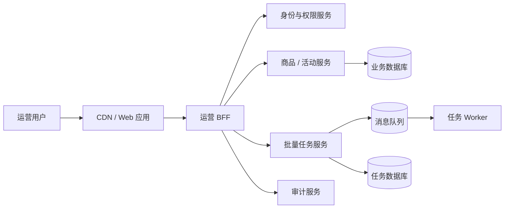
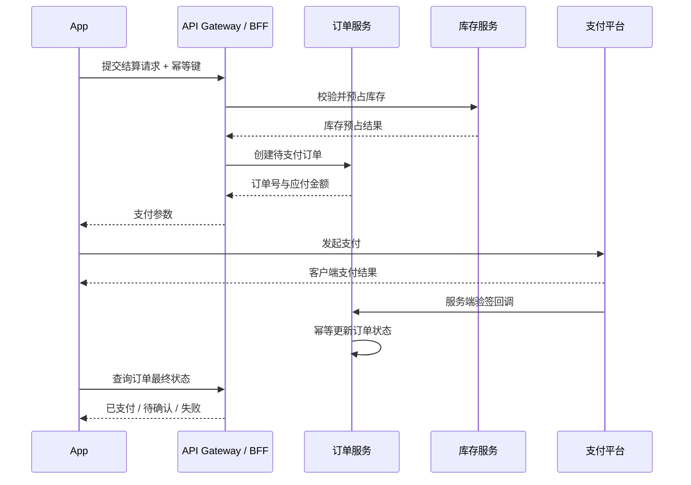
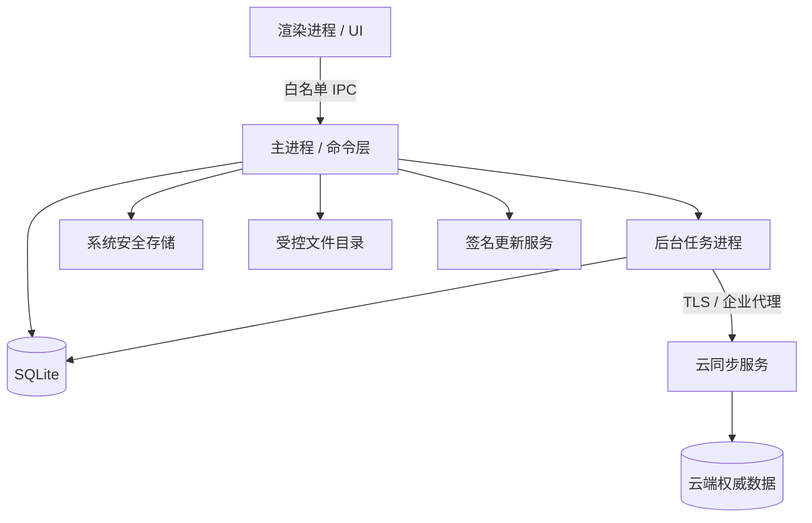

# Web、App 与桌面端项目架构指南

这份指南用于把业务目标转化为可交付、可验证、可演进的技术方案。它不提供一套适用于所有项目的固定技术栈，而是给出一条共同决策主线，并说明 Web、App 和桌面端在运行环境、发布方式及系统能力上的差异。

## 1. 如何使用这份指南

**适用对象**

- 技术负责人、架构师和开发负责人。
- 参与技术评审的产品、设计、测试、安全和运维人员。
- 需要接手、重构或评估现有系统的工程师。

**适用场景**

- 项目启动：澄清目标、边界、约束和首期范围。
- 架构评审：检查模块、数据、权限、故障和发布设计。
- 迭代设计：评估新需求对既有边界和非功能指标的影响。
- 发布评审：确认灰度、观测、回滚和责任人。
- 事故复盘：把问题转化为可验证的架构或工程改进。

**推荐阅读路径**

1. 先按第 3 章完成八个生命周期阶段，不因项目规模小而跳过关键决策。
2. 再查阅对应端的 Playbook，补齐平台特有约束。
3. 参考最接近的完整案例，核对核心数据流和异常策略。
4. 使用第 10 章模板形成评审和交付产物。

每个重要架构决策都应记录四件事：**适用条件、主要代价、验证方式、回退方案**。技术名称本身不是结论，能否满足当前约束才是结论。

## 2. 架构设计的共同原则

1. **从业务目标和约束出发。** 先明确用户、核心场景、成功指标、预算、团队和交付时间，再讨论框架或中间件。
2. **先定义边界与非功能需求，再选择技术。** 如果性能、可用性、安全、兼容性和数据保留目标不可度量，选型就缺少判断依据。
3. **明确数据权威源和一致性模型。** 缓存、客户端副本和搜索索引都不能默认成为事实来源；每条关键数据都要说明谁有最终解释权。
4. **客户端展示权限不替代服务端鉴权。** Web、App 和桌面端的按钮隐藏只改善体验，可信服务端必须校验身份、操作权限和数据范围。
5. **关键链路必须可测试、可观测、可灰度、可回滚。** 不能定位和恢复的功能，不算完成交付。
6. **记录取舍，不制造绝对结论。** 架构决策记录为什么现在这样选、接受了什么代价、何时需要重新评估。

## 3. 项目生命周期

八个阶段不是严格瀑布流程。项目可以迭代推进，但每个阶段都必须回答五类问题：目标是什么、做哪些关键决策、形成什么产物、有哪些风险、达到什么条件才能进入下一阶段。

### 3.1 业务目标与约束

**目标**

确认产品为什么做、为谁做、什么结果代表成功，以及哪些硬约束不能被技术方案绕过。

**关键决策**

- 定义目标用户、核心场景和首要价值。
- 选择可量化的业务指标，例如转化率、留存率、任务完成率或处理时效。
- 明确预算、团队能力、交付周期、合规地域、目标设备和网络环境。
- 划分 MVP、首个正式版本和后续演进范围。

**必要产物**

- 业务目标卡：用户、问题、价值、成功指标和观察周期。
- 约束清单：硬约束、可协商约束、负责人和确认时间。
- 范围边界：首期包含、不包含及依赖项。

**常见风险**

- 用技术先进性替代业务价值。
- 指标只有“体验更好”“系统更快”等不可验收描述。
- 默认团队能掌握陌生技术，忽略学习和维护成本。
- MVP 持续扩张，首个可验证版本迟迟无法交付。

**退出门禁**

- 目标可度量，指标有当前基线和目标值。
- 每个硬约束都有来源和负责人。
- MVP 与后续范围明确分开，关键依赖已确认。

### 3.2 需求边界与非功能需求

**目标**

把业务目标转化为可交付范围，并提前定义系统在正常、异常和极端条件下的质量要求。

**关键决策**

- 梳理角色、核心链路、状态变化、异常路径和人工兜底方式。
- 定义性能、可用性、容量、安全、隐私、兼容性和数据恢复目标。
- 确认外部系统、第三方服务、法规和审批依赖。
- 区分必须实时完成、允许异步完成和允许降级的能力。

**必要产物**

- 系统上下文图和核心用户流程。
- 功能范围、非目标及角色权限矩阵。
- 非功能需求清单和量化验收方法。
- 高风险需求、外部依赖和验证计划。

**常见风险**

- 只描述成功路径，不定义超时、重复提交、取消和部分失败。
- 把“高并发”“高可用”当需求，却没有流量模型和恢复目标。
- 第三方能力在开发后期才验证，导致方案重做。
- 权限只按页面划分，没有数据范围和操作边界。

**退出门禁**

- 每条关键链路都有成功、失败和恢复策略。
- 非功能需求具有目标值、测量方法和责任人。
- 外部依赖完成可行性验证，阻断风险有处置结论。

### 3.3 架构和数据设计

**目标**

确定系统边界、模块职责、依赖方向、数据流和关键故障策略，使团队能够并行实现而不破坏核心约束。

**关键决策**

- 划分客户端、BFF/API、领域服务、任务服务和基础设施边界。
- 选择同步或异步通信，并定义超时、重试、幂等和补偿。
- 指定关键数据的权威源、一致性级别、缓存失效和冲突策略。
- 设计身份认证、操作授权、数据权限、审计和敏感信息保护。
- 明确第三方故障时的熔断、降级和人工处理方案。

**必要产物**

- 系统上下文图、容器图或模块图。
- 核心链路时序图和状态机。
- 领域模型、数据模型和数据生命周期说明。
- 架构决策记录（ADR）、风险清单和验证原型。

**常见风险**

- 模块按技术层机械拆分，业务规则散落在多处。
- 本地缓存、服务端缓存和数据库都能修改同一事实。
- 在没有容量或团队依据时过早拆分微服务。
- 只画正常链路，不标注信任边界和失败传播路径。

**退出门禁**

- 关键模块职责和依赖方向无歧义。
- 数据权威源、一致性、幂等和恢复策略可解释。
- 高风险取舍已通过原型、压测或技术调研验证。
- 降级与回退方案具备可执行责任人。

### 3.4 工程基线建设

**目标**

建立所有业务模块共同遵循的开发、测试、构建、配置和发布基线，降低多人协作的不确定性。

**关键决策**

- 确定仓库和模块组织、分支策略、代码评审和版本规则。
- 统一配置、密钥、日志、错误码、网络请求和环境管理方式。
- 建立单元、组件、契约、集成和 E2E 测试边界。
- 建立构建、制品、安全扫描、部署和回滚流水线。
- 定义 Definition of Done 和技术文档更新要求。

**必要产物**

- 可运行、可测试、可构建的最小工程骨架。
- CI/CD 流水线和环境配置说明。
- 编码规范、目录约定、提交规则和评审清单。
- 日志、错误、监控和测试示例。

**常见风险**

- 脚手架堆入大量未验证依赖，后续无人维护。
- 环境差异靠口头约定，导致“只在某台机器可运行”。
- 测试框架存在但没有可复制示例。
- 发布流程需要个人本地操作，无法追溯和复现。

**退出门禁**

- 新成员能按文档在合理时间内启动项目。
- 最小业务链路能自动构建、测试并部署到非生产环境。
- 密钥不进入仓库，配置差异有明确管理方式。
- 失败构建和失败发布能被发现并阻断。

### 3.5 功能开发与联调

**目标**

按可验证的垂直业务切片交付功能，使接口、状态、异常和观测能力随功能同时完成。

**关键决策**

- 按用户价值拆分切片，而不是长期分别开发前端、后端和数据库。
- 先确定接口契约、错误语义、幂等标识和兼容策略，再开始联调。
- 明确加载、空数据、部分成功、失败、重试、取消和权限不足状态。
- 使用特性开关隔离未完成或高风险能力。

**必要产物**

- 可运行的业务功能和版本化接口契约。
- 对应层级的自动化测试及测试数据。
- 联调记录、已知限制和风险更新。
- 日志、指标和链路追踪埋点。

**常见风险**

- 客户端依赖未稳定接口，使用大量临时分支逻辑。
- 重试非幂等请求，造成重复订单或重复任务。
- 功能完成后才补错误处理和监控。
- 大分支长期不合并，集成风险在提测前集中爆发。

**退出门禁**

- 核心链路在集成环境端到端可用。
- 异常分支有明确用户反馈、服务端行为和恢复方式。
- 契约变更具备兼容或迁移方案。
- 关键规则由自动化测试保护，观测数据可查询。

### 3.6 质量验证

**目标**

用与风险匹配的验证手段证明功能正确、非功能指标达标，并确认系统在真实运行条件下能够恢复。

**关键决策**

- 单元测试保护规则，组件测试保护交互，契约测试保护边界，E2E 保护少量核心链路。
- 根据目标平台建立浏览器、设备、操作系统和版本兼容矩阵。
- 对容量、延迟、资源占用、安全、可访问性和恢复能力进行专项验证。
- 明确阻断缺陷、可接受风险和延期项的审批标准。

**必要产物**

- 功能、回归、兼容和专项测试报告。
- 性能基线、容量结论和安全问题清单。
- 恢复演练记录及发布候选版本。
- 已知问题、影响范围和接受人。

**常见风险**

- 自动化数量很多，但关键业务规则没有断言。
- 性能测试数据量和流量模型与生产环境无关。
- 只验证新功能，不验证旧客户端、旧数据和回滚版本。
- 安全问题被当作上线后的优化事项。

**退出门禁**

- 阻断缺陷清零，核心回归全部通过。
- 性能、可用性和兼容指标达到已批准的 NFR。
- 高风险安全问题关闭，剩余风险有书面接受记录。
- 备份、恢复和回滚路径经过演练。

### 3.7 发布、灰度与回滚

**目标**

以可控制的影响范围发布变更，通过实时信号决定继续、暂停或回滚。

**关键决策**

- 定义版本号、制品唯一性、配置变化和数据库迁移顺序。
- 选择按用户、租户、地域、设备或流量比例灰度。
- 明确观测窗口、放量条件、停止条件和回滚触发阈值。
- 确定代码、配置、数据和客户端版本的兼容范围。

**必要产物**

- 发布清单、变更记录和审批结果。
- 灰度方案、指标看板和告警规则。
- 回滚手册、数据库兼容说明和演练记录。
- 值守表、沟通渠道和升级路径。

**常见风险**

- 回滚只能恢复代码，无法处理已写入的新数据。
- 灰度人群不代表真实高风险用户。
- 放量只看技术错误率，不看支付或任务完成率。
- 发布依赖不可重复的手工步骤。

**退出门禁**

- 发布和回滚步骤均有演练证据。
- 监控、告警和值守在发布前生效。
- 每个停止条件都有明确决策人。
- 业务方、客服和运维知道变化及应急入口。

### 3.8 可观测性和长期演进

**目标**

持续判断系统是否满足业务和技术目标，并用运行证据安排容量、依赖、技术债和架构演进。

**关键决策**

- 同时观测业务结果、用户体验、系统健康和依赖健康。
- 为关键服务定义 SLI、SLO、错误预算和告警分级。
- 确定事故响应、复盘、行动项追踪和运行手册维护机制。
- 按收益、风险和成本管理依赖升级、技术债和架构改造。

**必要产物**

- 业务与技术看板、告警规则和运行手册。
- 容量趋势、成本报告和依赖风险清单。
- 事故复盘、行动项及验证结果。
- 季度或版本级架构演进路线图。

**常见风险**

- 告警只反映 CPU 和内存，不反映用户任务失败。
- 告警过多且没有处置手册，团队逐渐忽略。
- 重构目标只写“代码更优雅”，无法衡量收益。
- 技术债没有负责人和触发治理的阈值。

**退出门禁**

- 关键问题能从告警定位到受影响用户和依赖。
- 每项高优先级风险都有负责人、截止时间和验证方式。
- 演进项能关联业务收益、可靠性目标或可量化成本。
- 复盘行动项按期关闭，并验证没有重复发生。

## 4. Web 架构 Playbook

### 4.1 渲染模式与应用边界

- **CSR** 适合登录后交互密集、SEO 要求低的后台系统；代价是首屏依赖脚本加载，需要重点控制包体和白屏。
- **SSR** 适合首屏和搜索可见性重要、内容又高度动态的页面；代价是服务端容量、缓存和同构代码复杂度。
- **SSG/ISR** 适合更新频率可控的内容页、官网和商品详情；代价是构建规模、内容新鲜度和失效机制。
- 同一产品可以按路由混用模式。渲染模式应由页面目标决定，而不是由框架默认值决定。
- 浏览器应用负责交互和展示；敏感规则、价格、权限和数据范围必须由可信服务端决定。

### 4.2 路由、状态与数据获取

- URL 状态保存可分享、可返回的筛选条件、分页和资源定位。
- 本地 UI 状态保存弹窗、选中项和未提交编辑状态。
- 服务端状态由数据请求层管理缓存、失效、重试和并发去重。
- 全局状态只承载真正跨页面、跨生命周期的数据，避免把所有请求结果复制一份。
- 请求必须定义超时、取消、错误分类和用户可恢复动作；非幂等请求不能自动盲重试。

### 4.3 BFF、鉴权与数据权限

- 当一个页面需要聚合多个服务、适配多端协议或隔离后端变化时，可引入 BFF。
- BFF 不应成为缺少边界的业务逻辑堆积层；领域规则仍由所属服务负责。
- 会话优先使用安全 Cookie 时，设置 `HttpOnly`、`Secure` 和合适的 `SameSite`。
- 服务端按身份、操作和数据范围三层校验，前端路由守卫只负责提前反馈。
- 关键操作记录操作者、租户、目标资源、前后值和请求关联 ID。

### 4.4 缓存、SEO 与 Web 安全

- CDN 缓存公共静态资源；浏览器缓存使用内容指纹；接口缓存必须有失效和一致性策略。
- 私有响应不得进入公共缓存，缓存键必须包含会影响结果的租户、权限或语言维度。
- SEO 页面提供稳定 URL、语义化 HTML、元数据、结构化数据和站点地图。
- 默认转义不可信内容；富文本经过白名单清洗；使用 CSP 降低 XSS 影响。
- 状态变更请求防护 CSRF，跨域策略使用明确来源白名单，不以 `*` 代替设计。

### 4.5 部署、性能与可观测性

- 静态资源使用不可变文件名，HTML 和配置采用可控短缓存，保证版本切换可回退。
- 以真实用户监控观察 LCP、INP、CLS、白屏率、脚本错误和关键接口失败。
- 性能预算至少包含首屏资源、主线程阻塞、图片体积和第三方脚本。
- 发布按租户或用户灰度，同时观察技术指标和关键业务转化。
- Source Map 受控上传到错误平台，不直接公开敏感源码。

| 决策 | 何时选择 | 主要代价 | 验证方式 |
|---|---|---|---|
| CSR | 登录后交互密集、SEO 低优先级 | 首屏和包体压力 | Web Vitals、慢网首屏测试 |
| SSR | 首屏、SEO和动态内容都重要 | 服务端容量和同构复杂度 | 搜索抓取、TTFB、峰值压测 |
| SSG/ISR | 内容可预生成且更新频率可控 | 构建规模和新鲜度管理 | 构建耗时、失效时延 |
| BFF | 页面聚合、多端适配或协议隔离明显 | 新增部署单元和边界治理 | 接口数量、页面延迟、变更影响面 |

## 5. App 架构 Playbook

### 5.1 原生、跨端与 Hybrid 边界

- 原生适合重度系统能力、极致性能或平台体验差异大的产品，但双端团队和功能同步成本较高。
- React Native 适合已有 React/TypeScript 能力、业务 UI 为主且需要一定原生扩展的团队。
- Flutter 适合重视多端视觉一致性、愿意维护 Dart 技术栈的团队。
- Hybrid 适合更新频繁、系统能力较少的活动或内容模块，不宜承载高性能和复杂手势主链路。
- 选型原型必须覆盖最难的端能力、复杂列表、启动时间和包体，而不是只实现登录页。

### 5.2 导航、状态与端能力

- 导航状态应支持深链、登录拦截、返回栈恢复和进程被回收后的最小恢复。
- 页面临时状态、跨页面会话状态和服务端数据缓存分层管理。
- 相机、相册、定位、推送、支付和生物识别通过统一端能力接口封装。
- 权限在使用前按场景申请，并为拒绝、永久拒绝和系统能力不可用提供替代路径。
- 后台任务遵守平台限制，不能假设 App 一直存活。

### 5.3 离线数据、弱网与同步

- 本地缓存用于提升可用性，不默认成为价格、库存、账户余额等数据的权威源。
- 为请求定义连接超时、响应超时、退避重试和网络恢复策略。
- 写操作使用业务幂等键；重试前区分“未发送”“结果未知”和“服务端明确失败”。
- 离线可编辑能力需要本地操作日志、同步状态、冲突检测和用户可理解的解决方式。
- 大文件上传使用分片、校验和断点续传，并允许用户取消。

### 5.4 权限、安全与版本兼容

- Token 和密钥使用 Keychain/Keystore 等安全存储，不写入普通配置或日志。
- 传输使用 TLS，敏感字段最小化采集并按期限删除。
- 服务端必须兼容一定范围的旧客户端；破坏性协议变更需要版本协商。
- 区分推荐升级和强制升级，强制升级应只用于无法兼容或高风险安全问题。
- 支付结果以服务端验签回调和订单状态为准，不能信任客户端成功页面。

### 5.5 发布、灰度与移动端可观测性

- 同时管理应用版本、构建号、API 兼容版本和远程配置版本。
- 使用商店分阶段发布、服务端用户灰度和特性开关控制风险。
- 监控崩溃率、ANR、启动耗时、卡顿、内存、耗电、网络成功率和核心转化。
- 错误分析按系统、机型、App 版本、网络和用户链路聚合。
- 商店版本无法即时回滚，远程关闭高风险功能和服务端兼容尤其重要。

| 决策 | 何时选择 | 主要代价 | 验证方式 |
|---|---|---|---|
| 原生双端 | 重系统能力、重性能、平台差异明显 | 团队与版本同步成本 | 关键动效、耗电、端能力原型 |
| React Native | React 团队、业务 UI 为主、需原生扩展 | 桥接和升级成本 | 复杂列表、启动、原生模块原型 |
| Flutter | 多端视觉一致、团队接受 Dart | 平台适配和生态评估 | 包体、渲染、插件可维护性 |
| Hybrid | 内容或活动更新快、端能力少 | 体验和性能上限 | 弱网首屏、交互和容器兼容测试 |

## 6. 桌面端架构 Playbook

### 6.1 Electron、Tauri、Qt 与原生方案

- Electron 适合 Web 技术团队和复杂跨平台 UI，生态成熟；代价是包体、内存和 Chromium 更新治理。
- Tauri 适合关注包体和系统 WebView 复用、团队能维护 Rust 命令层的应用；代价是平台 WebView 差异和 Rust 学习成本。
- Qt 适合 C++ 团队、工业设备或重本地能力场景；代价是 UI 技术栈、许可和跨平台细节。
- 原生桌面适合深度系统集成或单平台产品；代价是多平台重复建设。
- 选型必须用真实文件、托盘、窗口、系统权限、更新和性能场景验证。

### 6.2 进程模型与模块边界

- 渲染进程负责 UI，不直接获得文件系统、Shell 或任意网络能力。
- 主进程或命令层管理窗口、系统 API、生命周期和可信能力入口。
- CPU 密集、长时间或易失败任务放入工作进程，避免阻塞 UI 和主进程。
- 进程通信使用显式请求/响应或事件协议，包含版本、超时、取消和错误码。
- 单实例、窗口恢复、后台驻留和退出语义需要产品与技术共同定义。

### 6.3 IPC、本地文件与安全

- IPC 采用能力白名单，不暴露任意函数调用、命令执行或路径访问。
- 对消息来源、参数类型、资源归属和调用频率进行校验。
- 文件路径先规范化，再校验是否位于允许目录；防止路径穿越和符号链接绕过。
- 外部链接交给系统浏览器并校验协议；禁用不必要的 Node 集成和动态代码执行。
- 凭据进入系统安全存储，日志默认脱敏，诊断包由用户确认后导出。

### 6.4 SQLite、离线同步与冲突处理

- SQLite 适合本地结构化工作集，但需要迁移版本、事务、索引、备份和损坏恢复策略。
- 云端协作数据应记录服务端版本、本地版本、同步状态和最后错误。
- 同步流程区分拉取、应用远端变更、上传本地操作和确认提交。
- 冲突可按字段合并、最后写入、服务端裁决或人工处理，选择必须匹配业务风险。
- 数据迁移和批量同步在后台执行，并向 UI 暴露进度、取消和恢复状态。

### 6.5 安装、自动更新与故障恢复

- 各平台安装包需签名；macOS 按分发方式完成公证，Windows 管理证书信誉。
- 更新清单和安装包必须验签，下载支持校验、断点续传和代理环境。
- 更新采用分阶段放量，保留可运行旧版本，并定义数据向前/向后兼容范围。
- 文件写入使用临时文件加原子替换，数据库迁移前创建可恢复备份。
- 崩溃后恢复未保存工作、后台任务和更新状态，避免无限重启循环。

| 决策 | 何时选择 | 主要代价 | 验证方式 |
|---|---|---|---|
| Electron | Web 团队、复杂 UI、跨平台优先 | 包体、内存、安全面 | 冷启动、常驻内存、IPC 安全测试 |
| Tauri | 包体敏感、可维护 Rust、系统 WebView 可接受 | WebView 差异、生态成熟度 | 三平台兼容和命令层原型 |
| Qt | C++ 团队、工业或重本地能力 | UI 栈和许可成本 | 设备集成、渲染和部署验证 |
| 原生 | 单平台或深度系统集成 | 多平台重复开发 | 关键系统 API 与维护成本评估 |

## 7. 完整案例：SaaS 运营后台

#### 1. 业务目标和约束

目标是支持多个租户的运营人员完成商品配置、活动审批、批量导入和数据查询。系统需要复杂表格表单、分钟级批量任务反馈、细粒度 RBAC、数据范围控制和完整审计。首期团队以 Web 技术为主，后端已有商品和活动服务。

#### 2. 架构图与关键链路

浏览器只访问 BFF。BFF 聚合页面数据并传递可信身份，领域服务校验资源归属和业务规则。批量操作转为异步任务，避免长请求占用和重复提交。

#### 3. 模块职责

- Web 应用：路由、表单、表格、交互状态和权限提示。
- 运营 BFF：接口聚合、协议适配、会话校验和租户上下文。
- 身份与权限服务：角色、权限点及数据范围规则。
- 领域服务：最终数据授权、业务校验和事务写入。
- 任务服务：任务创建、进度、重试、取消和结果文件。
- 审计服务：保存关键操作、前后值、操作者和关联 ID。

#### 4. 核心数据流

1. 用户提交批量操作，客户端生成请求幂等键。
2. BFF 校验会话并把租户、用户和请求上下文传给任务服务。
3. 任务服务校验操作权限，创建唯一任务并立即返回任务 ID。
4. Worker 分批处理，每条数据仍由领域服务校验数据范围和业务规则。
5. Web 通过轮询或服务端事件获取进度，最终下载带成功/失败原因的结果。
6. 任务创建、执行、取消和导出都写入审计记录。

#### 5. 关键取舍

- 使用 BFF 减少复杂页面对多个服务的耦合，但不把领域规则搬到 BFF。
- 批量任务采用异步执行，接受结果非即时返回，换取可重试、可观测和可取消。
- 权限缓存只缩短读取时间；高风险写操作仍以服务端最新策略为准。
- 表格查询使用服务端分页和筛选，避免浏览器加载完整数据集。

#### 6. 异常和安全设计

- 前端隐藏无权限按钮，服务端对每次请求重新校验操作权限和数据范围。
- 任务按幂等键去重，分片处理记录游标；失败重试不重复处理已确认数据。
- 导出文件使用短时签名地址，绑定租户和用户，不进入公共缓存。
- 第三方或下游故障时暂停任务并展示可操作原因，不将无限重试伪装成处理中。
- 审计日志追加写入，业务管理员不能修改或删除。

#### 7. 测试与发布

- 用权限矩阵测试角色、操作和数据范围组合。
- 用契约测试保护 BFF 与领域服务的错误语义。
- E2E 覆盖登录、查询、编辑、提交批量任务和下载结果。
- 压测大列表查询和批量任务队列，验证租户间资源隔离。
- 按内部租户、试点租户、普通租户灰度，特性开关支持关闭批量入口。

#### 8. 监控指标

- Web：LCP、INP、脚本错误率和白屏率。
- API：P95/P99 延迟、错误率、权限拒绝率和缓存命中率。
- 任务：排队时长、执行成功率、重试率、取消率和单条处理耗时。
- 业务：关键操作完成率、批量任务使用率和导出成功率。
- 审计：关键操作审计覆盖率和写入延迟。

#### 9. 演进路径

首期保持模块化 BFF 和独立任务服务。任务类型、容量或隔离需求增长后，再按任务域拆 Worker 和队列；多区域合规出现后，再引入区域化数据边界。是否拆分以队列等待、发布耦合和团队所有权数据为依据。

## 8. 完整案例：移动电商 App

#### 1. 业务目标和约束

目标是支持商品浏览、购物车、结算、支付、订单查询和推送。用户网络波动明显，客户端版本无法即时统一升级。价格、促销、库存和支付状态必须可信，支付链路需要幂等、可追踪且能在客户端中断后恢复。

#### 2. 架构图与关键链路

客户端支付结果只用于即时反馈，订单最终状态以支付平台服务端验签回调为准。

#### 3. 模块职责

- App：展示缓存、购物意图、端能力、网络状态和恢复入口。
- Gateway/BFF：会话、版本兼容、聚合和移动端协议适配。
- 商品服务：商品信息和价格展示模型。
- 购物车服务：用户购物意图，不承诺最终价格和库存。
- 库存服务：库存权威源、预占、释放和扣减。
- 订单服务：结算快照、订单状态机、幂等和超时关闭。
- 支付适配层：支付下单、回调验签、查询和退款。

#### 4. 核心数据流

1. App 可离线展示最近商品和购物车缓存，但结算必须请求服务端。
2. 服务端重新计算价格、优惠、运费和可售库存，返回差异供用户确认。
3. 用户确认后以幂等键创建订单并预占库存。
4. App 发起第三方支付；中断、超时或返回结果不明时查询订单状态。
5. 支付回调验签后，订单状态机幂等推进并发布订单事件。
6. 超时未支付订单关闭并释放库存，推送和订单页同步最终结果。

#### 5. 关键取舍

- 本地缓存提升浏览可用性，但价格和库存始终由服务端结算确认。
- 库存预占减少超卖，但引入过期释放和对账成本。
- API 保持多个客户端版本兼容，新增字段优先向后兼容。
- 推荐升级用于普通能力，只有安全风险或协议无法兼容时才强制升级。

#### 6. 异常和安全设计

- 网络重试使用指数退避和抖动；创建订单、支付查询等操作使用业务幂等键。
- 区分请求未发出、服务端明确失败和结果未知；结果未知时查询而不是重复创建。
- Token 存入系统安全存储，日志不记录完整手机号、地址和支付参数。
- 支付回调校验签名、金额、商户、订单号和事件幂等性。
- 库存、订单和支付通过状态机与对账任务发现并修复不一致。

#### 7. 测试与发布

- 单元测试覆盖价格展示、订单状态机映射和重试分类。
- 契约测试覆盖旧版本请求、可选字段和错误码。
- 集成测试覆盖库存预占、订单创建、支付回调和超时释放。
- 真机测试覆盖主流系统版本、低端机、弱网、断网恢复和进程回收。
- 使用商店分阶段发布叠加服务端灰度，远程配置可关闭新结算入口。

#### 8. 监控指标

- 稳定性：崩溃率、ANR、卡顿率和内存异常。
- 性能：冷启动、首屏、商品列表加载和结算接口耗时。
- 网络：请求成功率、超时率、重试率和弱网分布。
- 交易：结算成功率、订单创建成功率、支付成功率和回调延迟。
- 一致性：库存冲突率、结果未知率和对账差异量。

#### 9. 演进路径

首期采用在线结算和有限离线浏览。用户规模增长后，按真实瓶颈优化 CDN、商品缓存、库存热点和订单分片；国际化出现后，再扩展币种、税费、支付渠道和区域合规。每次演进都维持旧客户端兼容窗口。

## 9. 完整案例：跨平台企业客户端

#### 1. 业务目标和约束

目标是为企业用户提供 Windows、macOS 的本地资料管理、离线编辑、文件处理和云端协作。团队以 Web 技术为主，但产品要求访问本地文件、支持后台同步、企业代理和自动更新，并在异常退出后恢复工作。

#### 2. 架构图与关键链路

渲染进程不直接访问系统能力。所有文件、数据库、凭据和更新操作都通过有类型、可校验的 IPC 能力完成。

#### 3. 模块职责

- 渲染进程：界面、编辑状态、进度和用户冲突处理。
- 主进程/命令层：窗口生命周期、IPC 鉴权、文件、数据库和系统能力。
- 后台任务进程：索引、转换、上传下载和同步，避免阻塞 UI。
- SQLite：本地工作集、操作日志、同步游标和任务状态。
- 云同步服务：身份、共享权限、版本裁决和云端权威状态。
- 更新服务：渠道、版本清单、签名、灰度和下载。

#### 4. 核心数据流

1. 用户编辑时先在 SQLite 事务中保存内容、基础版本和本地操作日志。
2. 后台任务读取待同步操作，携带资源 ID、基础版本和幂等键上传。
3. 云端接受无冲突变更并返回新版本；发生冲突时返回远端版本和差异。
4. 可自动合并的字段生成合并版本；高风险冲突交由用户选择。
5. 下载文件先写临时路径，校验摘要后原子替换目标文件。
6. 同步游标和任务状态持久化，重启后从最后确认点恢复。

#### 5. 关键取舍

- 团队 Web 能力强且 UI 复杂时优先评估 Electron；若包体和内存是硬约束且可维护 Rust，再评估 Tauri。
- SQLite 是离线工作集，云端是多人协作权威源；单机私有数据可只保留本地。
- 后台同步换取离线体验，但需要状态机、冲突界面和更复杂的诊断。
- 自动更新提升修复速度，但必须接受签名、渠道、兼容和回滚治理成本。

#### 6. 异常和安全设计

- IPC 只暴露业务能力，校验调用来源、参数、资源归属和频率。
- 路径规范化后限制在授权目录，拒绝路径穿越、危险协议和任意 Shell 命令。
- 凭据保存在系统安全存储，数据库敏感字段按威胁模型加密。
- 数据库迁移前备份，失败恢复旧版本；文件保存采用临时文件和原子替换。
- 连续崩溃进入安全模式，禁用最近插件或高风险功能并提供诊断导出。

#### 7. 测试与发布

- 单元测试覆盖同步状态机、冲突判断、路径校验和版本比较。
- IPC 契约测试验证白名单、参数错误和权限拒绝。
- 集成测试覆盖数据库迁移、断网重连、代理、断点续传和文件损坏。
- 在真实 Windows/macOS 版本验证安装、签名、公证、升级和降级。
- 更新先内部渠道，再试点企业，最后分批生产；失败率超阈值停止放量。

#### 8. 监控指标

- 启动耗时、崩溃率、连续崩溃率和安全模式进入率。
- CPU、常驻内存、磁盘占用和后台任务耗时。
- 同步成功率、平均积压时间、冲突率和重试率。
- 文件损坏率、数据库迁移失败率和恢复成功率。
- 更新检查、下载、安装和新版本启动成功率。

#### 9. 演进路径

首期聚焦 Windows/macOS 和单一同步模型。稳定后根据客户需求增加 Linux、插件或企业私有部署。只有当资源指标和用户价值证明必要时，才迁移框架或拆分更多进程；迁移必须先保持数据格式和同步协议兼容。

## 10. 可复用模板

### 10.1 一页式架构方案模板

| 字段 | 要填写的内容 |
|---|---|
| 背景与目标 | 用户问题、业务价值、当前基线、目标指标和观察周期 |
| 范围与非目标 | 本次包含、不包含、后续阶段和外部依赖 |
| 约束 | 时间、预算、团队、合规、设备、网络和兼容范围 |
| 系统边界 | 上下游系统、可信边界、模块职责和所有者 |
| 核心数据流 | 正常链路、异常链路、同步/异步、超时和重试 |
| 数据设计 | 权威源、一致性、幂等、缓存、保留和恢复 |
| 关键决策 | 选择、适用条件、主要代价、验证方式和回退方案 |
| 安全与合规 | 身份、授权、数据范围、审计、隐私和密钥 |
| 质量策略 | 单元、契约、集成、E2E、兼容、性能和安全测试 |
| 发布策略 | 版本、迁移、特性开关、灰度、停止条件和回滚 |
| 可观测性 | 业务指标、技术指标、SLO、告警和运行手册 |
| 风险与行动项 | 风险、影响、处置、负责人、截止时间和验证结果 |

### 10.2 非功能需求清单

每项非功能需求都填写“目标值、测量方式、责任人、验收时间”，避免只写“高性能”或“高可用”。

| 类别 | 需要回答的问题 | 目标值 | 测量方式 | 责任人 | 验收时间 |
|---|---|---|---|---|---|
| 性能 | 启动、首屏、交互和接口 P95/P99 是多少？ |  |  |  |  |
| 可用性 | SLO、RTO、RPO 和允许降级范围是什么？ |  |  |  |  |
| 容量与扩展 | 峰值用户、QPS、数据量和增长率是多少？ |  |  |  |  |
| 安全与隐私 | 威胁、权限、加密、审计和删除要求是什么？ |  |  |  |  |
| 兼容性 | 浏览器、系统、设备、旧版本和协议窗口是什么？ |  |  |  |  |
| 可观测性 | 哪些业务和技术信号必须可查询、可告警？ |  |  |  |  |
| 可维护性 | 构建、测试、发布、回滚和接手时间要求是什么？ |  |  |  |  |
| 数据保留与恢复 | 保留期限、备份频率、恢复点和销毁方式是什么？ |  |  |  |  |
| 成本 | 基础设施、第三方、商店和人力预算上限是什么？ |  |  |  |  |

### 10.3 架构评审清单

- [ ] 业务目标、成功指标、范围、非目标和硬约束明确。
- [ ] 系统边界、模块职责、所有者和依赖方向清晰。
- [ ] 核心链路包含成功、超时、重复、取消、部分失败和恢复。
- [ ] 关键数据的权威源、一致性、缓存、幂等和保留策略明确。
- [ ] 身份、操作权限和数据范围由可信服务端校验。
- [ ] 第三方依赖具有超时、熔断、降级、对账和退出方案。
- [ ] NFR 有目标值、测量方式、负责人和验收时间。
- [ ] 测试覆盖与业务风险匹配，兼容和恢复路径可验证。
- [ ] 发布、灰度、停止、回滚和数据兼容方案可执行。
- [ ] 业务与技术指标、告警、值守和运行手册完整。
- [ ] 关键取舍进入 ADR，并写明重新评估条件。

### 10.4 发布前门禁

- [ ] 构建来自受控流水线，制品、源码提交和配置版本可追溯。
- [ ] 生产配置、密钥、域名、证书和第三方配额已核对。
- [ ] 数据库迁移具备顺序、耗时评估、兼容窗口、备份和回退。
- [ ] 核心自动化测试、兼容测试、性能基线和安全扫描通过。
- [ ] 已知问题记录影响、规避方式、接受人和修复计划。
- [ ] 灰度对象、比例、观察窗口、放量条件和停止条件明确。
- [ ] 回滚版本、数据兼容、操作步骤、权限和负责人已演练。
- [ ] 业务与技术看板、告警、值守、客服说明和升级渠道已生效。

### 10.5 上线后复盘模板

| 字段 | 记录内容 |
|---|---|
| 变更目标 | 原计划解决的问题和预期指标 |
| 实际结果 | 发布范围、完成情况和指标变化 |
| 异常时间线 | 发现、判断、止损、恢复和确认的时间点 |
| 用户与业务影响 | 受影响用户、功能、数据、时长和业务损失 |
| 根因 | 直接技术根因及其证据 |
| 促成因素 | 流程、测试、监控、权限、沟通或组织因素 |
| 处置有效性 | 哪些动作有效、哪些无效、为什么 |
| 做得好的部分 | 应保留并标准化的实践 |
| 需改进部分 | 应修改的设计、实现、验证和发布机制 |
| 行动项 | 具体动作、负责人、截止时间、优先级和验证方式 |

复盘不以“人为失误”作为终点。每个高优先级行动项都必须能降低再次发生的概率、缩短发现时间或缩短恢复时间，并在关闭时附验证证据。
